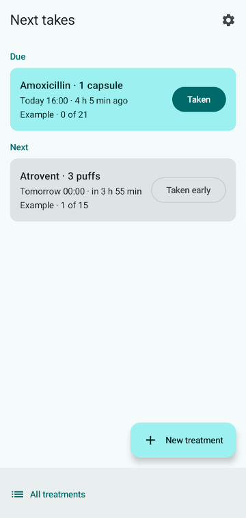
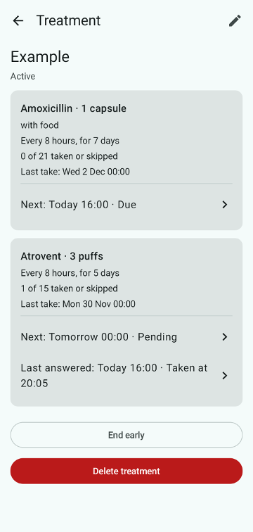
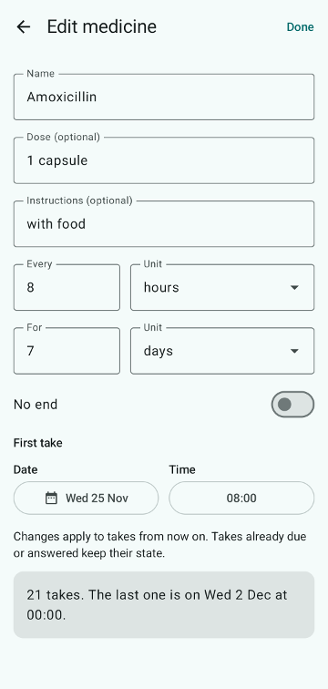
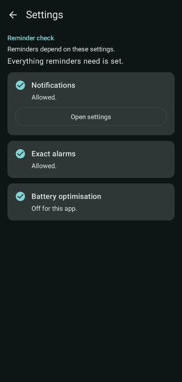
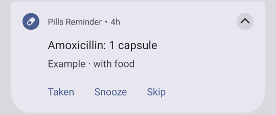

# Pills Reminder

An Android app that keeps track of medical treatments and reminds you when to take each medicine. It is built for personal use on one phone.

A treatment groups one or more medicines, each with its dose, how often it is taken and for how long. For example:

- Amoxicillin, 1 capsule every 8 hours for 7 days.
- Atrovent, 3 puffs every 8 hours for 5 days.

The app works out every take, shows the next one for each medicine, and alerts you when it's due, even with the app closed.

It is a reminder only. It doesn't give medical advice or check doses. It works offline, with no accounts and no analytics, and the data stays on the phone.

## What version 1.0 does

- **Treatments:** several at once, each with one or more medicines. A medicine is taken every so many hours, days or weeks, for a number of days or weeks, or with no end. The editor shows how many takes that makes and when the last one is.
- **Home:** the next take of each medicine, with the time left and the progress, due takes first, each with a **Taken** button.
- **Reminders:** one per take, with its medicine, dose, treatment and instructions, and **Taken**, **Snooze** and **Skip**. An unanswered reminder alerts again every 10 minutes, up to 3 times. Reminders arrive on time with the app closed, the screen off, the phone idle or restarted. They follow the phone's Do Not Disturb, silent mode and notification volume.
- **Takes:** Taken, Skipped or Missed. The time taken can be corrected, and each medicine's last answer changed.
- **Reminder check:** what reminders need on the phone, with a button to each setting. It opens at the first launch, and stays in Settings.

## Screenshots

From the emulator, with the specification's example: Amoxicillin, 1 capsule every 8 hours for 7 days, and Atrovent, 3 puffs every 8 hours for 5 days.

| Home | Treatment | Medicine editor | Reminder check, dark theme |
|---|---|---|---|
|  |  |  |  |

A reminder in the notification shade:

## Installing

The app is installed from a computer; it isn't on Google Play. It needs Android 13 or later.

1. Download `pills-reminder-1.0.0.apk` from the [releases](https://github.com/davamix/pills-reminder/releases). The release notes give its SHA-256, and the SHA-256 digest of its signing certificate.
2. On the phone, turn on USB debugging in the developer options; on a Xiaomi phone, also *Install via USB*.
3. Install it with `adb install pills-reminder-1.0.0.apk`. A later version installs over it with `adb install -r`, keeping your treatments.
4. Open it. The reminder check asks for permission to send notifications, then lists what's still missing: Android's battery optimisation, and, on a Xiaomi phone, HyperOS's Autostart, Floating notifications and Lock screen notifications. Each has a button to its setting. Home warns until everything is set.

Reminders play at the phone's notification volume: check it isn't too low to hear.

Uninstalling the app deletes every treatment: there is no backup.

## Building

With Android Studio 2026.1 or its JDK: `./gradlew build` compiles, runs the unit tests and the checks. `./gradlew assembleRelease` builds an unsigned release APK unless the signing properties are set; `./gradlew installDebug` installs a debug build, which lives beside the release with its own data. [CLAUDE.md](CLAUDE.md) has the details.

## Documents

- [Specification](docs/SPECIFICATION.md): what the app does.
- [Implementation plan](docs/IMPLEMENTATION_PLAN.md): how it is built, in eight phases, each with its own specification and handover in [docs/phases/](docs/phases/).
- [Acceptance record](docs/phases/P8-integration/ACCEPTANCE.md): how each requirement was checked on the phone before version 1.0.
