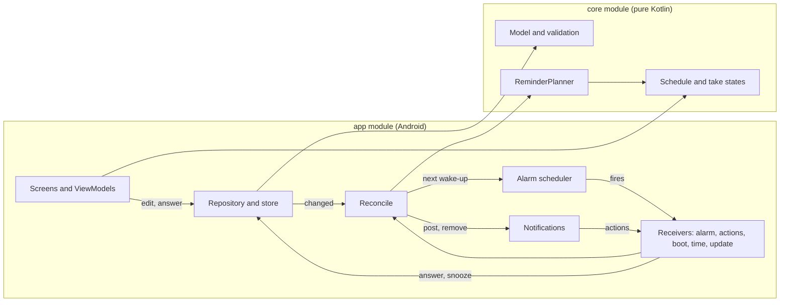
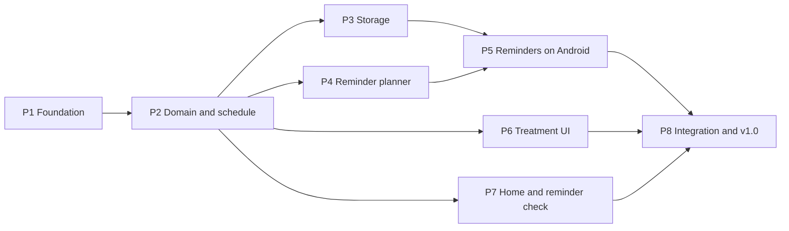

# Pills Reminder — Implementation Plan

| | |
|---|---|
| **Status** | v0.4, agreed |
| **Last updated** | 2026-11-20 |
| **Based on** | [SPECIFICATION.md](SPECIFICATION.md) v0.7 |

[SPECIFICATION.md](SPECIFICATION.md) says *what* the app does. This plan says *how* it is built: the architecture, the technical decisions, and the phases of work. Each phase gets its own specification and handover documents (see [§6](#6-working-method)).

How to read it:

- IDs are used the same way as in the specification, so each item can be accepted, changed or discarded on its own:
  - `D-n`: technical decisions
  - `P1`–`P8`: phases
  - `SK-n`: Claude Code skills
  - `PQ-n`: open questions about the plan
- Requirement IDs such as `RM-3` or `NF-1` refer to [SPECIFICATION.md](SPECIFICATION.md).

---

## Contents

1. [Tech stack](#1-tech-stack)
2. [Architecture](#2-architecture)
3. [Security and privacy](#3-security-and-privacy)
4. [Testing strategy](#4-testing-strategy)
5. [Phases](#5-phases)
6. [Working method](#6-working-method)
7. [Claude Code skills and context](#7-claude-code-skills-and-context)
8. [Open questions](#8-open-questions)
9. [Change log](#9-change-log)

---

## 1. Tech stack

| Area | Choice |
|---|---|
| Language | Kotlin |
| UI | Jetpack Compose with Material 3, single activity |
| Build | Gradle (Kotlin DSL) with a version catalog. Android Studio 2026.1 is installed. |
| SDK levels | `minSdk` 33 (Android 13, the phone). Compile and target SDK: the latest stable level the build tools support, pinned in P1. |
| Modules | `:core` (pure Kotlin, no Android) and `:app` (Android) |
| Time | `java.time`, with an injected `Clock` |
| Storage | One JSON document (kotlinx.serialization) in Jetpack DataStore |
| Reminders | `AlarmManager` exact alarms and notifications. No services, no WorkManager. |
| Dependency injection | Manual, through one `AppContainer` class |
| Tests | JUnit, kotlinx-coroutines-test, Compose UI tests on the emulator and the phone |
| CI | GitHub Actions: build, unit tests, lint, manifest checks |

### 1.1 Technical decisions

| ID | Decision | Reason |
|---|---|---|
| D-1 | Kotlin and Jetpack Compose (Material 3), single activity. | The standard modern Android stack, and the one Workout Timer used, so its lessons carry over. |
| D-2 | Two Gradle modules. `:core` holds the model, the schedule, the take states and the reminder planner, in pure Kotlin. `:app` holds everything that needs Android. | The scheduling and reminder rules are the heart of the app and most of its risk. On the JVM they can be tested in seconds, over simulated days and time zones, and Android code can't leak into them. |
| D-3 | Manual dependency injection through an `AppContainer`. | The app has few dependencies. A framework such as Hilt adds build complexity with no real gain at this size. |
| D-4 | All data is one JSON document, with a `schemaVersion`, stored with Jetpack DataStore and a kotlinx.serialization serializer. | DataStore writes atomically (a new file, then a rename), so an interrupted save never damages the old data (`NF-4`). It gives a `Flow` of changes, which keeps the screens current (`HM-5`). The data is small: even a medicine with no end, every 8 hours, adds about 1,100 answers a year. Room (SQLite) was considered: it needs more code and migrations, and there are no queries to justify it. |
| D-5 | **Takes are worked out, not stored.** The store keeps the treatments, their medicines and schedules, and the *answers*: Taken (with the time taken) or Skipped, plus snoozes and which alerts have played. Pending, Due and Missed come from the schedule, the answers and the clock. | A medicine with no end has no last take, so its takes can't all be stored. Deriving them also keeps the rules of §4.3 in one place. |
| D-6 | Planned times are **local date-times** on the phone's clock (`java.time.LocalDateTime`), turned into instants with the phone's current time zone only when needed. A take that falls in the hour skipped by a daylight saving change moves forward by that hour. In the repeated hour, the earlier one counts. Time comes from an injected `java.time.Clock`. | Implements `SC-4`: 08:00 stays 08:00 across daylight saving and time zone changes. Tests use fixed clocks and zones, including Europe/Madrid on the days the clocks change. |
| D-7 | **One alarm at a time.** The app keeps a single exact alarm, set for the next moment something must happen: a take becomes due, a reminder alerts again, a snooze ends, or a take becomes Missed. When it fires, and after every change, a **reconcile** works out what the notification shade should show now, posts or removes notifications, and sets the next alarm. | One idempotent path handles every trigger: the alarm, a notification action, a restart, an edit, opening the app. Running it twice changes nothing. There are no per-take alarms that could be forgotten or left behind. |
| D-8 | Exact alarms use `setExactAndAllowWhileIdle()` with the `USE_EXACT_ALARM` permission. That permission is granted at install and can't be revoked. Google Play restricts it to clock and calendar apps, but this app is never published there (`NF-9`). P5 measures on the phone, in Doze, whether this meets `NF-1`. If it doesn't, the alarm switches to `setAlarmClock()`, which PQ-2 accepted. | `setExactAndAllowWhileIdle()` is the usual way to alert at a precise time in Doze. Whether HyperOS delays it is unknown until measured. `setAlarmClock()` is never delayed, but it shows an alarm icon in the status bar. |
| D-9 | **Reconcile on every event that can lose an alarm.** Receivers for `BOOT_COMPLETED`, `MY_PACKAGE_REPLACED`, `TIME_SET` and `TIMEZONE_CHANGED`, and the app's start, all run the reconcile. Receivers do their short work with `goAsync()`. | Implements `NF-2`. Opening the app after a *Force stop* sets the alarm again. Nothing runs between reminders (`NF-5`). |
| D-10 | **One notification channel**, "Reminders": high importance (heads-up), the default notification sound, vibration off, full content on the lock screen, category *reminder*, and no Do Not Disturb bypass. Each take has its own notification, in one group, with Taken, Snooze and Skip actions. Each action is an explicit, immutable `PendingIntent` to a receiver that isn't exported. | Implements `RM-1`–`RM-4`, `RM-8` and `RM-11`. A channel's sound and vibration are set when it is created, so they are right from the first install. |
| D-11 | `minSdk` 33. | The only phone is Android 13. The notification permission and `USE_EXACT_ALARM` exist from API 33, so no older code paths are needed (`NF-6`). The emulator, at API 36, covers later versions. |
| D-12 | Android Auto Backup is disabled (`allowBackup="false"`), and the data extraction rules exclude everything. | `NF-3`: treatment data never leaves the phone. |
| D-13 | Versions: the latest stable releases that work with the installed Android Studio. Workout Timer found that Android Studio 2026.1.3 supports AGP up to 9.3; P1 confirms it. Everything is pinned in the version catalog during P1. | Reproducible builds that open in the installed IDE. Upgrades are deliberate. |
| D-14 | Each UI feature keeps its text in its own resource file (`strings_<feature>.xml`). | `NF-8` asks for translatable text. Separate files also avoid merge conflicts when phases run in parallel. |
| D-15 | **Debug builds can schedule in minutes.** They add a "minutes" unit to the interval, and a debug screen that creates a test schedule and shows the next alarm. Release builds have neither. | Checking a reminder on the phone (Doze, restarts, repeats, a missed take) would otherwise take hours per run. This changes nothing the user sees in a release build. |
| D-16 | The data stays in Android's default, credential-encrypted storage. After a restart, reminders start again once the phone has been unlocked for the first time. A reminder that came due in between alerts as soon as the phone is unlocked. (PQ-1) | The phone has a password, so that storage stays locked until the first unlock, and the data is better protected. Device-encrypted storage, readable before the unlock, isn't needed. |
| D-17 | **Skills are reviewed after each phase.** When a phase is closed, the session reviews what came up during it, and proposes new skills, or changes to existing skills or to CLAUDE.md, that would save time or give context to later phases. The user decides which to make (skill `phase-close`). | Asked for in the plan review. Each phase runs in its own session, so a lesson that isn't written into a skill or CLAUDE.md is lost to the next one. |

## 2. Architecture

### 2.1 Modules and packages

```
pills-reminder/
├── core/              pure Kotlin (JVM), no Android dependencies
│   ├── model/         Treatment, Medicine, Interval, Duration, answers; validation; repository interface
│   ├── schedule/      planned takes, their count and the last one; take states; treatment status
│   └── reminders/     ReminderPlanner: what the shade shows now, what alerts, when to wake next
└── app/               Android application
    ├── data/          the store (DataStore and JSON) and the repository
    ├── reminders/     alarm scheduler, reconcile, receivers, notifications
    ├── ui/            theme and screens: home, treatments, treatment, editors, take, settings
    ├── navigation/    navigation host and routes
    └── di/            AppContainer
```

The base package is `io.github.davamix.pillsreminder`, and the debug build's application ID adds `.debug`, so it installs next to a release build.

### 2.2 Components



### 2.3 How a reminder works

1. **The schedule** (`:core`, P2) turns each medicine into its planned takes: the first take, then one interval after another, until the end of its duration, or without end. With the answers and the time now, it says what state each take is in (spec §4.3).
2. **The reminder planner** (`:core`, P4) is a pure function of the stored data and the time now. It returns a plan:
   - the takes whose notifications should be in the shade: those Due and not snoozed;
   - which of them must **alert** now (a sound), because a take has just become due, a repeat is due (`RM-5`), or a snooze has ended (`RM-3`). The others are shown or updated silently;
   - the notifications to remove: answered, Missed (`TK-3`), or no longer in any treatment;
   - the **next wake-up**: the earliest moment in the future when the plan would change.
3. **The reconcile** (`:app`, P5) applies the plan:
   - it posts and removes notifications;
   - it records which alerts have played, so a reconcile a minute later doesn't alert again;
   - it replaces the single alarm with one at the next wake-up (`D-7`).
   Reconciles run one at a time, behind a lock in the app's process.
4. **The alarm fires** → its receiver runs the reconcile.
5. **A notification action** (Taken, Snooze, Skip) → its receiver records the answer or the snooze, then runs the reconcile.
6. **The app opens, a treatment is edited, the phone restarts, the app is updated, or the time or time zone changes** → the reconcile runs (`D-9`).

Because the planner is pure Kotlin, a test can run a whole treatment, minute by minute, over simulated days, and check every alert, repeat and removal. That includes reconciles at random moments in between.

The home screen (P7) reads the same schedule and take states as the planner, and works them out again each minute while it is open (`HM-5`).

### 2.4 Storage

- One document in the app's private storage, written by DataStore. Its JSON has a `schemaVersion` field, so the format can change later without losing data.
- It holds:
  - the treatments, and their medicines and schedules;
  - for a medicine edited after it started, its earlier schedule, which still applies to the takes that were already due or answered (`TR-10`);
  - the answers, by medicine and planned time;
  - the snoozes, and which alerts have played. P4 defines them, and P5 adds them to P3's format (P3 Q3).
- Deleting a treatment deletes all of that for it (`TR-9`).
- If the file can't be read, the app keeps it as it is, doesn't write over it, and says so. A damaged file is never silently replaced by an empty one (`NF-4`).
  - The home screen shows a message (P7), and the editors refuse to save (P6).
  - The app offers no repair. The file stays as it is, so that it can be read over adb. Clearing the app's storage in Android's settings starts again, and deletes it. (P3 Q1)
  - The reminders change nothing: those already in the shade stay, and no new alarm is set (P5). (P5 Q1)
- If a reconcile's write fails, nothing is applied, and an alarm 5 minutes later tries again, for as long as it fails (P5 Q1).
- The repository interface lives in `:core` (P2), with an in-memory fake for tests and for the phases that run before P3 is merged.

## 3. Security and privacy

Treatments are health data. They stay on the phone, and the app stays small and closed:

- **No network.** The manifest has no `INTERNET` permission. CI fails if the merged manifest gains it, for example through a library (`NF-3`).
- **No backup.** Auto Backup is disabled, and the data extraction rules exclude everything (`D-12`).
- **Private storage only.** The data lives in app-private, credential-encrypted storage (`D-16`).
- **Permissions:** the merged manifest may declare only these. CI fails on any other.
  - `POST_NOTIFICATIONS`: show reminders. Asked at runtime (`RM-9`).
  - `USE_EXACT_ALARM`: alert at the planned minute (`D-8`).
  - `RECEIVE_BOOT_COMPLETED`: set the alarm again after a restart (`D-9`).
  - `REQUEST_IGNORE_BATTERY_OPTIMIZATIONS`: lets the reminder check ask Android to stop optimising the app's battery use (`RM-9`).
  - Whatever AndroidX adds that gives access to nothing, such as `DYNAMIC_RECEIVER_NOT_EXPORTED_PERMISSION`. P1 lists them.
- **Minimal surface.** Only the launcher activity is exported, and, in debug builds only, the debug tools' launcher activity (`D-15`, P5 Q3). The receivers aren't: the system still delivers its own broadcasts to them, and the alarm and the notification actions use explicit, immutable `PendingIntent`s. P5 confirms on the phone that each receiver gets what it needs.
- **Lock screen:** reminders show their full content there, as agreed (`RM-11`, Q16).
- **Logs never contain treatment content:** no names, doses, instructions or notes, only IDs and times. Release builds don't log.
- **Signing keys stay out of the repo.** The release keystore and its passwords live outside the repository, in user-level Gradle properties. `.gitignore` already excludes keystore files.
- **The repo is public.** No personal data or real treatments in code, tests, documents or screenshots. Test data uses the specification's §4.4 example, and published screenshots come from the emulator (CLAUDE.md).
- **Trusted dependencies.**
  - Only well-known AndroidX, JetBrains and Google libraries, from Google Maven and Maven Central, and the libraries they themselves depend on, such as Square's Okio, which DataStore uses (P3 Q5).
  - The Gradle wrapper is pinned with a checksum and validated in CI.
  - GitHub Actions are pinned to commit SHAs, and CI runs with read-only permissions.

## 4. Testing strategy

| Level | What | Where | Tools |
|---|---|---|---|
| Unit (JVM) | Model, validation, schedule, take states, reminder planner, over simulated days and in several time zones, including daylight saving days | `:core` | JUnit, fixed `Clock`s and zones |
| Unit (JVM) | Store (JSON round trip, schema version, damaged file), repository, reconcile with fakes, ViewModels | `:app` unit tests | JUnit, kotlinx-coroutines-test, temporary folders, fakes |
| UI (instrumented) | Key flows: create, edit, end and delete a treatment; the home screen; the reminder check | The emulator first, then the phone | Compose UI tests |
| Instrumented | Notifications posted with the right content, sound and actions; the alarm set at the right time | The emulator, then the phone | androidx.test, the `phone` skill's `alarms` and `notifications` |
| Device runs | `NF-1` and `NF-2` on the phone: Doze, screen off, swiped away, restarted, updated, time zone changed. Stock HyperOS settings first, then those the reminder check asks for. | **The phone** | Debug schedules in minutes (`D-15`), the `phone` skill |
| Manual | Readability, flows by hand, sound | The phone | A checklist in each phase's handover |

Rules:

- Each phase spec says which test or manual check covers each requirement it implements.
- CI runs the build, unit tests, lint and the manifest checks on every push and pull request. CI has no device.
- Instrumented tests run locally, on the emulator and the phone.
- A device run counts only on the phone. The emulator has no HyperOS power management, so a pass there proves nothing about Doze or HyperOS. Each run records the Android and HyperOS versions and whether the power settings were stock.

## 5. Phases

### 5.1 Overview

| Phase | Name | Folder | Depends on | Status |
|---|---|---|---|---|
| P1 | Project foundation | `docs/phases/P1-foundation/` | — | Done |
| P2 | Domain model and schedule | `docs/phases/P2-domain/` | P1 | Done |
| P3 | Storage | `docs/phases/P3-storage/` | P2 | Done |
| P4 | Reminder planner | `docs/phases/P4-reminder-planner/` | P2 | Done |
| P5 | Reminders on Android | `docs/phases/P5-reminders/` | P3, P4 | In progress |
| P6 | Treatment management UI | `docs/phases/P6-treatment-ui/` | P2 | Planned |
| P7 | Home screen and reminder check | `docs/phases/P7-home/` | P2 | Planned |
| P8 | Integration and v1.0 | `docs/phases/P8-integration/` | P5, P6, P7 | Planned |



**Running phases in parallel:**

- After P2, phases **P3, P4, P6 and P7** can run in parallel.
- P5 starts once P3 and P4 are both done.
- The critical path is P1 → P2 → P3 / P4 → P5 → P8. P5 is also the riskiest phase, so it should start as soon as it can.

**Rules that make parallel work safe:**

- **Package ownership.** Each phase owns the packages and resource files listed in its spec. Shared files are created in P1 with a slot for every feature: the Gradle files, the version catalog, `AppContainer`, the navigation host and the manifest. Later phases only fill in their own slot. P5 owns the manifest's receivers and the reminder permissions.
- **Interfaces and fakes.** Phases code against interfaces from P2 (the repository, the schedule) and P4 (the planner's plan).
- **Pending wiring.** If the phase that provides a real implementation is already merged, wire it in. If not, use the fake and list the missing connection under "Pending wiring" in the handover. P8 completes it.
- **Branches.** Each phase works on its own branch, in its own git worktree when phases run in parallel (§6.3).

### 5.2 Phase details

The summaries below are the source for each phase's own SPEC.md, which expands them (§6.1).

#### P1 — Project foundation

- **Goal:** an empty but complete app skeleton that builds, tests and installs on the emulator and the phone, with CI.
- **Covers:**
  - `NF-3` (the manifest), `NF-6` (SDK levels), `NF-7` (portrait), `NF-9` (installed from the PC), `NF-10` (light and dark theme);
  - the foundation for `NF-8` (text in resources).
- **Scope:**
  - **Gradle setup:** the version catalog, the `:core` and `:app` modules, and the Gradle wrapper with checksum. Versions are pinned (`D-13`).
  - **App skeleton:**
    - a single activity, portrait only;
    - a Material 3 theme, light and dark, following the system;
    - the navigation host, with placeholder screens for the seven screens of spec §6;
    - the `AppContainer`;
    - application ID `io.github.davamix.pillsreminder`, and `.debug` for the debug build.
  - **Manifest:** no `INTERNET` permission, Auto Backup disabled with data extraction rules that exclude everything, and only the launcher activity exported.
  - **Code style:** a Kotlin style check (ktlint).
  - **GitHub Actions:**
    - build, unit tests and lint;
    - Gradle wrapper validation;
    - a check that the merged manifest declares only the permissions in §3, and never `INTERNET`.
  - **CLAUDE.md:** the build commands, the code structure and the conventions. Carry over the Workout Timer lessons that apply: Gradle's exit code through pipes, ktlint, test names, and the Compose UI test pitfalls.
  - **`phone` skill:** run the helpers that need the app (`gradle`, `instrument`, `launch`, `force_stop`, `end_process`) and fix them. Measure the app's content area on the phone and the emulator, and record it in the skill.
- **Done when:**
  - `gradlew build` passes locally and in CI;
  - `gradlew installDebug` installs the app on the emulator and on the phone;
  - the app opens in portrait, in light and dark theme, and moves between the placeholder screens.

#### P2 — Domain model and schedule

- **Goal:** the treatment model, and the pure logic that turns each medicine into its planned takes and their states.
- **Covers:**
  - the rules of `TR-1`–`TR-8` and `TR-10`–`TR-12`;
  - `SC-1`–`SC-5`;
  - the rules of `TK-1`–`TK-5`;
  - spec §4.2 (structure), §4.3 (scheduling rules) and §4.4 (example).
- **Scope:**
  - **Model:** treatments, medicines, the free-text dose, the interval (a number of hours, days or weeks, plus minutes in debug builds, `D-15`), the duration (days, weeks or no end), the first take, and the answers. Validation returns a list of errors (`TR-8`).
  - **Schedule:** the planned takes as local date-times (`D-6`), lazily for a medicine with no end; their count and the last one; daylight saving and time zone changes.
  - **Take states:** Pending, Due, Taken, Skipped and Missed, from the schedule, the answers and the time now (`TK-1`, `TK-3`). The rules for marking the next take early (`TK-4`), correcting the time taken (`TK-2`) and changing the last answered take (`TK-5`).
  - **Changes:** editing a started medicine (`TR-10`), ending a treatment early (`TR-11`), and the treatment's status (§4.3 rule 7).
  - **Storage interface:** the repository interface and an in-memory fake.
- **Done when:** unit tests cover every rule in §4.3, and:
  - the §4.4 example: 21 and 15 takes, the last on Mon 30 Nov 00:00 and Sat 28 Nov 00:00;
  - intervals in days and weeks, and a medicine with no end;
  - both daylight saving changes in Europe/Madrid, and a change of time zone;
  - editing a medicine halfway through, and ending a treatment early.

#### P3 — Storage

- **Goal:** keep treatments and answers on the phone.
- **Covers:** `NF-4`, and the storage side of `TR-9` and `TR-12`.
- **Scope:**
  - **JSON format:** version 1, with `schemaVersion`.
  - **Store:** DataStore with a kotlinx.serialization serializer (`D-4`), behind P2's repository interface.
  - **Damaged file:** kept, never written over, and reported (§2.4).
- **Done when:**
  - tests cover a save-and-load round trip, the schema version, an interrupted write and a damaged file;
  - on the phone, the data survives closing the app, an app update (`adb install -r`) and a restart.

#### P4 — Reminder planner

- **Goal:** the pure logic that decides, at any moment, which reminders the shade shows, which of them alert, which go, and when to wake next (§2.3).
- **Covers:**
  - the logic of `RM-3` (snooze), `RM-4` (one per take), `RM-5` (repeats) and `RM-7` (removal);
  - the moment a take becomes Missed (`TK-3`);
  - the timing side of `NF-1`: the next wake-up is exact.
- **Scope:**
  - **`ReminderPlanner`:** from the stored data and the time now, the plan: notifications to show, which of them alert, notifications to remove, and the next wake-up.
  - **Alert records:** what the store must remember so that a reconcile at any moment never alerts twice and never skips an alert.
  - **Cases:** several takes at the same time; a snooze; three repeats ten minutes apart; a take that becomes Missed; a treatment edited, ended or deleted while a reminder is in the shade.
- **Done when:** tests run the §4.4 example over several simulated days, and a weekly medicine with no end over several weeks, with reconciles at random moments in between. Every alert happens once, at the right minute, and every removal on time.

#### P5 — Reminders on Android

- **Goal:** real reminders on the phone, from the alarm and notifications, that survive Doze, restarts and the app's process ending.
- **Covers:**
  - `RM-1`, `RM-2`, `RM-6`, `RM-8` and `RM-11`, and the Android side of `RM-3`–`RM-5` and `RM-7`;
  - `NF-1`, `NF-2` and `NF-5`;
  - answering from a notification (`TK-2`), and the reminder side of `TR-9` and `TR-11` (removing their notifications).
- **Scope:**
  - **Measure first,** on the phone, with throwaway probes and stock HyperOS settings, then with the settings relaxed:
    - when an exact alarm fires with the screen off, in Doze, after the app is swiped away, and after a restart;
    - whether repeats ten minutes apart are delayed in Doze;
    - whether `USE_EXACT_ALARM` is granted, and whether HyperOS shows the notifications as heads-up and on the lock screen by default.
    - The results settle `D-8` (and PQ-2), and give P7 the list of HyperOS settings the reminder check must name (`RM-9`).
  - **Alarm scheduler:** the single exact alarm (`D-7`, `D-8`).
  - **Reconcile:** applies the planner's plan (§2.3).
  - **Receivers:** the alarm, the notification actions, `BOOT_COMPLETED`, `MY_PACKAGE_REPLACED`, `TIME_SET` and `TIMEZONE_CHANGED` (`D-9`).
  - **Notifications:** the channel, and one notification per take with its actions (`D-10`). Tapping it opens the app on the take (`RM-6`): on P6's Take screen if it's merged, or on a placeholder otherwise.
  - **Debug tools:** the minutes unit, and a debug screen to create test schedules and see the next alarm (`D-15`).
  - **Store:** P4's reminder state in P3's JSON document, following P3's rules for changing the format (P3 Q3).
- **Done when:**
  - instrumented tests check the posted notifications and the alarm, on the emulator;
  - on the phone, the device runs of §4 pass for every event in `NF-1` and `NF-2`, with the HyperOS settings recorded.

#### P6 — Treatment management UI

- **Goal:** the screens to create, edit, end and delete treatments, and to see and correct a take.
- **Covers:**
  - the UI side of `TR-1`–`TR-13`, `SC-2`, `SC-5`, `TK-2` and `TK-5`;
  - `NF-7`, `NF-8` and `NF-10` on these screens.
- **Scope:**
  - **Treatments:** every treatment, grouped as Active, Upcoming and Finished.
  - **Treatment:** its medicines, with their schedule and progress, and each one's last answered take; end early (`TR-11`); delete with confirmation (`TR-9`).
  - **Treatment editor:** name and notes; adding, editing and removing medicines; validation messages; a confirmation before discarding unsaved changes (`TR-13`).
  - **Stored data that can't be read:** the editors refuse to save, and say why. A save that fails says the change wasn't saved (§2.4, P3 Q1).
  - **Medicine editor:**
    - name, free-text dose and instructions;
    - the interval, as a number and a unit;
    - the duration, as a number and a unit, or no end;
    - the first take, a date and a time, starting at the next full hour (`TR-4`);
    - the number of takes and the last one, or "No end" (`SC-2`, `SC-5`).
  - **Take:** its planned time, state and time taken; Taken, Skip, change the time taken, undo.
- **Done when:**
  - Compose UI tests cover creating the §4.4 example, validation, editing a started treatment, ending one early and deleting one;
  - every state of every screen has been drawn and checked, in light and dark theme and at a large font size;
  - a manual check on the phone passes.

#### P7 — Home screen and reminder check

- **Goal:** the home screen with the next takes, and the reminder check with its settings screen.
- **Covers:**
  - `HM-1`–`HM-5`, `TK-4`, and marking a due take Taken from the home screen (`TK-2`);
  - `RM-9`;
  - `NF-7`, `NF-8` and `NF-10` on these screens.
- **Scope:**
  - **Home:**
    - due takes first, highlighted, with a Taken button;
    - then the next take of each medicine, with the time left and the progress, or "No end";
    - upcoming treatments, and an empty state;
    - a message when the stored data can't be read (§2.4, P3 Q1);
    - updates each minute while open (`HM-5`);
    - marking the next take Taken early (`TK-4`).
  - **Reminder check:**
    - the notification permission, asked at first launch;
    - exact alarms;
    - battery optimisation, with Android's own request dialog;
    - HyperOS's Autostart and battery saver, plus anything P5's measurements add, as steps for the user to confirm, each with a button to its settings screen where one can be opened;
    - a warning on the home screen while something is missing.
  - **Settings:** the reminder check.
- **Done when:**
  - Compose UI tests cover the home screen's order, a due take, a take marked early and the empty state;
  - on the emulator (API 36), the reminder check follows each permission being revoked and granted again;
  - on the phone, each of the check's buttons opens the right screen.

#### P8 — Integration and v1.0

- **Goal:** everything wired together, accepted on the phone, and released.
- **Covers:** every requirement, with final checks of `NF-1` and `NF-2` on the release build, `NF-3` and `NF-9`.
- **Scope:**
  - **Wiring:** finish any pending wiring: the real repository everywhere; a tapped reminder opens the Take screen; answers in the app remove their notification; the home screen shows answers given from a notification.
  - **End-to-end test:** one UI test that creates a treatment, gets its reminder, answers it and sees the home screen change.
  - **Acceptance:** an acceptance record (`ACCEPTANCE.md`) of how each requirement ID was checked on the phone. It includes a real use of the app over at least a day and a night, with the settings the reminder check asks for.
  - **Release:** a release build signed with a new keystore of its own, kept outside the repo, the `v1.0.0` tag, and a GitHub release with the APK attached (PQ-3). Tag and release only with the user's go-ahead.
- **Done when:** every item in the acceptance record passes, and `v1.0.0` is tagged.

### 5.3 Requirement coverage

Every requirement in the specification is assigned to at least one phase.

| Requirements | Phases |
|---|---|
| `TR-1`–`TR-3`, `TR-5`–`TR-8` | P2 (model and rules), P6 (UI) |
| `TR-4` | P2 (model), P6 (the editor's suggestion) |
| `TR-9` | P3 (delete), P5 (remove notifications), P6 (UI) |
| `TR-10` | P2 (rule), P3 (earlier schedule stored), P6 (UI) |
| `TR-11` | P2 (rule), P5 (remove notifications), P6 (UI) |
| `TR-12` | P2 (status), P3 (kept), P6 (UI) |
| `TR-13` | P6 |
| `SC-1`, `SC-3`, `SC-4` | P2 |
| `SC-2` | P2 (count and last take), P6 (editor) |
| `SC-5` | P2 (rule), P6 and P7 ("No end") |
| `RM-1`, `RM-2`, `RM-6`, `RM-8`, `RM-11` | P5 |
| `RM-3`–`RM-5`, `RM-7` | P4 (logic), P5 (Android) |
| `RM-9` | P5 (measures what HyperOS needs), P7 (the check) |
| `TK-1`, `TK-3` | P2 (states), P4 (when Missed) |
| `TK-2` | P2 (rule), P5 (from a notification), P6 (Take screen), P7 (home) |
| `TK-4` | P2 (rule), P7 |
| `TK-5` | P2 (rule), P6 |
| `HM-1`–`HM-5` | P7 |
| `NF-1`, `NF-2` | P4 (timing), P5, verified in P8 |
| `NF-3` | P1, verified in P8 |
| `NF-4` | P3 |
| `NF-5` | P5 |
| `NF-6` | P1 (SDK levels), P5 (Android 14 and later, on the emulator), verified in P8 |
| `NF-7`, `NF-8`, `NF-10` | P1 (foundation), P6, P7 |
| `NF-9` | P1, P8 (release) |

## 6. Working method

### 6.1 Phase documents

Each phase has a folder `docs/phases/PN-<name>/` with two documents. Templates are in [docs/phases/_templates/](phases/_templates/).

| Document | Purpose | When it's written |
|---|---|---|
| **SPEC.md** | The goal of the phase and everything needed to implement it: the requirements it covers (with their text quoted), design, security, tests, tasks and done criteria. It starts from the summary in §5.2 and expands it. | Before the phase starts, once its dependencies are stable. It is reviewed like the main specification. |
| **HANDOVER.md** | Tracks the phase as it is built: status, next steps, task progress, decisions and deviations, known issues, pending wiring, how to verify, and a session log. | Updated at the end of every working session, so the next session can continue without re-reading everything. |

**Self-contained:** a phase SPEC.md quotes the requirement text it implements. Working on a phase then only needs CLAUDE.md plus that phase's SPEC.md and HANDOVER.md, not the whole specification and plan.

**Precedence:** SPECIFICATION.md, then this plan, then the phase SPEC.md. If a phase finds a problem in a higher document, that document is fixed first (with a new version), then the change flows down.

### 6.2 Phase lifecycle

| Status | Meaning |
|---|---|
| Planned | Listed in this plan only |
| Spec draft | SPEC.md written and under review |
| Ready | SPEC.md agreed, and its dependencies are done |
| In progress | Being implemented; HANDOVER.md is updated every session |
| Done | Done criteria met and merged into `main` |

The status column in §5.1 is updated whenever a phase changes status. Status changes are committed straight to `main` and don't need a new plan version. Committing them on phase branches would cause merge conflicts between parallel phases.

### 6.3 Git workflow

- `main` always builds and passes CI.
- Each phase is built on its own branch, `phase/pN-<name>`, where `<name>` is its folder name without the `PN-` prefix. Phases running in parallel use separate git worktrees.
- A phase is merged into `main` through a pull request once its done criteria pass. The pull request links to the phase documents. The user merges.
- Document drafts (specification, plan, phase SPEC.md files) are committed and pushed to `main` at each version.

### 6.4 Session routine

1. **Start:** read the phase's HANDOVER.md and carry on from "Next steps" (skill `phase-start`).
2. **Work:** follow the phase SPEC.md. Record any decision or deviation in the handover as it happens.
3. **End:** run the checks, update the handover, then commit and push (skill `handover`).
4. **After the merge:** close the phase on `main`, then review the skills (skill `phase-close`, `D-17`).

## 7. Claude Code skills and context

The biggest context saver is **CLAUDE.md** at the repo root, which Claude Code loads in every session. It already holds the project overview, the documents and their workflow, the skills and the environment. P1 adds the build commands, the code structure and the coding conventions.

Skills complement it. They are repeatable procedures, loaded only when used. They live in `.claude/skills/` inside the repo, so they are versioned and available in every session.

| ID | Skill | What it does | Status |
|---|---|---|---|
| SK-1 | `doc-review` | Applies a review round to the specification or this plan: answered questions, accepted and discarded proposals, a new version, commit and push. | Created 2026-11-19 |
| SK-2 | `phase-docs` | Creates a phase's SPEC.md and HANDOVER.md from §5.2 and the templates, quoting each covered requirement. Applies their review, and changes a SPEC.md during implementation. | Created 2026-11-19 |
| SK-3 | `phase-start` | Loads only the phase's SPEC.md and HANDOVER.md, checks its dependencies, creates the branch or worktree, and marks the phase in progress. | Created 2026-11-19 |
| SK-4 | `handover` | At the end of a session: runs the checks, updates the handover, commits and pushes, and opens the pull request when the phase is done. | Created 2026-11-19 |
| SK-5 | `phase-close` | After the user merges a phase's pull request: marks it `Done` in this plan, its SPEC and its handover. | Created 2026-11-19 |
| SK-6 | `phone` | The phone and the emulator over adb, with helpers: install, launch, screen, logs, instrumented tests that keep the app's data, the app's alarms and notifications, Doze, and HyperOS pitfalls. Its helpers that need the app are checked in P1. | Created 2026-11-19 |
| SK-7 | `reminder-run` | A candidate for the skills review after P5, if the device runs turn out to repeat the same steps: set up a test schedule, put the phone through one event (Doze, swipe, restart, …), and record when each reminder alerted. | Candidate |

**Skills review after each phase** (`D-17`). Once a phase is merged and closed, the `phase-close` skill looks back at the phase: its decisions and deviations, its known issues, and anything that cost time or had to be worked out twice. It proposes:

- a new skill, for a procedure later phases will repeat;
- changes to an existing skill, where it was wrong, incomplete or slow;
- additions to CLAUDE.md, for a lesson that applies to every phase.

The user decides which to make. They go straight to `main`, like the closing edits, and new skills get the next `SK-n` in the table above.

## 8. Open questions

None at the moment. New questions are numbered from PQ-4.

### Answered

| # | Question | Decision |
|---|---|---|
| PQ-1 | Reminders before the first unlock after a restart | The phone has a password. Reminders start again after the first unlock, and the data stays in the default, credential-encrypted storage (`D-16`). |
| PQ-2 | `setAlarmClock()` as the fallback if exact alarms are late in Doze | Accepted, if P5's measurement shows it's needed, despite its alarm icon in the status bar (`D-8`). |
| PQ-3 | Release signing | A new keystore for this app, kept outside the repo. The signed APK is attached to a `v1.0.0` GitHub release, made only with the user's go-ahead (P8). |

## 9. Change log

| Version | Date | Changes |
|---|---|---|
| 0.1 | 2026-11-20 | First draft, based on specification v0.4. |
| 0.2 | 2026-11-20 | Review applied: PQ-1 to PQ-3 answered, confirming the draft assumptions (`D-8`, `D-16`, P8). Added `D-17`: skills are reviewed after each phase (§6.4, §7). Every other decision agreed. |
| 0.3 | 2026-11-20 | From the P3 spec review (P3 Q1, Q3 and Q5). §2.4: when the stored file can't be read, P7's home screen says so and P6's editors refuse to save, and the app offers no repair. §2.4 and P5: P5 adds P4's reminder state to P3's format. §3: the libraries that the chosen libraries depend on are accepted, such as Okio for DataStore. Now based on specification v0.5. |
| 0.4 | 2026-11-20 | From the P5 spec review (P5 Q1 and Q3), confirming its draft assumptions. §2.4: with a stored file that can't be read, the reminders already in the shade stay and no new alarm is set; a reconcile whose write fails tries again 5 minutes later. §3: in debug builds only, the debug tools' launcher activity is exported as well. Now based on specification v0.7, which adds P5 Q2 and Q4 to `RM-4` and `RM-5`. |
