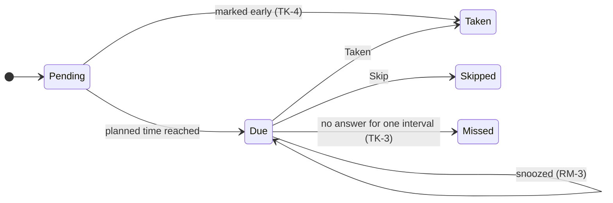

# Pills Reminder — Specification

| | |
|---|---|
| **Status** | Draft v0.2 |
| **Last updated** | 2026-11-20 |
| **Platform** | Android phone, single user, personal use |

This document describes *what* the app does. Once it is agreed, it is the base for the implementation plan.

How to read it:

- Every requirement has an ID (`TR-1`, `RM-3`, …) so that the implementation plan and later discussions can refer to it. IDs are never reused. Discarded proposals keep their ID and are listed in [§9.2](#92-discarded-proposals).
- The **Source** column says where a requirement comes from:
  - **Requested**: asked for in the original brief or in review answers.
  - **Agreed**: a proposal accepted in review.
  - **Proposed**: a suggestion still waiting for review.
- Unresolved points are listed in [§8 Open questions](#8-open-questions), each with the assumption this version makes for now.
- The app's own terms (treatment, medicine, take, …) are defined in [§4.1](#41-glossary).

---

## Contents

1. [Purpose](#1-purpose)
2. [Scope](#2-scope)
3. [Target device](#3-target-device)
4. [Concepts](#4-concepts)
5. [Functional requirements](#5-functional-requirements)
6. [Screens](#6-screens)
7. [Non-functional requirements](#7-non-functional-requirements)
8. [Open questions](#8-open-questions)
9. [Decisions](#9-decisions)
10. [Future ideas](#10-future-ideas)
11. [Change log](#11-change-log)

---

## 1. Purpose

An app that keeps track of medical **treatments** and reminds you when to take each **medicine**. A treatment groups the medicines prescribed together, each with its own dose, how often it is taken and for how long. For example:

- Amoxicillin, 1 capsule every 8 hours for 7 days.
- Atrovent, 3 puffs every 8 hours for 5 days.

From that, the app works out every planned take, and:

- shows when the next take of each medicine is due;
- alerts you on the phone when a take is due, even when the app is closed;
- records each take as taken or skipped.

The app is a reminder. It doesn't give medical advice, check doses or know anything about medicines: it reminds you of what you enter. It runs on one specific phone (see §3) and is installed directly from the development machine; it is not published on an app store.

## 2. Scope

### In scope (v1)

- Creating, editing and deleting treatments and their medicines in the app.
- Interval schedules: a dose every N hours, from a first take, for N days or with no end.
- A reminder for every take, which works with the app closed, the screen off, and after the phone restarts.
- A home screen with the next take of each medicine.
- Recording each take as taken or skipped.
- Storing everything on the phone only.

### Out of scope (v1)

- Accounts, cloud sync, or any network use.
- Publishing on Google Play.
- Medical content: a database of medicines, dose checks, interactions or advice.
- Other kinds of schedule: fixed times of day, days of the week, "as needed", or doses that change during a treatment (see [§10](#10-future-ideas) and Q2).
- A history of past takes, or statistics (`TK-6`, discarded).
- Counting the pills left, or reminding you to buy more.
- Treatments for several people, or profiles: you manage every treatment in the app yourself (Q14).
- Backups and exports (Q17).
- Tablets, landscape layout, smartwatches and home-screen widgets.

## 3. Target device

Information read from the phone with `adb` on 2026-11-19.

| Property | Value |
|---|---|
| Device | POCO F3 (model `M2012K11AG`, codename `alioth`) |
| OS | Android 13, **API level 33**, Xiaomi HyperOS `OS1.0.6.0.TKHEUXM`, security patch 2024-03-01 |
| CPU ABI | `arm64-v8a` |
| Screen | 1080 × 2400 px, 440 dpi → about **393 × 873 dp in portrait** |
| System language | Spanish (`es-ES`), time zone Europe/Madrid, 24-hour clock |
| Connection to the PC | USB debugging and wireless debugging |

For development there is also an emulator, `PillsReminder_API_36`: Android 16 (API 36), with Google Play, and the same screen size and density as the phone.

What this means for the app:

- **Notifications need a permission.** Since Android 13, an app must ask the user at runtime before it can show notifications. Without it, no reminder can appear (`RM-9`).
- **Exact alarms.** A reminder at a precise time needs Android's exact alarms. On Android 13 that permission is granted at install, but the user can revoke it. From Android 14 it is denied by default, so the app must be able to ask for it if the phone is ever updated. The emulator, at API 36, covers that case. The app is never published on Google Play (`NF-9`), so Google Play's rules on declaring that permission don't apply.
- **HyperOS restricts apps in the background.** For an app installed outside the store, HyperOS turns *Autostart* off and limits its battery use. Either can stop reminders after the app is swiped away or the phone restarts. The app can't change these settings, and can't read Autostart at all, so it guides you to them (`RM-9`). This was seen on this same phone in the owner's earlier project, [IAmOk](https://github.com/davamix/IAmOk/blob/main/docs/testing/device-matrix.md), which also found that a *Force stop* cancels every alarm (`NF-2`).
- **Installing from the PC** needs *Install via USB* turned on in HyperOS's developer options.
- **The emulator can't answer the riskiest question.** It has no HyperOS power management, and its Doze is not a real phone's. Whether reminders arrive on time is checked on the phone (`NF-1`).
- **The system language is Spanish,** but the app starts in English, with every text ready for a Spanish translation (`NF-8`).
- The layout targets a phone in portrait, about 393 dp wide.

## 4. Concepts

### 4.1 Glossary

| Term | Meaning |
|---|---|
| **Treatment** | A named group of medicines prescribed together, for example for one illness. |
| **Medicine** | One medicine in a treatment, with its dose, interval, duration and first take. The same medicine in two treatments is two separate entries. |
| **Dose** | How much is taken each time, as free text, such as "1 capsule", "3 puffs" or "1/3 tablet". |
| **Interval** | The time between two takes of a medicine, in whole hours: "every 8 hours", or "every 168 hours" for once a week (Q19). |
| **Duration** | How long a medicine is taken: a number of days, counted from its first take, or **no end**. |
| **First take** | The date and time of a medicine's first take. Every later take follows from it. |
| **Take** | One planned intake: a medicine and its dose, at a date and time. For example "Amoxicillin, 1 capsule, Monday 16:00". |
| **Reminder** | The phone's alert for a take that is due. |
| **Due** | A take whose time has come, and which hasn't been answered yet. |
| **Snooze** | Asking a reminder to alert again a few minutes later. |

### 4.2 Structure

```
Treatment
├── name
├── notes (optional)
└── medicines (at least 1)
    ├── name
    ├── dose (free text)
    ├── instructions (optional), e.g. "with food"
    ├── interval (hours)
    ├── duration (days, or no end)
    ├── first take (date and time)
    └── takes (worked out from the values above)
        ├── planned time
        ├── state: Pending, Due, Taken, Skipped or Missed
        └── time taken (when Taken)
```

### 4.3 Scheduling rules

1. A medicine's first take is at its first-take time.
2. Each following take is one interval after the planned time of the one before.
3. With a duration in days, the medicine's period runs from its first take for that many days. The last take is the last one that falls inside that period. Every 8 h for 7 days gives 7 × 24 / 8 = **21 takes**. When the interval doesn't divide the period evenly, the count rounds up: every 5 h for 1 day gives takes at 0, 5, 10, 15 and 20 h, so 5 takes.
4. With **no end**, takes carry on until the treatment is ended or the medicine is removed from it (`SC-5`).
5. Planned times are fixed: taking one late or early doesn't move the others (`SC-3`).
6. Planned times are clock times on the phone, including across daylight saving changes (`SC-4`).
7. A treatment is **Upcoming** until its first take, **Active** while it has takes still to come or unanswered, and **Finished** after that, or once it is ended early (`TR-11`). A treatment with a medicine that has no end stays Active until it is ended.

Each take moves through these states:



An answered take can be corrected later (`TK-5`).

### 4.4 Example

Treatment "Example", started on Monday 23 November 2026:

- Amoxicillin: 1 capsule every 8 h for 7 days, first take Monday 08:00.
- Atrovent: 3 puffs every 8 h for 5 days, first take Monday 08:00.

| Medicine | Takes | First take | Last take | Times each day |
|---|---|---|---|---|
| Amoxicillin | 21 (7 days × 3) | Mon 23 Nov, 08:00 | Mon 30 Nov, 00:00 | 08:00, 16:00, 00:00 |
| Atrovent | 15 (5 days × 3) | Mon 23 Nov, 08:00 | Sat 28 Nov, 00:00 | 08:00, 16:00, 00:00 |

The last take of each falls at midnight, on the calendar day after the last full day: a 7-day period that starts on Monday at 08:00 ends the next Monday at 08:00, and the 00:00 take is the last one before that.

On Monday at 10:30, with both 08:00 takes marked Taken, the home screen shows:

| Next take | Medicine | Dose | Progress |
|---|---|---|---|
| Today 16:00 (in 5 h 30 min) | Amoxicillin | 1 capsule | 1 of 21 |
| Today 16:00 (in 5 h 30 min) | Atrovent | 3 puffs | 1 of 15 |

At 16:00 two reminders alert, "Amoxicillin: 1 capsule" and "Atrovent: 3 puffs", and each is answered on its own (`RM-4`).

## 5. Functional requirements

### 5.1 Treatments and medicines

| ID | Requirement | Source |
|---|---|---|
| TR-1 | The app manages several treatments. More than one can be active at the same time. | Requested |
| TR-2 | A treatment has one or more medicines. | Requested |
| TR-3 | Each medicine has a name, a dose per take written as free text (such as "1 capsule" or "3 puffs"), an interval ("every 8 hours") and a duration: a number of days ("for 7 days"), or no end. | Requested |
| TR-4 | Each medicine has its own first take, a date and a time. Medicines in the same treatment can start at different times. The editor suggests the next full hour. | Agreed |
| TR-5 | A treatment has a name, and optional notes. | Agreed |
| TR-6 | A medicine can have optional instructions, such as "with food", which its reminder shows. | Agreed |
| TR-7 | The dose is free text, such as "1 capsule", "3 puffs" or "1/3 tablet". There is no list of units, and no limit on the amount. | Agreed |
| TR-8 | Validation: the treatment and each medicine need a name, and a treatment has at least one medicine. The interval is a whole number of hours and the duration a whole number of days, each at least 1, with no upper limit; or the duration is set to no end. | Agreed (Q19) |
| TR-9 | Treatments can be created, edited and deleted in the app. Deleting asks for confirmation, and also deletes every take recorded for the treatment. | Agreed |
| TR-10 | Editing a treatment that has already started changes only what is still to come. Takes that are due or answered keep their state; takes not yet due are worked out again from the new values. | Agreed |
| TR-11 | A treatment can be ended early, for example when the doctor stops it. Its takes not yet due are removed and their reminders cancelled, and it shows as Finished. | Agreed |
| TR-12 | Finished treatments stay in the app until you delete them. | Agreed |
| TR-13 | Leaving the editor with unsaved changes asks for confirmation before discarding them. | Agreed |

### 5.2 Schedule

| ID | Requirement | Source |
|---|---|---|
| SC-1 | A medicine is taken every *interval* hours, from its first take, for its duration. | Requested |
| SC-2 | The app works out every planned take as in §4.3. The editor shows each medicine's number of takes and the date and time of its last take, before saving. | Agreed |
| SC-3 | Planned times are fixed. Taking a dose late or early doesn't move the later takes. | Agreed |
| SC-4 | Planned times are clock times on the phone. When the clocks change for daylight saving, a take planned at 08:00 still alerts at 08:00, so one interval that night is an hour longer or shorter. After a change of time zone, takes keep the same clock times in the new zone. | Agreed |
| SC-5 | A medicine with no end keeps its schedule until its treatment is ended (`TR-11`) or the medicine is removed from the treatment. Where the app shows a number of takes or a last take (`SC-2`, `HM-3`), it shows "No end" instead. | Proposed |

### 5.3 Reminders

| ID | Requirement | Source |
|---|---|---|
| RM-1 | When a take is due, the phone alerts with a reminder that names the medicine, the dose and the treatment, for example "Amoxicillin: 1 capsule" and "Example". It also shows the medicine's instructions, if it has any. | Requested |
| RM-2 | A reminder is a heads-up notification with sound, without vibration. It alerts whether the app is open or closed, the screen is on or off, the phone is locked, or the phone has restarted since the treatment was saved. | Agreed (Q20) |
| RM-3 | A reminder has three actions: **Taken**, **Snooze** and **Skip**. Taken and Skip record the answer (`TK-2`) and remove the reminder. Snooze removes it, and alerts again 10 minutes later. | Agreed |
| RM-4 | Each take has its own reminder, so takes due at the same time are answered separately. Android groups them in the notification shade. | Agreed |
| RM-5 | A reminder that isn't answered stays in the notification shade, and alerts again every 10 minutes, up to 3 times. After that it stays there silently, until it is answered or the take becomes Missed (`TK-3`). | Agreed |
| RM-6 | Tapping a reminder opens the app on that take. | Agreed |
| RM-7 | When a take is answered in the app, or becomes Missed, its reminder is removed from the shade. | Agreed |
| RM-8 | Reminders follow the phone's Do Not Disturb and silent mode settings. | Agreed (Q20) |
| RM-9 | **Reminder check:** the app checks what its reminders depend on: the notification permission, the exact-alarm permission, and Android's battery optimisation for the app. It shows what is missing, each with a button that opens the right settings screen. HyperOS's own settings (Autostart, battery saver), which the app can't read, are listed as steps for you to confirm. The check is shown on first launch and in Settings, and the home screen warns while something is missing. | Agreed |
| RM-11 | The lock screen shows a reminder's full content. | Agreed |

### 5.4 Takes

| ID | Requirement | Source |
|---|---|---|
| TK-1 | Each planned take has a state: Pending (not yet due), Due, Taken, Skipped or Missed (§4.3). | Agreed |
| TK-2 | Marking a take Taken records the time it was marked. That time can be corrected afterwards, for example to "taken at 08:20". | Agreed |
| TK-3 | A take still unanswered one interval after its planned time becomes Missed. With an interval of 8 h, the 08:00 take becomes Missed at 16:00. | Agreed (Q21) |
| TK-4 | A medicine's next take can be marked Taken before it is due, from the app, for example before going out. Its reminder is then cancelled. | Agreed |
| TK-5 | An answered take can be changed later: to Taken, to Skipped, or back to unanswered. | Agreed (Q22) |

### 5.5 Home screen

| ID | Requirement | Source |
|---|---|---|
| HM-1 | The home screen shows the next take of each medicine in the active treatments: its date and time, how long until then ("in 2 h 15 min"), the medicine and the dose. | Requested |
| HM-2 | Due takes come first, highlighted, each with a **Taken** button. The others follow, ordered by time. | Agreed |
| HM-3 | Each medicine shows its progress, such as "5 of 21" (takes answered out of the total), and its treatment's name. | Agreed |
| HM-4 | Upcoming treatments show when they start. With no treatment active or upcoming, the screen says so and offers to create one. | Agreed |
| HM-5 | While the home screen is open, the times left and the states stay current, without leaving and coming back. | Agreed |

## 6. Screens

All screens are portrait.

| Screen | Purpose | Main actions |
|---|---|---|
| **Home: next takes** | The next take of each medicine, due takes first (`HM-1` to `HM-5`) | Mark a take Taken, open a treatment, new treatment, all treatments, settings |
| **Treatments** | Every treatment, grouped as Active, Upcoming and Finished | Open one, new treatment |
| **Treatment** | One treatment: its medicines, with their schedule and progress, and each medicine's last answered take (`TK-5`, Q22) | Edit, end early (`TR-11`), delete (with confirmation), open a take |
| **Treatment editor** | The treatment's name, notes and medicines | Add, edit or remove a medicine; save; cancel (asks for confirmation if there are unsaved changes) |
| **Medicine editor** | Name, dose, instructions, interval, duration (days or no end) and first take. Shows the number of takes and the last one (`SC-2`, `SC-5`). | Save, cancel |
| **Take** | One take: planned time, state, and time taken | Taken, Skip, change the time taken, undo (`TK-2`, `TK-5`) |
| **Settings** | The reminder check (`RM-9`) | Open Android's settings, back |
| **Reminder** (a notification, not a screen) | A due take (`RM-1`) | Taken, Snooze, Skip; tap to open the take |

Sketches (low fidelity, layout only), from the example in §4.4.

Home, on Monday at 16:05: Amoxicillin's 16:00 take is due, and Atrovent's was taken at 16:01.

```
+------------------------------------------+
| Next takes                          [⚙]  |
|                                          |
|  DUE                                     |
|  Amoxicillin · 1 capsule                 |
|  Today 16:00 · 5 min ago    [ Taken ]    |
|  Example · 1 of 21                       |
|                                          |
|  NEXT                                    |
|  Atrovent · 3 puffs                      |
|  Tomorrow 00:00 · in 7 h 55 min          |
|  Example · 2 of 15                       |
|                                          |
|                                          |
|  [ Treatments ]              [ + New ]   |
+------------------------------------------+
```

Medicine editor:

```
+------------------------------------------+
| ←  Medicine                      [ Save ]|
|                                          |
|  Name          [ Amoxicillin          ]  |
|  Dose          [ 1 capsule            ]  |
|  Instructions  [ with food            ]  |
|  Every         [ 8 ] hours               |
|  For           [ 7 ] days   [ ] No end   |
|  First take    [ Mon 23 Nov ]  [ 08:00 ] |
|                                          |
|  21 takes. The last one is on            |
|  Mon 30 Nov at 00:00.                    |
+------------------------------------------+
```

Reminder:

```
+------------------------------------------+
| [icon] Pills Reminder · now              |
| Amoxicillin: 1 capsule                   |
| Example · with food                      |
|  [ TAKEN ]     [ SNOOZE ]     [ SKIP ]   |
+------------------------------------------+
```

## 7. Non-functional requirements

| ID | Requirement | Source |
|---|---|---|
| NF-1 | **On time:** a reminder alerts within 1 minute of its planned time, also when the phone is idle (Doze), the screen is off, the app was swiped away from Recents, or the phone has restarted, as long as the reminder check (`RM-9`) passes. This is checked on the phone, not only on the emulator. | Agreed |
| NF-2 | **Reminders survive events:** they are set again after the phone restarts, after an app update, after a change of time or time zone, and after Android ends the app's process. A *Force stop* from Android's settings cancels every alarm, and Android gives the app no chance to undo that until it is opened again; when it is, it sets them again at once. | Agreed |
| NF-3 | **Offline and private:** no network permission, no accounts, no analytics, no ads. Treatment data stays on the phone. Android's cloud backup is turned off. | Agreed |
| NF-4 | **Data is kept safe:** treatments and takes survive app restarts, phone restarts and app updates. A save interrupted halfway, for example by a flat battery, never loses or damages what was saved before. There is no backup: uninstalling the app deletes everything. | Agreed |
| NF-5 | **Battery:** nothing runs in the background between reminders. The app wakes only to alert. | Agreed |
| NF-6 | **Compatibility:** runs on Android 13 (API 33) on the target phone, and keeps working if the phone is updated to a later Android version. The lowest version supported is set in the implementation plan. | Agreed |
| NF-7 | **Phone layout:** portrait only, for a screen about 393 dp wide. Touch targets are at least 48 dp. Text stays usable with the system's larger font sizes. | Agreed |
| NF-8 | **Language and formats:** the UI is in English. All user-facing text lives in resource files, so a Spanish translation can be added later without code changes. Dates and times follow the phone's settings, such as its 24-hour clock. | Agreed |
| NF-9 | **Distribution:** installed as an APK from the development machine (`adb` or Android Studio). It is never published on Google Play. | Agreed |
| NF-10 | **Theme:** follows the system's light or dark setting. | Agreed |

## 8. Open questions

Each question lists the assumption this draft makes until it is answered. These four come from the answers to the first review.

| # | Question | Draft assumption |
|---|---|---|
| Q19 | Long intervals: with no upper limit (`TR-8`), a medicine taken once a week is "every 168 hours". Should the editor take the interval in hours only, or in hours, days or weeks? | Hours only, as Q2 says, and the editor also shows the interval in days or weeks when it's a whole number of them: "168 hours (1 week)". |
| Q20 | Vibrate mode: when the phone is set to vibrate, Android mutes the reminders' sound (`RM-8`). Since reminders don't vibrate (`RM-2`), they then only appear on screen, with no sound and no vibration. Is that what you want, or should reminders vibrate when the phone is on vibrate? | As answered: reminders never vibrate, so on vibrate they are silent. |
| Q21 | Missed takes with long intervals: a take becomes Missed one interval after its planned time (`TK-3`). For a weekly medicine, an unanswered take stays Due for a week, silent after its 3 repeats (`RM-5`), at the top of the home screen. Keep that, or should a take become Missed sooner, for example after 24 hours? | Keep one interval, whatever its length. |
| Q22 | With the history discarded (`TK-6`), where can an answered take be changed (`TK-5`), for example a "Taken" pressed by mistake? | On the Treatment screen, each medicine shows its last answered take, which can be opened and changed. Older takes can't be seen or changed. |

## 9. Decisions

### 9.1 Answered questions

| # | Question | Decision |
|---|---|---|
| Q1 | "The number of takes of each" medicine | The dose each time. The app works out the total number of takes from the interval and the duration (`TR-3`, `SC-2`). |
| Q2 | Kinds of schedule | Only "every N hours" in v1 (`SC-1`). Other schedules are future ideas (§10). |
| Q3 | Length of a medicine | A number of days, or no end (`TR-3`, `SC-5`). |
| Q4 | A late take | Later takes keep their planned times (`SC-3`). |
| Q5 | Daylight saving and time zones | Keep the clock times (`SC-4`). |
| Q6 | How insistent a reminder is | A notification with sound, without vibration. No full-screen alarm. (`RM-2`) |
| Q7 | Do Not Disturb and silent mode | Reminders follow the phone's settings (`RM-8`). |
| Q8 | Snooze and repeats | A 10-minute snooze; an unanswered reminder alerts again every 10 minutes, up to 3 times. Fixed values, not settings. (`RM-3`, `RM-5`) |
| Q9 | Takes due at the same time | One reminder each (`RM-4`). |
| Q10 | When a take is Missed | One interval after its planned time (`TK-3`). |
| Q11 | Marking a take early | Only each medicine's next take, at any time before it's due (`TK-4`). |
| Q12 | Editing a started treatment | Changes apply from now on (`TR-10`). |
| Q13 | Dose units | Free text, with no list of units and no limit on the amount, so thirds or any other fraction can be written (`TR-3`, `TR-7`). |
| Q14 | Several people | No profiles. You manage every treatment in the app yourself (§2). |
| Q15 | UI language | English first, with every text in resource files for a later Spanish translation (`NF-8`). |
| Q16 | Lock screen | It shows the reminder's full content (`RM-11`). |
| Q17 | Backups | No backup and no export. Uninstalling the app deletes everything. (`NF-3`, `NF-4`) |
| Q18 | Distribution | Installed from the PC only. It won't be published on Google Play. (`NF-9`) |

### 9.2 Discarded proposals

| ID | Proposal | Reason |
|---|---|---|
| RM-10 | **Test reminder:** in Settings, a button schedules a test reminder 1 minute later, to check that the phone delivers it with the app closed. | Not needed: reminder delivery is tested during the implementation. |
| TK-6 | Each treatment shows its history: every take, with its planned time, its state and, when Taken, the time taken. A summary per medicine says how many takes were taken, skipped and missed, out of the total. | Not needed for now. Kept as a future idea (§10). |

## 10. Future ideas

Not planned for v1; listed so they are not lost.

- Other schedules: fixed times of day, certain days of the week, "as needed" with a minimum gap, and doses that change during a treatment (Q2).
- A history of the takes of each treatment, with a summary per medicine, and statistics across treatments (`TK-6`).
- Counting the pills left, with a reminder to buy more.
- Exporting and importing treatments, as a backup (Q17).
- A Spanish translation (Q15).
- A home-screen widget with the next takes.
- An optional early warning a few minutes before a take.
- A photo of the medicine or its box, to recognise it.

## 11. Change log

| Version | Date | Changes |
|---|---|---|
| 0.1 | 2026-11-19 | First draft, from the initial brief and the phone's information. |
| 0.2 | 2026-11-20 | First review: Q1–Q18 answered. `RM-10` (test reminder) and `TK-6` (history) discarded. Changed: `TR-3` (a duration can have no end, and the dose is free text), `TR-7` (free-text dose, no list of units), `TR-8` (validates only the names and at least one medicine; no upper limit on the interval or the duration), `RM-2` (no vibration). `TR-9` and `TR-12` no longer mention a history. Added `SC-5` (medicines with no end). Every other proposal agreed. New questions Q19–Q22. |
