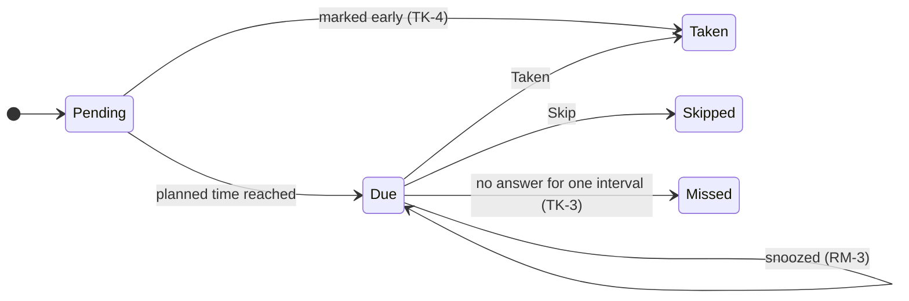

# Pills Reminder — Specification

| | |
|---|---|
| **Status** | Draft v0.1 |
| **Last updated** | 2026-11-19 |
| **Platform** | Android phone, single user, personal use |

This document describes *what* the app does. Once it is agreed, it is the base for the implementation plan.

How to read it:

- Every requirement has an ID (`TR-1`, `RM-3`, …) so that the implementation plan and later discussions can refer to it. IDs are never reused. Discarded proposals keep their ID and are listed in [§9.2](#92-discarded-proposals).
- The **Source** column says where a requirement comes from:
  - **Requested**: asked for in the original brief or in review answers.
  - **Agreed**: a proposal accepted in review.
  - **Proposed**: a suggestion still waiting for review.
- Unresolved points are listed in [§8 Open questions](#8-open-questions), each with the assumption this version makes for now.
- The app's own terms (treatment, medicine, take, …) are defined in [§4.1](#41-glossary).

---

## Contents

1. [Purpose](#1-purpose)
2. [Scope](#2-scope)
3. [Target device](#3-target-device)
4. [Concepts](#4-concepts)
5. [Functional requirements](#5-functional-requirements)
6. [Screens](#6-screens)
7. [Non-functional requirements](#7-non-functional-requirements)
8. [Open questions](#8-open-questions)
9. [Decisions](#9-decisions)
10. [Future ideas](#10-future-ideas)
11. [Change log](#11-change-log)

---

## 1. Purpose

An app that keeps track of medical **treatments** and reminds you when to take each **medicine**. A treatment groups the medicines prescribed together, each with its own dose, how often it is taken and for how long. For example:

- Amoxicillin, 1 capsule every 8 hours for 7 days.
- Atrovent, 3 puffs every 8 hours for 5 days.

From that, the app works out every planned take, and:

- shows when the next take of each medicine is due;
- alerts you on the phone when a take is due, even when the app is closed;
- records what you took, so you can see how each treatment is going.

The app is a reminder. It doesn't give medical advice, check doses or know anything about medicines: it reminds you of what you enter. It runs on one specific phone (see §3) and is installed directly from the development machine; it is not published on an app store.

## 2. Scope

### In scope (v1)

- Creating, editing and deleting treatments and their medicines in the app.
- Interval schedules: a dose every N hours, for N days, from a first take.
- A reminder for every take, which works with the app closed, the screen off, and after the phone restarts.
- A home screen with the next take of each medicine.
- Recording each take as taken or skipped, and a history per treatment.
- Storing everything on the phone only.

### Out of scope (v1)

- Accounts, cloud sync, or any network use.
- Publishing on Google Play.
- Medical content: a database of medicines, dose checks, interactions or advice.
- Other kinds of schedule: fixed times of day, days of the week, every N days, "as needed", or doses that change during a treatment (see [§10](#10-future-ideas) and Q2).
- Counting the pills left, or reminding you to buy more.
- Treatments for several people, such as a child's or a parent's (Q14).
- Tablets, landscape layout, smartwatches and home-screen widgets.

## 3. Target device

Information read from the phone with `adb` on 2026-11-19.

| Property | Value |
|---|---|
| Device | POCO F3 (model `M2012K11AG`, codename `alioth`) |
| OS | Android 13, **API level 33**, Xiaomi HyperOS `OS1.0.6.0.TKHEUXM`, security patch 2024-03-01 |
| CPU ABI | `arm64-v8a` |
| Screen | 1080 × 2400 px, 440 dpi → about **393 × 873 dp in portrait** |
| System language | Spanish (`es-ES`), time zone Europe/Madrid, 24-hour clock |
| Connection to the PC | USB debugging and wireless debugging |

For development there is also an emulator, `PillsReminder_API_36`: Android 16 (API 36), with Google Play, and the same screen size and density as the phone.

What this means for the app:

- **Notifications need a permission.** Since Android 13, an app must ask the user at runtime before it can show notifications. Without it, no reminder can appear (`RM-9`).
- **Exact alarms.** A reminder at a precise time needs Android's exact alarms. On Android 13 that permission is granted at install, but the user can revoke it. From Android 14 it is denied by default, so the app must be able to ask for it if the phone is ever updated. The emulator, at API 36, covers that case.
- **HyperOS restricts apps in the background.** For an app installed outside the store, HyperOS turns *Autostart* off and limits its battery use. Either can stop reminders after the app is swiped away or the phone restarts. The app can't change these settings, and can't read Autostart at all, so it guides you to them (`RM-9`). This was seen on this same phone in the owner's earlier project, [IAmOk](https://github.com/davamix/IAmOk/blob/main/docs/testing/device-matrix.md), which also found that a *Force stop* cancels every alarm (`NF-2`).
- **Installing from the PC** needs *Install via USB* turned on in HyperOS's developer options.
- **The emulator can't answer the riskiest question.** It has no HyperOS power management, and its Doze is not a real phone's. Whether reminders arrive on time is checked on the phone (`NF-1`).
- **The system language is Spanish** (Q15).
- The layout targets a phone in portrait, about 393 dp wide.

## 4. Concepts

### 4.1 Glossary

| Term | Meaning |
|---|---|
| **Treatment** | A named group of medicines prescribed together, for example for one illness. |
| **Medicine** | One medicine in a treatment, with its dose, interval, duration and first take. The same medicine in two treatments is two separate entries. |
| **Dose** | How much is taken each time: an amount and a unit, such as "1 capsule" or "3 puffs". |
| **Interval** | The time between two takes of a medicine, in whole hours: "every 8 hours". |
| **Duration** | How long a medicine is taken, in days, counted from its first take. |
| **First take** | The date and time of a medicine's first take. Every later take follows from it. |
| **Take** | One planned intake: a medicine and its dose, at a date and time. For example "Amoxicillin, 1 capsule, Monday 16:00". |
| **Reminder** | The phone's alert for a take that is due. |
| **Due** | A take whose time has come, and which hasn't been answered yet. |
| **Snooze** | Asking a reminder to alert again a few minutes later. |

### 4.2 Structure

```
Treatment
├── name
├── notes (optional)
└── medicines (at least 1)
    ├── name
    ├── dose: amount and unit
    ├── instructions (optional), e.g. "with food"
    ├── interval (hours)
    ├── duration (days)
    ├── first take (date and time)
    └── takes (worked out from the values above)
        ├── planned time
        ├── state: Pending, Due, Taken, Skipped or Missed
        └── time taken (when Taken)
```

### 4.3 Scheduling rules

1. A medicine's first take is at its first-take time.
2. Each following take is one interval after the planned time of the one before.
3. The medicine's period runs from its first take for its duration. The last take is the last one that falls inside that period. Every 8 h for 7 days gives 7 × 24 / 8 = **21 takes**. When the interval doesn't divide the period evenly, the count rounds up: every 5 h for 1 day gives takes at 0, 5, 10, 15 and 20 h, so 5 takes.
4. Planned times are fixed: taking one late or early doesn't move the others (`SC-3`, Q4).
5. Planned times are clock times on the phone, including across daylight saving changes (`SC-4`, Q5).
6. A treatment is **Upcoming** until its first take, **Active** while it has takes still to come or unanswered, and **Finished** after that, or once it is ended early (`TR-11`).

Each take moves through these states:



An answered take can be corrected later (`TK-5`).

### 4.4 Example

Treatment "Example", started on Monday 23 November 2026:

- Amoxicillin: 1 capsule every 8 h for 7 days, first take Monday 08:00.
- Atrovent: 3 puffs every 8 h for 5 days, first take Monday 08:00.

| Medicine | Takes | First take | Last take | Times each day |
|---|---|---|---|---|
| Amoxicillin | 21 (7 days × 3) | Mon 23 Nov, 08:00 | Mon 30 Nov, 00:00 | 08:00, 16:00, 00:00 |
| Atrovent | 15 (5 days × 3) | Mon 23 Nov, 08:00 | Sat 28 Nov, 00:00 | 08:00, 16:00, 00:00 |

The last take of each falls at midnight, on the calendar day after the last full day: a 7-day period that starts on Monday at 08:00 ends the next Monday at 08:00, and the 00:00 take is the last one before that.

On Monday at 10:30, with both 08:00 takes marked Taken, the home screen shows:

| Next take | Medicine | Dose | Progress |
|---|---|---|---|
| Today 16:00 (in 5 h 30 min) | Amoxicillin | 1 capsule | 1 of 21 |
| Today 16:00 (in 5 h 30 min) | Atrovent | 3 puffs | 1 of 15 |

At 16:00 two reminders alert, "Amoxicillin: 1 capsule" and "Atrovent: 3 puffs", and each is answered on its own (`RM-4`).

## 5. Functional requirements

### 5.1 Treatments and medicines

| ID | Requirement | Source |
|---|---|---|
| TR-1 | The app manages several treatments. More than one can be active at the same time. | Requested |
| TR-2 | A treatment has one or more medicines. | Requested |
| TR-3 | Each medicine has a name, a dose per take (an amount and a unit, such as "1 capsule" or "3 puffs"), an interval ("every 8 hours") and a duration ("for 7 days"). | Requested |
| TR-4 | Each medicine has its own first take, a date and a time. Medicines in the same treatment can start at different times. The editor suggests the next full hour. | Proposed |
| TR-5 | A treatment has a name, and optional notes. | Proposed |
| TR-6 | A medicine can have optional instructions, such as "with food", which its reminder shows. | Proposed |
| TR-7 | The dose unit is chosen from a list: capsule, tablet, puff, drop, ml, sachet, application. The amount is a whole number or a half: 0.5, 1, 1.5, … | Proposed (Q13) |
| TR-8 | Validation: the treatment and each medicine need a name; a treatment has at least one medicine; the amount is more than 0 and at most 99; the interval is 1 to 24 whole hours; the duration is 1 to 365 days. | Proposed |
| TR-9 | Treatments can be created, edited and deleted in the app. Deleting asks for confirmation, and also deletes the treatment's history. | Proposed |
| TR-10 | Editing a treatment that has already started changes only what is still to come. Takes that are due or answered keep their state; takes not yet due are worked out again from the new values. | Proposed (Q12) |
| TR-11 | A treatment can be ended early, for example when the doctor stops it. Its takes not yet due are removed and their reminders cancelled, and it shows as Finished. | Proposed |
| TR-12 | Finished treatments stay in the app, with their history, until you delete them. | Proposed |
| TR-13 | Leaving the editor with unsaved changes asks for confirmation before discarding them. | Proposed |

### 5.2 Schedule

| ID | Requirement | Source |
|---|---|---|
| SC-1 | A medicine is taken every *interval* hours, from its first take, for its duration. | Requested |
| SC-2 | The app works out every planned take as in §4.3. The editor shows each medicine's number of takes and the date and time of its last take, before saving. | Proposed |
| SC-3 | Planned times are fixed. Taking a dose late or early doesn't move the later takes. | Proposed (Q4) |
| SC-4 | Planned times are clock times on the phone. When the clocks change for daylight saving, a take planned at 08:00 still alerts at 08:00, so one interval that night is an hour longer or shorter. After a change of time zone, takes keep the same clock times in the new zone. | Proposed (Q5) |

### 5.3 Reminders

| ID | Requirement | Source |
|---|---|---|
| RM-1 | When a take is due, the phone alerts with a reminder that names the medicine, the dose and the treatment, for example "Amoxicillin: 1 capsule" and "Example". It also shows the medicine's instructions, if it has any. | Requested |
| RM-2 | A reminder is a heads-up notification with sound and vibration. It alerts whether the app is open or closed, the screen is on or off, the phone is locked, or the phone has restarted since the treatment was saved. | Proposed (Q6) |
| RM-3 | A reminder has three actions: **Taken**, **Snooze** and **Skip**. Taken and Skip record the answer (`TK-2`) and remove the reminder. Snooze removes it, and alerts again 10 minutes later. | Proposed (Q8) |
| RM-4 | Each take has its own reminder, so takes due at the same time are answered separately. Android groups them in the notification shade. | Proposed (Q9) |
| RM-5 | A reminder that isn't answered stays in the notification shade, and alerts again every 10 minutes, up to 3 times. After that it stays there silently, until it is answered or the take becomes Missed (`TK-3`). | Proposed (Q8) |
| RM-6 | Tapping a reminder opens the app on that take. | Proposed |
| RM-7 | When a take is answered in the app, or becomes Missed, its reminder is removed from the shade. | Proposed |
| RM-8 | Reminders follow the phone's Do Not Disturb and silent mode settings. | Proposed (Q7) |
| RM-9 | **Reminder check:** the app checks what its reminders depend on: the notification permission, the exact-alarm permission, and Android's battery optimisation for the app. It shows what is missing, each with a button that opens the right settings screen. HyperOS's own settings (Autostart, battery saver), which the app can't read, are listed as steps for you to confirm. The check is shown on first launch and in Settings, and the home screen warns while something is missing. | Proposed |
| RM-10 | **Test reminder:** in Settings, a button schedules a test reminder 1 minute later, to check that the phone delivers it with the app closed. | Proposed |
| RM-11 | The lock screen shows a reminder's full content. | Proposed (Q16) |

### 5.4 Takes and history

| ID | Requirement | Source |
|---|---|---|
| TK-1 | Each planned take has a state: Pending (not yet due), Due, Taken, Skipped or Missed (§4.3). | Proposed |
| TK-2 | Marking a take Taken records the time it was marked. That time can be corrected afterwards, for example to "taken at 08:20". | Proposed |
| TK-3 | A take still unanswered one interval after its planned time becomes Missed. With an interval of 8 h, the 08:00 take becomes Missed at 16:00. | Proposed (Q10) |
| TK-4 | A medicine's next take can be marked Taken before it is due, from the app, for example before going out. Its reminder is then cancelled. | Proposed (Q11) |
| TK-5 | An answered take can be changed later: to Taken, to Skipped, or back to unanswered. | Proposed |
| TK-6 | Each treatment shows its history: every take, with its planned time, its state and, when Taken, the time taken. A summary per medicine says how many takes were taken, skipped and missed, out of the total. | Proposed |

### 5.5 Home screen

| ID | Requirement | Source |
|---|---|---|
| HM-1 | The home screen shows the next take of each medicine in the active treatments: its date and time, how long until then ("in 2 h 15 min"), the medicine and the dose. | Requested |
| HM-2 | Due takes come first, highlighted, each with a **Taken** button. The others follow, ordered by time. | Proposed |
| HM-3 | Each medicine shows its progress, such as "5 of 21" (takes answered out of the total), and its treatment's name. | Proposed |
| HM-4 | Upcoming treatments show when they start. With no treatment active or upcoming, the screen says so and offers to create one. | Proposed |
| HM-5 | While the home screen is open, the times left and the states stay current, without leaving and coming back. | Proposed |

## 6. Screens

All screens are portrait.

| Screen | Purpose | Main actions |
|---|---|---|
| **Home: next takes** | The next take of each medicine, due takes first (`HM-1` to `HM-5`) | Mark a take Taken, open a treatment, new treatment, all treatments, settings |
| **Treatments** | Every treatment, grouped as Active, Upcoming and Finished | Open one, new treatment |
| **Treatment** | One treatment: its medicines with their schedule and progress, and its history (`TK-6`) | Edit, end early (`TR-11`), delete (with confirmation) |
| **Treatment editor** | The treatment's name, notes and medicines | Add, edit or remove a medicine; save; cancel (asks for confirmation if there are unsaved changes) |
| **Medicine editor** | Name, dose, instructions, interval, duration and first take. Shows the number of takes and the last one (`SC-2`). | Save, cancel |
| **Take** | One take: planned time, state, and time taken | Taken, Skip, change the time taken, undo (`TK-2`, `TK-5`) |
| **Settings** | The reminder check (`RM-9`) and the test reminder (`RM-10`) | Open Android's settings, send a test reminder, back |
| **Reminder** (a notification, not a screen) | A due take (`RM-1`) | Taken, Snooze, Skip; tap to open the take |

Sketches (low fidelity, layout only), from the example in §4.4.

Home, on Monday at 16:05: Amoxicillin's 16:00 take is due, and Atrovent's was taken at 16:01.

```
+------------------------------------------+
| Next takes                          [⚙]  |
|                                          |
|  DUE                                     |
|  Amoxicillin · 1 capsule                 |
|  Today 16:00 · 5 min ago    [ Taken ]    |
|  Example · 1 of 21                       |
|                                          |
|  NEXT                                    |
|  Atrovent · 3 puffs                      |
|  Tomorrow 00:00 · in 7 h 55 min          |
|  Example · 2 of 15                       |
|                                          |
|                                          |
|  [ Treatments ]              [ + New ]   |
+------------------------------------------+
```

Medicine editor:

```
+------------------------------------------+
| ←  Medicine                      [ Save ]|
|                                          |
|  Name          [ Amoxicillin          ]  |
|  Dose          [ 1 ]  [ capsule     ▾ ]  |
|  Instructions  [ with food            ]  |
|  Every         [ 8 ] hours               |
|  For           [ 7 ] days                |
|  First take    [ Mon 23 Nov ]  [ 08:00 ] |
|                                          |
|  21 takes. The last one is on            |
|  Mon 30 Nov at 00:00.                    |
+------------------------------------------+
```

Reminder:

```
+------------------------------------------+
| [icon] Pills Reminder · now              |
| Amoxicillin: 1 capsule                   |
| Example · with food                      |
|  [ TAKEN ]     [ SNOOZE ]     [ SKIP ]   |
+------------------------------------------+
```

## 7. Non-functional requirements

| ID | Requirement | Source |
|---|---|---|
| NF-1 | **On time:** a reminder alerts within 1 minute of its planned time, also when the phone is idle (Doze), the screen is off, the app was swiped away from Recents, or the phone has restarted, as long as the reminder check (`RM-9`) passes. This is checked on the phone, not only on the emulator. | Proposed |
| NF-2 | **Reminders survive events:** they are set again after the phone restarts, after an app update, after a change of time or time zone, and after Android ends the app's process. A *Force stop* from Android's settings cancels every alarm, and Android gives the app no chance to undo that until it is opened again; when it is, it sets them again at once. | Proposed |
| NF-3 | **Offline and private:** no network permission, no accounts, no analytics, no ads. Treatment data stays on the phone. Android's cloud backup is turned off. | Proposed (Q17) |
| NF-4 | **Data is kept safe:** treatments and history survive app restarts, phone restarts and app updates. A save interrupted halfway, for example by a flat battery, never loses or damages what was saved before. Uninstalling the app deletes everything. | Proposed |
| NF-5 | **Battery:** nothing runs in the background between reminders. The app wakes only to alert. | Proposed |
| NF-6 | **Compatibility:** runs on Android 13 (API 33) on the target phone, and keeps working if the phone is updated to a later Android version. The lowest version supported is set in the implementation plan. | Proposed |
| NF-7 | **Phone layout:** portrait only, for a screen about 393 dp wide. Touch targets are at least 48 dp. Text stays usable with the system's larger font sizes. | Proposed |
| NF-8 | **Language and formats:** the UI is in English. All user-facing text lives in resource files, so a translation can be added without code changes. Dates and times follow the phone's settings, such as its 24-hour clock. | Proposed (Q15) |
| NF-9 | **Distribution:** installed as an APK from the development machine (`adb` or Android Studio). | Proposed (Q18) |
| NF-10 | **Theme:** follows the system's light or dark setting. | Proposed |

## 8. Open questions

Each question lists the assumption this draft makes until it is answered.

| # | Question | Draft assumption |
|---|---|---|
| Q1 | "The number of takes of each" medicine: does it mean the dose each time (1 capsule, 3 puffs), or the total number of takes? | The dose each time. The app works out the total from the interval and the duration, and shows it (`SC-2`). |
| Q2 | Which kinds of schedule are needed, besides "every N hours"? For example fixed times of day ("at 09:00 and 21:00"), every N days, certain days of the week, "as needed", or a dose that changes (2 tablets the first day, then 1). | Only "every N hours" in v1, from 1 to 24 h. The others are future ideas (§10). |
| Q3 | How is a medicine's length set: in days, by an end date, by a number of takes, or with no end, for a medicine taken indefinitely? | In days only, and it's required. Medicines with no end are a future idea. |
| Q4 | If a take is late, do the next ones keep their planned times, or move to stay one interval after the real take? | They keep their times (`SC-3`). Moving them would let the schedule drift a little later every day. |
| Q5 | Daylight saving and time zones: keep the clock times (08:00 stays 08:00), or keep exact intervals (08:00 becomes 07:00 or 09:00)? | Keep the clock times (`SC-4`). |
| Q6 | How insistent should a reminder be: a notification with sound, or a full-screen alarm, like an alarm clock's, that has to be dismissed? | A heads-up notification with sound and vibration (`RM-2`), which alerts again if unanswered (`RM-5`). |
| Q7 | Should reminders sound when the phone is in Do Not Disturb or silent mode? | No: they follow the phone's settings (`RM-8`). Android's own settings can let the app's reminders through Do Not Disturb, if you want that. |
| Q8 | Snooze and repeats: how long is a snooze, and how often and how many times does an unanswered reminder alert again? Should these be settings? | A 10-minute snooze; alert again every 10 minutes, up to 3 times. Fixed values, not settings. |
| Q9 | Takes due at the same time: one reminder each, or one reminder for all of them, with a single "Taken"? | One each (`RM-4`). |
| Q10 | When does an unanswered take count as Missed? | One interval after its planned time (`TK-3`). |
| Q11 | Can a take be marked Taken before it's due, and how early? | Only each medicine's next take, at any time before it's due (`TK-4`). |
| Q12 | When a started treatment is edited, for example because the doctor changes the dose or the interval, from when does the change apply? | From now: takes that are due or answered stay as they are; the takes not yet due are worked out again from the medicine's first take, with the new values (`TR-10`). |
| Q13 | Dose units: a fixed list, or free text? Are halves of a tablet needed? | A fixed list, and amounts in halves (`TR-7`). |
| Q14 | Is the app only for your own treatments, or also for other people's, such as a child's or a parent's? | Only yours. There are no profiles. |
| Q15 | The phone is in Spanish. Should the app be in English, in Spanish, or both? | English, with every text in resource files (`NF-8`), as in Workout Timer. |
| Q16 | Lock screen: show medicine names, or hide them until the phone is unlocked? | Show them (`RM-11`). It's your own phone. |
| Q17 | Backups: Android's cloud backup could copy the data to your Google account. Should it stay off? Is an export to a file needed in v1? | Off, and no export in v1 (a future idea). Uninstalling the app deletes everything (`NF-3`, `NF-4`). |
| Q18 | Will the app only ever be installed from the PC, as Workout Timer is, or might it be published on Google Play one day? It changes how the exact-alarm permission can be declared. | Installed from the PC only (`NF-9`). |

## 9. Decisions

### 9.1 Answered questions

None yet.

| # | Question | Decision |
|---|---|---|

### 9.2 Discarded proposals

None yet.

| ID | Proposal | Reason |
|---|---|---|

## 10. Future ideas

Not planned for v1; listed so they are not lost.

- Other schedules: fixed times of day, every N days, certain days of the week, "as needed" with a minimum gap, and doses that change during a treatment (Q2).
- Medicines with no end date (Q3).
- Counting the pills left, with a reminder to buy more.
- Treatments for several people, each with their own list (Q14).
- Exporting and importing treatments and history, as a backup (Q17).
- A Spanish translation (Q15).
- A home-screen widget with the next takes.
- An optional early warning a few minutes before a take.
- A photo of the medicine or its box, to recognise it.
- Statistics across treatments.

## 11. Change log

| Version | Date | Changes |
|---|---|---|
| 0.1 | 2026-11-19 | First draft, from the initial brief and the phone's information. |
