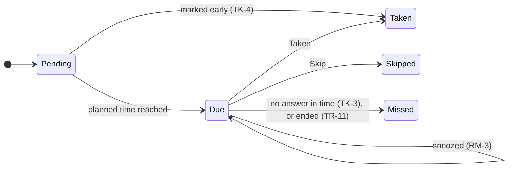

# P2 — Domain model and schedule: Specification

| | |
|---|---|
| **Status** | Ready, v0.3 |
| **Phase** | P2, see [Implementation plan §5](../../IMPLEMENTATION_PLAN.md#5-phases) |
| **Depends on** | P1 |
| **Branch** | `phase/p2-domain` |
| **Handover** | [HANDOVER.md](HANDOVER.md) |

This document holds everything needed to implement the phase. Working on it shouldn't require reading the full specification or plan.

## 1. Goal

The core of the app, in pure Kotlin in `:core`:

- the treatment model and its validation;
- the schedule, which turns each medicine into its planned takes;
- the take states;
- the rules for editing a started medicine, ending a treatment early, and answering takes;
- the repository interface that every later phase codes against, with an in-memory fake.

Nothing changes on screen. Once P2 is merged, P3, P4, P6 and P7 can start in parallel: they all build on these types and rules, and none of them needs to work out a take again.

## 2. Requirements covered

Quoted from [SPECIFICATION.md](../../SPECIFICATION.md) v0.5. P2 implements the rules. The screens that show them come in P6 and P7, and the reminders in P4 and P5.

| ID | Requirement (quoted) | What this phase does for it |
|---|---|---|
| TR-1 | "The app manages several treatments. More than one can be active at the same time." | `PillsData` holds a list of treatments, each with its own status. |
| TR-2 | "A treatment has one or more medicines." | Validation (`TR-8`). |
| TR-3 | "Each medicine has a name, a dose per take written as free text (such as "1 capsule" or "3 puffs"), an interval in hours, days or weeks ("every 8 hours", "every 2 days", "every week") and a duration: a number of days or weeks ("for 7 days", "for 12 weeks"), or no end." | `Medicine`, `Interval`, `MedicineDuration` (§4.2). |
| TR-4 | "Each medicine has its own first take, a date and a time. Medicines in the same treatment can start at different times. The editor suggests the next full hour. The first take can be in the past, for a treatment that started before it was entered. Its takes already past are then Missed, except the latest one while it is still Due (`TK-3`)." | A first take per medicine, which validation doesn't check, so it can be in the past (§4.3.9). `suggestedFirstTake()` works out the next full hour for P6's editor. |
| TR-5 | "A treatment has a name, and optional notes." | `Treatment.name`, `Treatment.notes`. |
| TR-6 | "A medicine can have optional instructions, such as "with food", which its reminder shows." | `Medicine.instructions`. P5 shows them. |
| TR-7 | "The dose is free text, such as "1 capsule", "3 puffs" or "1/3 tablet". There is no list of units, and no limit on the amount." | `Medicine.dose` is a string, kept as typed apart from trimming. |
| TR-8 | "Validation: the treatment and each medicine need a name, and a treatment has at least one medicine. The interval is a whole number of hours, days or weeks, and the duration a whole number of days or weeks, each at least 1, with no upper limit; or the duration is set to no end." | `validate()` returns a list of errors (§4.3.9). |
| TR-9 | "Treatments can be created, edited and deleted in the app. Deleting asks for confirmation, and also deletes every take recorded for the treatment." | The data side only: `deleteTreatment()` removes the treatment and every answer of its medicines. P3 stores it, P5 removes the notifications, P6 asks for confirmation. |
| TR-10 | "Editing a treatment that has already started changes only what is still to come. Takes that are due or answered keep their state; takes not yet due are worked out again from the new values." | `saveTreatment()` keeps a started medicine's earlier schedule for its past and answered takes (§4.3.6). |
| TR-11 | "A treatment can be ended early, for example when the doctor stops it. Its takes not yet due are removed and their reminders cancelled, and it shows as Finished. A take that is due at that moment becomes Missed, and its reminder is removed. A take already marked Taken early (`TK-4`) keeps its answer." | `endTreatment()` (§4.3.7). P4 and P5 remove the reminders. |
| TR-12 | "Finished treatments stay in the app until you delete them." | Nothing removes a treatment except `deleteTreatment()`. |
| SC-1 | "A medicine is taken once every interval, a number of hours, days or weeks, from its first take, for its duration." | `PlannedTakes` (§4.3.1). |
| SC-2 | "The app works out every planned take as in §4.3. The editor shows each medicine's number of takes and the date and time of its last take, before saving." | The count and the last take, also for an edit not yet saved (`previewMedicine()`). P6 shows them. |
| SC-3 | "Planned times are fixed. Taking a dose late or early doesn't move the later takes." | Planned times come from the schedule alone, never from the answers. |
| SC-4 | "Planned times are clock times on the phone. When the clocks change for daylight saving, a take planned at 08:00 still alerts at 08:00, so one interval that night is an hour longer or shorter. After a change of time zone, takes keep the same clock times in the new zone." | Planned times are local date-times, turned into instants with the zone of the moment (§4.3.2). |
| SC-5 | "A medicine with no end keeps its schedule until its treatment is ended (`TR-11`) or the medicine is removed from the treatment. Where the app shows a number of takes or a last take (`SC-2`, `HM-3`), it shows "No end" instead." | Takes are worked out lazily, and the count and the last take are `null` for no end. P6 and P7 show "No end". |
| TK-1 | "Each planned take has a state: Pending (not yet due), Due, Taken, Skipped or Missed (§4.3)." | `TakeState`, derived from the schedule, the answers and the time now (§4.3.3). |
| TK-2 | "Marking a take Taken records the time it was marked. That time can be corrected afterwards, for example to "taken at 08:20"." | `markTaken()` and `setTakenTime()` (§4.3.8). P5, P6 and P7 call them. |
| TK-3 | "A take still unanswered one interval after its planned time becomes Missed. With an interval of 8 h, the 08:00 take becomes Missed at 16:00; with an interval of a week, a week later. After an edit (`TR-10`), it becomes Missed as soon as the medicine's next take is due, if that comes sooner, so a medicine never has more than one Due take." | `Take.missedAt` (§4.3.3). P4 removes the reminder at that moment. |
| TK-4 | "A medicine's next take can be marked Taken before it is due, from the app, for example before going out. Its reminder is then cancelled. The next take is the medicine's Due take, if it has one, or else its first unanswered take still to come. Only one take of a medicine can be marked ahead of its time: the one after it can be marked early once the marked take's planned time has passed." | `nextTake()` and `canMarkEarly()` (§4.3.4). P7 offers it. |
| TK-5 | "The last answered take of each medicine can be changed later, for example after pressing Taken by mistake: to Taken, to Skipped, or back to unanswered. The Treatment screen shows it. Older takes can't be seen or changed." | `lastAnswered()`, and the answer actions accept only that take (§4.3.8). P6 shows it. |

### 2.1 Specification §4.2–§4.4, quoted

**§4.2 Structure:**

```
Treatment
├── name
├── notes (optional)
└── medicines (at least 1)
    ├── name
    ├── dose (free text)
    ├── instructions (optional), e.g. "with food"
    ├── interval (a number of hours, days or weeks)
    ├── duration (a number of days or weeks, or no end)
    ├── first take (date and time)
    └── takes (worked out from the values above)
        ├── planned time
        ├── state: Pending, Due, Taken, Skipped or Missed
        └── time taken (when Taken)
```

**§4.3 Scheduling rules:**

1. A medicine's first take is at its first-take time.
2. Each following take is one interval after the planned time of the one before.
3. With a duration in days or weeks, the medicine's period runs from its first take for that long; a week is 7 days. The last take is the last one that falls inside that period. Every 8 h for 7 days gives 7 × 24 / 8 = **21 takes**. When the interval doesn't divide the period evenly, the count rounds up: every 5 h for 1 day gives takes at 0, 5, 10, 15 and 20 h, so 5 takes, and every 2 days for 7 days gives takes on days 0, 2, 4 and 6, so 4 takes.
4. With **no end**, takes carry on until the treatment is ended or the medicine is removed from it (`SC-5`).
5. Planned times are fixed: taking one late or early doesn't move the others (`SC-3`).
6. Planned times are clock times on the phone, including across daylight saving changes (`SC-4`). An interval in days or weeks keeps the time of day of the first take: every 2 days from Monday 08:00 is Wednesday 08:00, Friday 08:00, and so on.
7. A treatment is **Upcoming** until its first take, **Active** while it has takes still to come or unanswered, and **Finished** after that, or once it is ended early (`TR-11`). A treatment with a medicine that has no end stays Active until it is ended.

Each take moves through these states:



An answered take can be corrected later (`TK-5`).

**§4.4 Example:** treatment "Example", started on Monday 23 November 2026:

- Amoxicillin: 1 capsule every 8 h for 7 days, first take Monday 08:00.
- Atrovent: 3 puffs every 8 h for 5 days, first take Monday 08:00.

| Medicine | Takes | First take | Last take | Times each day |
|---|---|---|---|---|
| Amoxicillin | 21 (7 days × 3) | Mon 23 Nov, 08:00 | Mon 30 Nov, 00:00 | 08:00, 16:00, 00:00 |
| Atrovent | 15 (5 days × 3) | Mon 23 Nov, 08:00 | Sat 28 Nov, 00:00 | 08:00, 16:00, 00:00 |

"The last take of each falls at midnight, on the calendar day after the last full day: a 7-day period that starts on Monday at 08:00 ends the next Monday at 08:00, and the 00:00 take is the last one before that."

"On Monday at 10:30, with both 08:00 takes marked Taken, the home screen shows:"

| Next take | Medicine | Dose | Progress |
|---|---|---|---|
| Today 16:00 (in 5 h 30 min) | Amoxicillin | 1 capsule | 1 of 21 |
| Today 16:00 (in 5 h 30 min) | Atrovent | 3 puffs | 1 of 15 |

In the home screen sketch of spec §6, on Monday at 16:05, Amoxicillin's 16:00 take is Due ("1 of 21"), and Atrovent's was taken at 16:01, so its next take is Tuesday 00:00 ("2 of 15").

### 2.2 What later phases need from P2

P2's queries exist for these requirements, which other phases implement. They are quoted so the reasons for the queries in §4.2 are clear.

| ID | Requirement (quoted) | Phase | P2 provides |
|---|---|---|---|
| HM-1 | "The home screen shows the next take of each medicine in the active treatments: its date and time, how long until then ("in 2 h 15 min"), the medicine and the dose." | P7 | `nextTake()` |
| HM-2 | "Due takes come first, highlighted, each with a **Taken** button. The others follow, ordered by time." | P7 | `TakeState.DUE`, `markTaken()` |
| HM-3 | "Each medicine shows its progress, such as "5 of 21" (takes answered out of the total), and its treatment's name." | P7 | `answeredCount`, `count` |
| HM-4 | "Upcoming treatments show when they start. With no treatment active or upcoming, the screen says so and offers to create one." | P7 | `status()`, `firstTake` |
| RM-5 | "A reminder that isn't answered stays in the notification shade, and alerts again every 10 minutes, up to 3 times. After that it stays there silently, until it is answered or the take becomes Missed (`TK-3`)." | P4 | `missedAt`, `nextStateChange()` |

## 3. Scope

### In scope

- **Model:** treatments, medicines, the free-text dose, the interval (hours, days or weeks, plus minutes in debug builds, plan `D-15`), the duration (days, weeks or no end), the first take, the earlier schedules of an edited medicine, the end of a treatment ended early, and the answers.
- **Editor input and validation:** drafts of a treatment and a medicine, and their validation (`TR-8`).
- **Schedule:** the planned takes as local date-times (plan `D-6`), lazily for a medicine with no end; their count and the last one; daylight saving and time zone changes; the suggested first take (`TR-4`).
- **Take states:** Pending, Due, Taken, Skipped and Missed, and when a take becomes Missed (`TK-1`, `TK-3`).
- **Queries:** a medicine's next take, its last answered take, its progress, and the next moment a take changes state; a treatment's status (spec §4.3 rule 7) and first take.
- **Actions:** saving a treatment, including an edit of a started medicine (`TR-10`) and removing a medicine; ending a treatment early (`TR-11`); deleting one (the data side of `TR-9`); marking Taken (also early), skipping, clearing an answer and correcting the time taken (`TK-2`, `TK-4`, `TK-5`).
- **Storage interface:** the repository interface, an in-memory fake, and suspend helpers that run the actions through it.
- **Clock:** a `Clock` that follows the phone's current time zone, and the `AppContainer` entries for it and for the repository.

### Out of scope

| What | Phase |
|---|---|
| The JSON format, DataStore, a damaged file, and the real repository in `AppContainer` | P3 |
| The reminder planner, and what reminders must remember: snoozes and alerts played. P4 defines those types and how they are stored; `PillsData` doesn't hold them. | P4 |
| Alarms, notifications, receivers, the debug screen and its test schedules (plan `D-15`) | P5 |
| The editors (showing the count and last take, the suggested first take, validation messages), the Treatments, Treatment and Take screens | P6 |
| The home screen and its minute-by-minute refresh, the reminder check | P7 |

## 4. Design

### 4.1 Packages and files owned

`:core`'s base package is `io.github.davamix.pillsreminder.core` (P2-D1). The file names are suggestions; the packages and the public API in §4.2 are what other phases rely on.

```
core/build.gradle.kts                          adds kotlinx-coroutines-core (api) and kotlinx-coroutines-test
core/src/main/kotlin/io/github/davamix/pillsreminder/core/
    model/Ids.kt                               TreatmentId, MedicineId
    model/Schedule.kt                          Interval, IntervalUnit, MedicineDuration, Schedule, EarlierSchedule
    model/Treatment.kt                         Treatment, Medicine
    model/Answers.kt                           Answer, TakeKey
    model/PillsData.kt                         PillsData and its lookups
    model/Drafts.kt                            TreatmentDraft, MedicineDraft, DurationUnit, toDraft()
    model/Validation.kt                        ValidationError, validate()
    model/TreatmentRepository.kt               TreatmentRepository, StoredData, UnreadableDataException
    model/InMemoryTreatmentRepository.kt
    schedule/PlannedTakes.kt                   the takes of one schedule
    schedule/Take.kt                           Take, TakeState
    schedule/MedicineTakes.kt                  a medicine's takes, states and queries
    schedule/TreatmentStatus.kt                TreatmentStatus, status(), firstTake
    actions/TreatmentActions.kt                saveTreatment, previewMedicine, endTreatment, deleteTreatment
    actions/AnswerActions.kt                   markTaken, skip, clearAnswer, setTakenTime
    actions/RepositoryActions.kt               the same actions on a TreatmentRepository
    time/ClockTimes.kt                         dueAt(), suggestedFirstTake()
    time/CurrentZoneClock.kt
core/src/test/kotlin/io/github/davamix/pillsreminder/core/
    ExampleData.kt                             spec §4.4 as test data, with fixed IDs and clocks
    …Test.kt                                   one class per area, see §6
```

**Shared files** this phase changes:

- `app/src/main/kotlin/io/github/davamix/pillsreminder/di/AppContainer.kt`: adds `clock` and `repository` (P2-D9), and updates its comment on who adds what.
- `CLAUDE.md`: `:core`'s packages and main entry points, under "Code structure"; how to write times in test names (T7).

The version catalog doesn't change: `kotlinx-coroutines-core` and `-test` are already declared.

### 4.2 Interfaces and data

Signatures, in Kotlin. Names may change during implementation if the shape stays the same; record it in the handover.

**Model** (`core.model`). Every stored time is a `LocalDateTime` with whole minutes: seconds and nanoseconds are 0 (P2-D3).

```kotlin
@JvmInline value class TreatmentId(val value: String) { companion object { fun random(): TreatmentId } }
@JvmInline value class MedicineId(val value: String) { companion object { fun random(): MedicineId } }
// random() uses a UUID. Medicine IDs are unique across all treatments.

enum class IntervalUnit { HOURS, DAYS, WEEKS, MINUTES }      // MINUTES: debug builds only (plan D-15)
data class Interval(val amount: Int, val unit: IntervalUnit)   // amount >= 1

sealed interface MedicineDuration {
    data class Days(val count: Int) : MedicineDuration         // count >= 1
    data class Weeks(val count: Int) : MedicineDuration        // count >= 1
    data object NoEnd : MedicineDuration
}

data class Schedule(val firstTake: LocalDateTime, val interval: Interval, val duration: MedicineDuration)

/** An edited medicine's earlier schedule. It applies to its own takes planned up to [until], inclusive (TR-10). */
data class EarlierSchedule(val schedule: Schedule, val until: LocalDateTime)

data class Medicine(
    val id: MedicineId,
    val name: String,
    val dose: String,               // free text; may be empty (TR-8 checks names only)
    val instructions: String,       // empty: none
    val schedule: Schedule,         // the current one
    val earlierSchedules: List<EarlierSchedule> = emptyList(),   // oldest first
)

data class Treatment(
    val id: TreatmentId,
    val name: String,
    val notes: String,              // empty: none
    val medicines: List<Medicine>,
    val endedAt: LocalDateTime? = null,   // when it was ended early (TR-11)
)

/** Identifies a take: its medicine and its planned time. P1's TakeRoute carries the same two values. */
data class TakeKey(val medicineId: MedicineId, val plannedAt: LocalDateTime)

sealed interface Answer {
    data class Taken(val at: LocalDateTime) : Answer
    data object Skipped : Answer
}

/** Everything the repository stores. P3 turns it into JSON. */
data class PillsData(
    val treatments: List<Treatment> = emptyList(),
    val answers: Map<TakeKey, Answer> = emptyMap(),
)
fun PillsData.treatment(id: TreatmentId): Treatment?
fun PillsData.medicine(id: MedicineId): Pair<Treatment, Medicine>?
```

**Editor input and validation** (`core.model`):

```kotlin
enum class DurationUnit { DAYS, WEEKS }

data class MedicineDraft(
    val id: MedicineId,             // the editor creates it with MedicineId.random() for a new medicine
    val name: String,
    val dose: String,
    val instructions: String,
    val firstTake: LocalDateTime,
    val intervalAmount: Int?,       // null: empty, or not a whole number that fits in an Int
    val intervalUnit: IntervalUnit,
    val durationAmount: Int?,       // ignored when noEnd
    val durationUnit: DurationUnit,
    val noEnd: Boolean,
)
data class TreatmentDraft(val id: TreatmentId, val name: String, val notes: String, val medicines: List<MedicineDraft>)

fun Treatment.toDraft(): TreatmentDraft
fun Medicine.toDraft(): MedicineDraft
fun MedicineDraft.toSchedule(): Schedule        // valid drafts only; truncates firstTake to whole minutes

sealed interface ValidationError {
    data object TreatmentNameMissing : ValidationError
    data object NoMedicine : ValidationError
    data class MedicineNameMissing(val medicine: MedicineId) : ValidationError
    data class IntervalInvalid(val medicine: MedicineId) : ValidationError    // missing, or less than 1
    data class MinutesNotAllowed(val medicine: MedicineId) : ValidationError  // MINUTES when not allowed
    data class DurationInvalid(val medicine: MedicineId) : ValidationError    // missing or less than 1, without no end
}
fun MedicineDraft.validate(allowMinutes: Boolean): List<ValidationError>
fun TreatmentDraft.validate(allowMinutes: Boolean): List<ValidationError>   // its own errors, then each medicine's
```

`:app` passes `allowMinutes = BuildConfig.DEBUG`; `:core` can't read the build type.

**Schedule** (`core.schedule`):

```kotlin
/** The planned takes of one schedule, on their own (no answers, no edits, no end). */
class PlannedTakes(schedule: Schedule) {
    val count: Long?                                    // null: no end
    val last: LocalDateTime?                            // null: no end
    operator fun get(index: Long): LocalDateTime        // index 0 is the first take
    fun indexOfFirstAfter(time: LocalDateTime): Long?   // null: no take after it
}

enum class TakeState { PENDING, DUE, TAKEN, SKIPPED, MISSED }

data class Take(
    val key: TakeKey,
    val state: TakeState,
    val takenAt: LocalDateTime?,    // when TAKEN
    val missedAt: LocalDateTime,    // when it becomes, or became, Missed if unanswered (TK-3)
)

/** A medicine's takes: its earlier and current schedules, its treatment's end, and its answers. */
class MedicineTakes(medicine: Medicine, treatmentEndedAt: LocalDateTime?, answers: Map<LocalDateTime, Answer>) {
    val count: Long?                // every take, answered or not; null: no end
    val first: LocalDateTime?       // null: no takes at all (ended before its first take)
    val last: LocalDateTime?        // null: no end
    val answeredCount: Int          // Taken and Skipped (HM-3)
    val answers: Map<LocalDateTime, Answer>   // only those of takes that exist
    operator fun contains(plannedAt: LocalDateTime): Boolean                 // `plannedAt in takes`
    fun take(plannedAt: LocalDateTime, now: ZonedDateTime): Take?           // null: no such take
    fun takes(from: LocalDateTime, until: LocalDateTime, now: ZonedDateTime): Sequence<Take>  // planned in [from, until)
    fun nextTake(now: ZonedDateTime): Take?             // §4.3.4; null: none left
    fun canMarkEarly(plannedAt: LocalDateTime, now: ZonedDateTime): Boolean  // TK-4
    fun lastAnswered(now: ZonedDateTime): Take?         // TK-5
    fun nextStateChange(now: ZonedDateTime): Instant?   // the next time a take changes state by itself
}
fun PillsData.takesOf(medicineId: MedicineId): MedicineTakes?
fun PillsData.take(key: TakeKey, now: ZonedDateTime): Take?

enum class TreatmentStatus { UPCOMING, ACTIVE, FINISHED }
fun PillsData.status(treatmentId: TreatmentId, now: ZonedDateTime): TreatmentStatus?   // null: no such treatment (Q6)
fun PillsData.firstTake(treatmentId: TreatmentId): LocalDateTime?          // HM-4; null: no takes, or no such treatment
```

**Time** (`core.time`):

```kotlin
/** The instant a planned time falls due in [zone] (plan D-6): a time in a daylight saving gap moves forward by the gap;
 *  in the repeated hour, the earlier instant counts. Equal to atZone(zone).toInstant(). */
fun LocalDateTime.dueAt(zone: ZoneId): Instant

/** TR-4: the first whole hour after now that exists on the phone's clock. */
fun suggestedFirstTake(now: ZonedDateTime): LocalDateTime

/** The system clock, in the phone's time zone at each call. Clock.systemDefaultZone() keeps the zone it was created with. */
class CurrentZoneClock : Clock()
```

**Actions** (`core.actions`). Pure functions. Each returns the new data, or `null` when the change isn't allowed at that moment: nothing changes then. `now` is read once by the caller.

```kotlin
fun PillsData.saveTreatment(draft: TreatmentDraft, now: ZonedDateTime): PillsData    // creates or edits; the draft must be valid
fun PillsData.previewMedicine(treatmentId: TreatmentId, draft: MedicineDraft, now: ZonedDateTime): MedicineTakes  // SC-2
fun PillsData.endTreatment(id: TreatmentId, now: ZonedDateTime): PillsData?          // null: no such treatment, or already ended
fun PillsData.deleteTreatment(id: TreatmentId): PillsData?                           // null: no such treatment
fun PillsData.markTaken(key: TakeKey, now: ZonedDateTime): PillsData?
fun PillsData.skip(key: TakeKey, now: ZonedDateTime): PillsData?
fun PillsData.clearAnswer(key: TakeKey, now: ZonedDateTime): PillsData?
fun PillsData.setTakenTime(key: TakeKey, at: LocalDateTime, now: ZonedDateTime): PillsData?
```

**Storage** (`core.model`). P3 implements the interface with DataStore; the fake keeps the data in memory.

```kotlin
sealed interface StoredData {
    data class Readable(val data: PillsData) : StoredData
    data object Unreadable : StoredData        // the stored file can't be read (NF-4, P3); nothing may write over it
}

interface TreatmentRepository {
    /** The stored data, then every change to it. */
    val data: Flow<StoredData>
    /** Replaces the data with transform(current), atomically, and returns the new data. Throws
     *  UnreadableDataException when the data is Unreadable, and changes nothing. P3's store may also throw IOException. */
    suspend fun update(transform: (PillsData) -> PillsData): PillsData
}
class UnreadableDataException : Exception()

class InMemoryTreatmentRepository(initial: StoredData = StoredData.Readable(PillsData())) : TreatmentRepository

// Helpers (core.actions): read the clock once, then run the action in update(). They return false when the
// action wasn't allowed, and change nothing.
suspend fun TreatmentRepository.saveTreatment(draft: TreatmentDraft, clock: Clock)
suspend fun TreatmentRepository.endTreatment(id: TreatmentId, clock: Clock): Boolean
suspend fun TreatmentRepository.deleteTreatment(id: TreatmentId): Boolean
suspend fun TreatmentRepository.markTaken(key: TakeKey, clock: Clock): Boolean
suspend fun TreatmentRepository.skip(key: TakeKey, clock: Clock): Boolean
suspend fun TreatmentRepository.clearAnswer(key: TakeKey, clock: Clock): Boolean
suspend fun TreatmentRepository.setTakenTime(key: TakeKey, at: LocalDateTime, clock: Clock): Boolean
```

**`AppContainer`** gains:

```kotlin
val clock: Clock = CurrentZoneClock()
/** The in-memory fake until P3 replaces it with the DataStore repository. */
val repository: TreatmentRepository = InMemoryTreatmentRepository()
```

### 4.3 Behaviour

#### 4.3.1 The takes of one schedule

- Take *k* (from 0) is at `firstTake + k × interval`, worked out directly, never by adding one interval at a time, so a medicine with no end costs the same after ten years as on its first day.
- **All arithmetic is on `LocalDateTime`, in whole minutes:** an hour is 60 minutes, a day 1,440, a week 10,080. `LocalDateTime` has no time zone, so 08:00 plus 8 hours is always 16:00, also on a daylight saving day (rule 6, `SC-4`).
- **With a duration**, the period is `[firstTake, firstTake + duration)`, end excluded. The count is the period divided by the interval, rounded up (rule 3), and the last take is take `count − 1`. Every 8 h for 7 days: 10,080 / 480 = 21; the last take is 20 × 8 h = 160 h after Mon 23 Nov 08:00, on Mon 30 Nov at 00:00.
- **With no end**, `count` and `last` are `null`, and every index has a take.
- **Large numbers:** amounts are `Int`, so a duration of 2,147,483,647 weeks with an interval of 1 minute has about 2.2 × 10¹³ takes, ending some 41 million years from now. Counts and indexes are `Long`, and `LocalDateTime` reaches year 999,999,999, so nothing overflows. A test checks the largest values (P2-D10).

#### 4.3.2 Clock times and instants

Plan `D-6`: "Planned times are **local date-times** on the phone's clock (`java.time.LocalDateTime`), turned into instants with the phone's current time zone only when needed. A take that falls in the hour skipped by a daylight saving change moves forward by that hour. In the repeated hour, the earlier one counts. Time comes from an injected `java.time.Clock`."

- **Stored times are local** (P2-D3): planned times, times taken, a treatment's end, and the `until` of an earlier schedule. They are whole minutes, so a planned time prints as `2026-11-23T16:00`, the form P1's `TakeRoute(medicineId, plannedAt)` uses.
- **Comparisons with now use instants.** `now` is a `ZonedDateTime`, read once from the clock (`ZonedDateTime.now(clock)`). A take is due once `plannedAt.dueAt(now.zone) <= now.toInstant()`. Comparing local times would be wrong in the repeated hour: when the clock goes back from 03:00 to 02:00, a take planned at 02:30 that fell due at the first 02:30 would turn Pending again.
- **`dueAt`** is `atZone(zone).toInstant()`, which does what `D-6` asks: in Europe/Madrid on 29 March 2026, 02:30 doesn't exist and falls due at 03:30 CEST; on 25 October 2026, 02:30 happens twice and falls due at the first, 02:30 CEST.
- **Finding takes near now:** start from the local time a few hours before now and step forward, comparing instants. Never take `now.toLocalDateTime()` as the boundary, for the reason above.
- **A change of time zone** keeps the planned clock times (`SC-4`); only the instants move. A consequence: after flying west, an unanswered Due take can turn Pending again, and a Missed one Due, until the local clock catches up. Answers don't change. Tests record this.
- **With an interval in minutes** (debug builds only), a take in a daylight saving gap can fall due at the same moment as the next take, or after it. Intervals of an hour or more keep their order in Europe/Madrid, because its gap is one hour.
- **`CurrentZoneClock`** returns `ZoneId.systemDefault()` on every call. On Android that follows the phone's zone, because the system resets the default zone in a running app when the zone changes. P5 checks it on the emulator (pending wiring): the shell can't change the zone, so it needs the Settings screen.
- **`suggestedFirstTake(now)`** is the first whole hour after now that exists on the phone's clock: 10:30 gives 11:00, 10:00 exactly gives 11:00, 23:30 gives 00:00 the next day, and 01:30 on 29 March 2026 in Europe/Madrid gives 03:00, because 02:00 doesn't exist that day.

#### 4.3.3 Take states

A take's state is never stored (plan `D-5`). It comes from its answer, its planned time, its `missedAt` and now:

| Condition, checked in this order | State |
|---|---|
| Answered Taken | TAKEN |
| Answered Skipped | SKIPPED |
| `plannedAt` falls due after now | PENDING |
| `missedAt` falls due at or before now | MISSED |
| Otherwise | DUE |

**`missedAt`** (`TK-3`) is the earliest of:

- one interval of the take's own schedule after its planned time;
- the planned time of the medicine's next take, if it has one;
- the treatment's `endedAt`, if it ended at or after the take's planned time (`TR-11`).

In a schedule that was never edited, the first two are the same moment: one interval after a take is the next take. They differ only for the last take of an earlier schedule, after an edit (§4.3.6). The rule keeps **at most one Due take per medicine** at any moment, which the home screen (`HM-1`, `HM-2`) and the reminder planner (P4) can rely on.

Snoozing (`RM-3`) doesn't change the state: a snoozed take stays Due. Snoozes belong to P4.

#### 4.3.4 A medicine's takes, and the queries on them

- **Which takes exist:**
  - Each earlier schedule contributes its own takes planned after the previous earlier schedule's `until` (or all of them, for the oldest), up to and including its own `until`.
  - The current schedule contributes its takes planned after the last `until`, or all of them when there is no earlier schedule.
  - If the treatment was ended, only takes planned at or before `endedAt` exist, plus any answered take after it (`TR-11`).
  - Planned times are unique within a medicine, and in order.
- **`count`:** the number of takes that exist; `null` while the current schedule has no end and the treatment isn't ended. After an edit, it is the takes kept from earlier schedules plus the new ones (`SC-2`).
- **`answeredCount`:** the takes answered Taken or Skipped. Missed takes don't count ("1 of 21" in spec §4.4).
- **`nextTake(now)`** (`HM-1`, `TK-4`): the medicine's Due take, if it has one; otherwise its first unanswered take that is still to come; otherwise `null`.
- **`canMarkEarly(plannedAt, now)`** (`TK-4`): true when the take is the medicine's next take, it is Pending, and no take of the medicine is already answered ahead of its time. So at most one take per medicine is ever answered early, and a double tap on the home screen's Taken button can't mark two.
- **`lastAnswered(now)`** (`TK-5`): the answered take with the latest planned time. Once it is cleared, the answered take before it becomes the last one, so answers can be undone one at a time, newest first. Only one is ever changeable at a time.
- **`nextStateChange(now)`:** the earliest instant after now at which a take of the medicine changes state by itself: the first unanswered take still to come falls due, or the Due take becomes Missed. `null` when nothing is left to change. P4 uses it for the next wake-up, and P7 to refresh.

Example, at Mon 23 Nov 10:30 in spec §4.4 with both 08:00 takes Taken: Amoxicillin's next take is 16:00, Pending, `canMarkEarly` is true, and its progress is 1 of 21. Marked Taken early at 10:30, its next take becomes Tue 00:00, and `canMarkEarly` stays false until 16:00 has passed.

#### 4.3.5 Treatment status

Spec §4.3 rule 7, checked in this order:

| Condition | Status |
|---|---|
| `endedAt` is set | FINISHED |
| Now is before its first take falls due | UPCOMING |
| A take of any medicine is Pending or Due | ACTIVE |
| Otherwise | FINISHED |

The first take is the earliest first take of its medicines (`HM-4`). A medicine with no end always has a Pending take, so the treatment stays Active until it is ended. A Missed take counts as done: the §4.4 example, left unanswered, is Finished from Mon 30 Nov 08:00, when Amoxicillin's last take becomes Missed.

#### 4.3.6 Saving a treatment

`saveTreatment(draft, now)` runs inside the repository's `update`, on the latest stored data. The editor only supplies the draft, so an answer given from a notification while the editor is open is never lost (P2-D4). Names, dose, instructions and notes are saved trimmed.

- **A new treatment** (its ID isn't stored) is added at the end of the list.
- **For each medicine in the draft:**
  - **New** (its ID isn't stored): added with the draft's schedule.
  - **Its schedule is unchanged** (equal values): only the name, dose and instructions change. They apply to every take, past ones included.
  - **Its schedule changed** (`TR-10`): let the cut-off be the later of now and the planned time of the medicine's last answered take.
    - The takes that exist now and are planned up to the cut-off are kept, with their answers: the past ones (Due, Missed or answered), and any take answered early.
    - The old schedule becomes an `EarlierSchedule(old, until = cut-off)`.
    - The draft's schedule becomes the current one. Its takes after the cut-off replace those that weren't kept.
    - If nothing is kept (the medicine hadn't started, and has no answer), no earlier schedule is stored: the new schedule simply replaces the old one.
    - If takes are kept, but the old schedule holds none of them, it is still stored as an earlier schedule, with no takes. That happens with a second edit made before the first edit's new schedule had started. Its window ends at the cut-off, so the new schedule never adds takes before it. Extending the previous earlier schedule's `until` instead would give that schedule takes it never had.
  - The new schedule counts its duration from its own first take, as always. The editor shows that first take, so the user can keep it or move it.
- **A stored medicine missing from the draft** is removed, with all its answers (P2-D8).
- **An ended treatment** can still be saved: names and notes change, and its takes after `endedAt` stay removed.
- **`previewMedicine(treatmentId, draft, now)`** returns the `MedicineTakes` the medicine would have if the treatment were saved now. P6's editor shows its count and last take (`SC-2`).

Example, from spec §4.4, with the 08:00, 16:00, 00:00 and 08:00 takes of Amoxicillin answered Taken: on Tue 24 Nov at 10:00, its interval changes from 8 h to 12 h, and the first take stays Mon 23 Nov 08:00.

- The cut-off is Tue 24 Nov 10:00. The four answered takes are kept, under `EarlierSchedule(8 h, until = Tue 24 Nov 10:00)`.
- The new schedule's takes are Mon 08:00 and every 12 h after it, until Mon 30 Nov 08:00: 14 takes. The 11 planned after the cut-off are new: Tue 24 Nov 20:00, then 08:00 and 20:00 every day, up to Sun 29 Nov 20:00.
- The count becomes 4 + 11 = 15, the last take Sun 29 Nov 20:00, and the progress 4 of 15.

#### 4.3.7 Ending and deleting a treatment

- **`endTreatment(id, now)`** (`TR-11`) sets `endedAt` to now.
  - Its takes planned after then are removed, except a take already answered early, which keeps its answer, as in an edit.
  - A take Due at that moment becomes Missed at once (`missedAt` = `endedAt`), so its reminder goes.
  - The treatment is Finished. A medicine with no end now has a count and a last take.
  - It returns `null` if the treatment is already ended. A treatment that is Finished without being ended (all its takes past) can still be ended.
- **`deleteTreatment(id)`** removes the treatment, and every answer of its medicines (`TR-9`).
- **Nothing else removes a treatment** (`TR-12`).

#### 4.3.8 Answers

An answer belongs to a take that exists. Each action checks the take's state at `now`, and returns `null` (nothing changes) when the change isn't allowed:

| Action | Allowed on | Effect |
|---|---|---|
| `markTaken` | a Due take; a Pending take for which `canMarkEarly` is true (`TK-4`); the last answered take when it is Skipped (`TK-5`) | Taken, at now, in whole minutes (`TK-2`) |
| `skip` | a Due take; the last answered take when it is Taken (`TK-5`) | Skipped |
| `clearAnswer` | the last answered take (`TK-5`) | No answer: the take is Pending, Due or Missed again, by its times |
| `setTakenTime` | the last answered take, when it is Taken, with a time no later than now (`TK-2`) | Taken, at the given time |

- A Missed take can't be answered. It isn't answered, so `TK-5` doesn't apply to it, and the state diagram has no way out of Missed.
- A Pending take can't be skipped ahead of its time: the state diagram only allows marking it Taken.
- A taken time has no lower limit: the app doesn't check what the user enters (spec §1).

#### 4.3.9 Validation

`TR-8`, on drafts, with every error reported at once:

- The treatment's name, and each medicine's name, must contain something other than spaces.
- A treatment has at least one medicine.
- The interval amount is present and at least 1. Its unit is hours, days or weeks, or minutes when `allowMinutes` is true.
- The duration amount is present and at least 1, unless the duration is "no end".
- There is no upper limit, apart from what fits in an `Int` (P2-D10).
- The dose, instructions and notes are optional. An empty dose is valid, because `TR-8` checks only the names.
- The first take isn't checked: it may be in the past (`TR-4`). Its takes already past are then Missed, apart from the latest while it is still Due, by the usual rules. P6 may warn when the first take is in the past.

`saveTreatment` refuses an invalid draft with an `IllegalArgumentException` whose message names only the error types and IDs.

#### 4.3.10 Invariants

Unit tests check these after every action and at every step of the simulated walks:

- Every answer belongs to a take that exists.
- Within a medicine, planned times are unique and in order, and earlier schedules are in order of `until`.
- At most one take per medicine is Due, and at most one is answered ahead of its time.
- With no answers, each take goes Pending → Due → Missed, never back, as long as the zone stays the same.

### 4.4 Dependencies

- **Libraries:** no new ones. `:core` adds `kotlinx-coroutines-core` 1.11.0 as `api`, because `Flow` is part of the repository interface, and `kotlinx-coroutines-test` for its tests. Both are already in the version catalog.
- **`:core` must not depend** on Android, nor on kotlinx-serialization (P2-D2).
- **From P1:**
  - `:core` exists, with JUnit Jupiter set up and no sources yet.
  - `AppContainer` is empty apart from `appContext`.
  - `TakeRoute(medicineId: String, plannedAt: String)` takes the planned time in ISO-8601 form, such as `2026-11-23T16:00`. That is `TakeKey`'s two values: `MedicineId.value` and `LocalDateTime.toString()`.
  - P1's handover lists no pending wiring.

**Pitfalls that apply here** (from CLAUDE.md and P1):

- **Test names can't contain `:`** (nor `.` `;` `/` `\` `[` `]` `<` `>`), and these tests are full of times. Write "0800", "8 am" or "16h00" instead of "08:00": `` `the 0800 take becomes Missed at 1600` ``.
- **Coroutine tests:** in `runTest`, `advanceUntilIdle()` ignores work that only `backgroundScope` has scheduled. Wait for a value with `repository.data.first { … }` instead.
- **ktlint:** run `./gradlew ktlintFormat` as its own command, before `build`. Wrap by hand any long line it leaves half-wrapped. The reports are in `core/build/reports/ktlint/`.
- **Exit codes:** write Gradle's output to a file and filter that (CLAUDE.md), never pipe Gradle into `grep` before chaining the next step.
- **`./gradlew build` runs `:core:test`.** The test totals one-liner in CLAUDE.md includes `core/build/test-results/test/`.

### 4.5 Decisions made in this phase

| ID | Decision | Reason |
|---|---|---|
| P2-D1 | `:core`'s packages are `io.github.davamix.pillsreminder.core.model`, `.schedule`, `.actions` and `.time`. The plan's `core/model/`, `core/schedule/` and `core/reminders/` gain `actions` (the changes, which use both model and schedule) and `time`. | P5 adds a `reminders` package to `:app`, under the base package, and P4's `core/reminders/` would clash with it without the `core` segment. Keeping the actions apart avoids a cycle between `model` and `schedule`. |
| P2-D2 | The model is plain Kotlin, without kotlinx.serialization. P3 owns the JSON format, with its own serializable types, and maps them to and from `PillsData`. | The stored format is then explicit, and changing a domain type can't silently change the file that `NF-4` protects. P3's round-trip test catches every mismatch. |
| P2-D3 | Every stored time is a local date-time in whole minutes. Instants appear only when comparing with now, using the zone of that moment. `now` is passed as a `ZonedDateTime`. | Implements plan `D-6`. A taken time stays next to its planned time on the same clock after a change of zone. Whole minutes make the planned times print as `TakeRoute` expects. |
| P2-D4 | The repository has only `data` and `update(transform)`. Every rule is a pure function on `PillsData`, run inside `update`. The editor saves a draft, which is merged with the latest data there. | The fake and P3's store then behave the same, and every rule is tested once, on the JVM. Merging inside `update` means an answer given from a notification while the editor is open survives the save. |
| P2-D5 | Answers are stored apart from treatments, keyed by medicine ID and planned time. | Editing a treatment never has to carry its answers through the editor. Deleting a treatment or a medicine removes its answers by ID. |
| P2-D6 | A take's state is derived as in §4.3.3, with `missedAt` as the earliest of three moments (`TK-3`, `TR-11`). | One rule covers `TK-3`, edits and early ends, and keeps at most one Due take per medicine. |
| P2-D7 | An edited medicine keeps its earlier schedules, each with an inclusive `until`: the later of the edit time and its last answered take. | Implements `TR-10`, including a take answered early. Planned times stay unique, and every kept take comes before every new one. |
| P2-D8 | Removing a medicine from a treatment deletes it and its answers. | No screen shows past takes (`TK-6` was discarded), so keeping them would change nothing the user sees. P4 removes any reminder it had. |
| P2-D9 | `AppContainer` gets `clock` (`CurrentZoneClock`) and `repository`, the in-memory fake until P3 replaces it. | P3, P6 and P7 can run in parallel without each adding the same lines. Plan §2.4 already says the fake serves "the phases that run before P3 is merged". |
| P2-D10 | Amounts are `Int`. The editor treats a number too big for an `Int` (over 2,147,483,647) as invalid. | `TR-8` sets no upper limit, and no real treatment comes near this one. The arithmetic stays simple and can't overflow. |

## 5. Security and privacy

Plan §3 applies. P2 stores nothing, shows nothing and has no Android code apart from two `AppContainer` fields.

- **No logs.** `:core` doesn't log.
- **Exception messages** name only error types, IDs and times, never names, doses, instructions or notes, because a crash puts its message in the log. The model's `toString()` does include them, so a model object is never put into a message or a log. A test checks the message of a refused draft.
- **Test data** uses spec §4.4 ("Example", Amoxicillin, Atrovent) with made-up IDs. The repo is public: no real treatments.
- **No new permissions, no new libraries,** and nothing that could add one. The permission allowlist check keeps running in `build`.

## 6. Testing

Every test is a JUnit Jupiter unit test in `:core`, with fixed clocks (`Clock.fixed`) and explicit zones, mostly Europe/Madrid. Daylight saving in Europe/Madrid in 2026: Sunday 29 March, 02:00 → 03:00; Sunday 25 October, 03:00 → 02:00.

| Test | Covers |
|---|---|
| `ValidationTest`: each rule of §4.3.9; every error reported at once; blank names; zero, negative and missing amounts; minutes only when allowed; no end needs no duration amount; an empty dose is valid; `Int.MAX_VALUE` is valid; a first take in the past is valid | `TR-2`, `TR-3`, `TR-4`–`TR-8` |
| `PlannedTakesTest`: §4.4's 21 and 15 takes, last on Mon 30 Nov 00:00 and Sat 28 Nov 00:00; rule 3's rounding (every 5 h for 1 day → 5; every 2 days for 7 days → 4); every 2 days from Mon 08:00 → Wed and Fri at 08:00; weeks, and "for 12 weeks" = 84 days; no end, with a take 10 years ahead worked out directly; the largest amounts don't overflow | `SC-1`, `SC-2`, rules 1–4 and 6 |
| `ClockTimesTest`: `dueAt` in the gap and the repeated hour; every 8 h across 29 March (the 00:00 → 08:00 interval is 7 real hours) and 25 October (9 real hours); every 1 h through both changes; counts unchanged across them; a change of zone keeps the clock times; `suggestedFirstTake`, with the four examples of §4.3.2; `CurrentZoneClock` follows a change of the default zone (restored afterwards) | `SC-4`, `TR-4`, plan `D-6` |
| `TakeStatesTest`: Pending, Due, Missed, Taken, Skipped; Missed at 16:00 for the 08:00 take with 8 h, and a week later with a weekly interval; the last take is Missed one interval after it; a take stays Due through the repeated hour; after a change of zone westwards, a Due take is Pending again and answers are unchanged; taking a take late or early doesn't move the later ones; a first take two days in the past: its earlier takes are Missed, and the latest is Due | `TK-1`, `TK-3`, `SC-3`, `SC-4`, `TR-4` |
| `MedicineTakesTest`: earlier schedules built by hand; `nextTake`, `canMarkEarly` (one take ahead at most, none while one is Due), `lastAnswered`, `answeredCount`, `nextStateChange`; the last take of an earlier schedule becomes Missed when the next take falls due; a no-end medicine | `TK-3`, `TK-4`, `TK-5`, `SC-5` |
| `TreatmentStatusTest`: Upcoming, Active, Finished, by rule 7; a no-end medicine stays Active until ended; several treatments active at once; a Finished treatment stays in the data | Rule 7, `TR-1`, `TR-12`, `SC-5` |
| `ExampleWalkTest`: spec §4.4, minute by minute from Sun 22 Nov to Wed 2 Dec, with no answers: each take's state, and the treatment's status, at every minute; the invariants of §4.3.10. Plus the home screen numbers at Mon 10:30 (next 16:00, 1 of 21, 1 of 15) and 16:05 (Amoxicillin Due 1 of 21, Atrovent next Tue 00:00, 2 of 15) | The §4.4 example, `TK-1`, `TK-3`, rule 7 |
| `SaveTreatmentTest`: a new treatment, with its names saved trimmed and "1/3 tablet" as typed; an edit before the first take (no earlier schedule); §4.3.6's example halfway through (15 takes, last Sun 29 Nov 20:00, 4 of 15); a take answered early is kept; two edits in a row; an unchanged schedule adds nothing; a removed medicine takes its answers with it; an answer recorded between opening the draft and saving it survives; `previewMedicine` equals the saved result; an invalid draft is refused, without treatment content in the message | `TR-10`, `SC-2`, `SC-5` |
| `EndTreatmentTest`: §4.4 ended on Wed 25 Nov at 12:00 (7 takes each, the Wed 08:00 take Missed at once, Finished); a take answered early is kept; a no-end medicine gets a count and a last take; ending twice is refused | `TR-11` |
| `AnswersTest`: each row of the §4.3.8 table, allowed and refused; Taken records now in whole minutes; a corrected time; a corrected time later than now is refused; a Missed take can't be answered; clearing an answer; older takes can't be changed | `TK-2`, `TK-4`, `TK-5` |
| `DeleteTreatmentTest`: the treatment and all its answers go; other treatments are untouched | `TR-9` (data) |
| `InMemoryTreatmentRepositoryTest`: `data` emits the current data and every change; concurrent updates don't lose one another; with `Unreadable`, `update` throws and nothing changes; the helpers return false when an action is refused | The repository interface |

**Manual checks:** none on a device. P2 has no screens and no reminders, so neither the layout checks nor the phone checks apply. The phone isn't needed in this phase.

**On the emulator:** the existing instrumented smoke test still passes, which shows the app starts with the new `AppContainer`.

## 7. Tasks

| ID | Task |
|---|---|
| T1 | Model and validation: `:core`'s dependencies, the packages, the IDs, `Interval`, `MedicineDuration`, `Schedule`, `EarlierSchedule`, `Medicine`, `Treatment`, `Answer`, `TakeKey`, `PillsData` and its lookups; the drafts, `toDraft()`, `toSchedule()` and `validate()`; `ExampleData.kt`. `ValidationTest`. |
| T2 | `PlannedTakes`, `dueAt`, `suggestedFirstTake` and `CurrentZoneClock`. `PlannedTakesTest`, `ClockTimesTest`. Check `dueAt` against both Madrid changes first: §4.3.2 relies on it. |
| T3 | `MedicineTakes` and the take states: which takes exist (earlier schedules, the end, answers), `missedAt`, `take()` and `takes()`. `TakeStatesTest`, with earlier schedules built by hand. |
| T4 | The queries: `nextTake`, `canMarkEarly`, `lastAnswered`, `answeredCount`, `nextStateChange`, `status()` and `firstTake`. `MedicineTakesTest`, `TreatmentStatusTest`, `ExampleWalkTest`, with a helper that checks the invariants of §4.3.10. |
| T5 | The actions: `saveTreatment`, `previewMedicine`, `endTreatment`, `deleteTreatment`, `markTaken`, `skip`, `clearAnswer`, `setTakenTime`. `SaveTreatmentTest`, `EndTreatmentTest`, `AnswersTest`, `DeleteTreatmentTest`, each checking the invariants after every action. |
| T6 | The repository: `StoredData`, `TreatmentRepository`, `UnreadableDataException`, `InMemoryTreatmentRepository`, the repository helpers; `AppContainer`'s `clock` and `repository`. `InMemoryTreatmentRepositoryTest`. |
| T7 | Wrap-up: check every row of §6 and every rule of spec §4.3 against the tests; KDoc on the public API; `CLAUDE.md` (`:core`'s packages and entry points, times in test names); `build`; the smoke test on the emulator; the pull request with CI green. |

## 8. Done criteria

- [ ] All tasks done
- [ ] `./gradlew build` passes locally and in CI, with `:core`'s tests among them (the totals recorded in the handover)
- [ ] Unit tests cover every rule of spec §4.3 and every row of §6, including the plan's list for P2:
  - [ ] the §4.4 example: 21 and 15 takes, the last on Mon 30 Nov 00:00 and Sat 28 Nov 00:00;
  - [ ] intervals in days and weeks, and a medicine with no end;
  - [ ] both daylight saving changes in Europe/Madrid, and a change of time zone;
  - [ ] editing a medicine halfway through, and ending a treatment early.
- [ ] `:core` depends on nothing but Kotlin, kotlinx-coroutines and its test libraries
- [ ] Every instrumented test passes on the emulator
- [ ] HANDOVER.md is up to date, and the plan's status table is updated

## 9. Open questions

None at the moment. New questions are numbered from Q7.

### Answered

The review confirmed the five draft assumptions, and Q1–Q4 clarified the specification, now v0.5. Q6 came up during implementation.

| # | Question | Decision |
|---|---|---|
| Q1 | When a Due take kept by an edit becomes Missed | One interval after its planned time, or when the medicine's next take falls due, if that comes first. A medicine never has more than one Due take. (`TK-3`, §4.3.3) |
| Q2 | Which take is a medicine's next take, and how far ahead takes can be marked | The Due take, or else the first unanswered take still to come. Only one take of a medicine can be answered ahead of its time. (`TK-4`, §4.3.4) |
| Q3 | Ending a treatment while a take is Due, or marked Taken early | The Due take becomes Missed at once, and its reminder goes. A take marked Taken early keeps its answer. (`TR-11`, §4.3.7) |
| Q4 | A first take in the past | Accepted, with no check. Its takes already past are Missed, except the latest while it is still Due. P6 may warn. (`TR-4`, §4.3.9) |
| Q5 | A duration in minutes for debug builds | No: only the interval has minutes, as plan `D-15` says. P5 can ask for one later. |
| Q6 | `status()` of a treatment that doesn't exist. v0.2 gave it a non-null result, which would mean an exception for an unknown ID, and a screen can still hold the ID of a treatment just deleted. | It returns `TreatmentStatus?`, `null` for an unknown ID, as `firstTake()` does (§4.2). |

## 10. Change log

| Version | Date | Changes |
|---|---|---|
| 0.1 | 2026-11-20 | First draft |
| 0.2 | 2026-11-20 | Review: Q1–Q5 answered, confirming the draft assumptions. Q1–Q4 went into specification v0.5 (`TK-3`, `TK-4`, `TR-11`, `TR-4`), which §2 now quotes. A test for a first take in the past added to `TakeStatesTest`. Ready. |
| 0.3 | 2026-11-20 | During implementation (T4, T5). Q6: `status()` returns `null` for an unknown treatment. §4.2 lists `MedicineTakes.answers` and `contains`. §4.3.6: an old schedule holding no kept take is still stored, with no takes. §4.3.7: a treatment Finished without being ended can still be ended. §6: trimming is tested in `SaveTreatmentTest`. |
