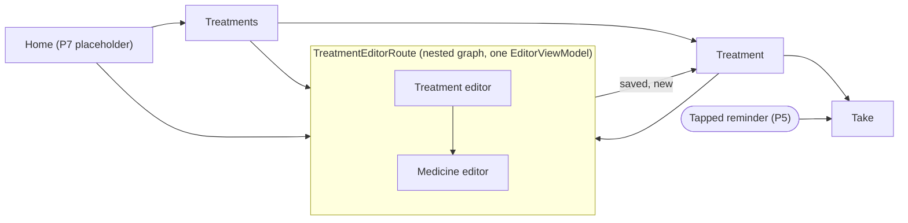

# P6 — Treatment management UI: Specification

| | |
|---|---|
| **Status** | Ready, v0.3 |
| **Phase** | P6, see [Implementation plan §5](../../IMPLEMENTATION_PLAN.md#5-phases) |
| **Depends on** | P2 (done). P3 and P5 are merged too, so the screens use the real store, and the reminders follow every change. |
| **Branch** | `phase/p6-treatment-ui` |
| **Handover** | [HANDOVER.md](HANDOVER.md) |

This document holds everything needed to implement the phase. Working on it shouldn't require reading the full specification or plan.

## 1. Goal

The screens that manage treatments, replacing P1's placeholders:

- **Treatments:** every treatment, grouped as Active, Upcoming and Finished.
- **Treatment:** its medicines, with their schedule, progress, next take and last answered take; end it early, or delete it.
- **Treatment editor** and **medicine editor:** create and edit a treatment and its medicines, with validation, the number of takes and the last one before saving, and a confirmation before discarding changes.
- **Take:** one take, its state and time taken; Taken, Skip, change the time taken, undo.

Every change goes through P2's actions on the real store (P3), so the reminders follow it with nothing to wire (P5-D2). The home screen and the reminder check stay P7's.

## 2. Requirements covered

The text of each requirement is quoted from [SPECIFICATION.md](../../SPECIFICATION.md) (version v0.9), so this document stands on its own. P2 implemented the rules; P6 shows them and calls them.

| ID | Requirement (quoted) | What this phase does for it |
|---|---|---|
| TR-1 | "The app manages several treatments. More than one can be active at the same time." | The Treatments screen lists them all, in their groups (§4.3.3). |
| TR-2 | "A treatment has one or more medicines." | The treatment editor adds, edits and removes medicines; saving needs at least one (§4.3.6). |
| TR-3 | "Each medicine has a name, a dose per take written as free text (such as "1 capsule" or "3 puffs"), an interval in hours, days or weeks ("every 8 hours", "every 2 days", "every week") and a duration: a number of days or weeks ("for 7 days", "for 12 weeks"), or no end." | The medicine editor's fields (§4.3.7). Debug builds also offer minutes (plan `D-15`). |
| TR-4 | "Each medicine has its own first take, a date and a time. Medicines in the same treatment can start at different times. The editor suggests the next full hour. The first take can be in the past, for a treatment that started before it was entered. Its takes already past are then Missed, except the latest one while it is still Due (`TK-3`)." | A date and a time per medicine, starting at `suggestedFirstTake(now)`. A first take in the past is accepted, with a note (§4.3.7). |
| TR-5 | "A treatment has a name, and optional notes." | The treatment editor's fields; the Treatment screen shows the notes. |
| TR-6 | "A medicine can have optional instructions, such as "with food", which its reminder shows." | The medicine editor's field; the Treatment and Take screens show them. The reminder already does (P5). |
| TR-7 | "The dose is free text, such as "1 capsule", "3 puffs" or "1/3 tablet". There is no list of units, and no limit on the amount." | A plain text field, with no check. |
| TR-8 | "Validation: the treatment and each medicine need a name, and a treatment has at least one medicine. The interval is a whole number of hours, days or weeks, and the duration a whole number of days or weeks, each at least 1, with no upper limit; or the duration is set to no end." | P2's `validate()`, each error shown as a message by its field (§4.3.8). |
| TR-9 | "Treatments can be created, edited and deleted in the app. Deleting asks for confirmation, and also deletes every take recorded for the treatment." | The editors create and edit; the Treatment screen deletes, after a confirmation (§4.3.4). P2's `deleteTreatment` removes the answers, P5 the reminders. |
| TR-10 | "Editing a treatment that has already started changes only what is still to come. Takes that are due or answered keep their state; takes not yet due are worked out again from the new values." | P2's `saveTreatment` merges the draft inside the store's `update`. The medicine editor says so for a started medicine, and its preview counts the kept takes (§4.3.7). |
| TR-11 | "A treatment can be ended early, for example when the doctor stops it. Its takes not yet due are removed and their reminders cancelled, and it shows as Finished. A take that is due at that moment becomes Missed, and its reminder is removed. A take already marked Taken early (`TK-4`) keeps its answer. A treatment ended early can't be edited any more, only deleted." | End early on the Treatment screen, after a confirmation (Q6). P2's `endTreatment` applies it; P5 removes the reminders. Once ended, the Treatment screen offers no Edit (Q4). |
| TR-12 | "Finished treatments stay in the app until you delete them." | The Treatments screen's Finished group. |
| TR-13 | "Leaving the editor with unsaved changes asks for confirmation before discarding them." | Both editors ask, on Back, the back arrow and Cancel (§4.3.9). |
| SC-2 | "The app works out every planned take as in §4.3. The editor shows each medicine's number of takes and the date and time of its last take, before saving." | The medicine editor shows P2's `previewMedicine()`: the count and the last take, live (§4.3.7). |
| SC-5 | "A medicine with no end keeps its schedule until its treatment is ended (`TR-11`) or the medicine is removed from the treatment. Where the app shows a number of takes or a last take (`SC-2`, `HM-3`), it shows "No end" instead." | The medicine editor, the Treatment screen and the editor's list show "No end" where they would show a count or a last take. |
| TK-2 | "Marking a take Taken records the time it was marked. That time can be corrected afterwards, for example to "taken at 08:20"." | Taken on the Take screen; Change time for the last answered take (§4.3.5). |
| TK-5 | "The last answered take of each medicine can be changed later, for example after pressing Taken by mistake: to Taken, to Skipped, or back to unanswered. The Treatment screen shows it. Older takes can't be seen or changed. A take set back to unanswered that is Due again gets its reminder back, which alerts at once, as when the take fell due." | The Treatment screen shows each medicine's last answered take and opens it; the Take screen changes it. The reminder comes back by itself (P4, P5). |
| NF-7 | "**Phone layout:** portrait only, for a screen about 393 dp wide. Touch targets are at least 48 dp. Text stays usable with the system's larger font sizes." | Every screen fits the phone's content area, with 48 dp targets, and is drawn at font scale 2 (§4.3.11, T2, T3). |
| NF-8 | "**Language and formats:** the UI is in English. All user-facing text lives in resource files, so a Spanish translation can be added later without code changes. Times follow the phone's 24-hour clock setting. Day and month names are in the UI's language, such as "Mon 23 Nov", so a translation brings its own." | Every text in P6's `strings_*.xml`, the date patterns and their locale included. Times follow the phone's 24-hour setting (Q5, §4.3.2). |
| NF-10 | "**Theme:** follows the system's light or dark setting." | P1's theme; every state is drawn in both. |

Also touched, with nothing new to build:

| ID | Requirement (quoted) | What this phase does for it |
|---|---|---|
| TK-4 | "A medicine's next take can be marked Taken before it is due, from the app, for example before going out. Its reminder is then cancelled. The next take is the medicine's Due take, if it has one, or else its first unanswered take still to come. Only one take of a medicine can be marked ahead of its time: the one after it can be marked early once the marked take's planned time has passed." | P7 covers it on the home screen. The Take screen offers Taken whenever P2's `markTaken` allows it, which includes this case (Q7). |
| RM-6 | "Tapping a reminder opens the app on that take." | P5 opens `TakeRoute`; P6's Take screen replaces the placeholder there. |
| RM-7 | "When a take is answered in the app, or becomes Missed, its reminder is removed from the shade." | P5 reconciles after every change of the data (P5-D2), so an answer on the Take screen removes its reminder. Checked on the phone (M2). |

### 2.1 What the specification and the plan say, quoted

Spec §6, the screens this phase builds:

| Screen | Purpose | Main actions |
|---|---|---|
| **Treatments** | Every treatment, grouped as Active, Upcoming and Finished | Open one, new treatment |
| **Treatment** | One treatment: its medicines, with their schedule and progress, each medicine's next take, and its last answered take (`TK-5`) | Edit (not once ended early), end early (`TR-11`, with confirmation), delete (with confirmation), open a medicine's next take or its last answered take |
| **Treatment editor** | The treatment's name, notes and medicines | Add, edit or remove a medicine (removing one that has started asks for confirmation); save; cancel (asks for confirmation if there are unsaved changes) |
| **Medicine editor** | Name, dose, instructions, interval, duration (days or weeks, or no end) and first take. Shows the number of takes and the last one (`SC-2`, `SC-5`). | Done: back to the treatment editor, whose Save stores the treatment; cancel (asks for confirmation if there are unsaved changes) |
| **Take** | One take: planned time, state, and time taken | Taken, Skip, change the time taken, undo (`TK-2`, `TK-5`) |

Spec §6's sketch of the medicine editor (low fidelity, layout only), from the §4.4 example:

```
+------------------------------------------+
| ←  Medicine                      [ Done ]|
|                                          |
|  Name          [ Amoxicillin          ]  |
|  Dose          [ 1 capsule            ]  |
|  Instructions  [ with food            ]  |
|  Every         [ 8 ] [ hours ▾ ]         |
|  For           [ 7 ] [ days ▾ ]          |
|                [ ] No end                |
|  First take    [ Mon 23 Nov ]  [ 08:00 ] |
|                                          |
|  21 takes. The last one is on            |
|  Mon 30 Nov at 00:00.                    |
+------------------------------------------+
```

Spec §4.4, the example the tests use: treatment "Example", started on Monday 23 November 2026.

- Amoxicillin: 1 capsule every 8 h for 7 days, first take Monday 08:00.
- Atrovent: 3 puffs every 8 h for 5 days, first take Monday 08:00.

| Medicine | Takes | First take | Last take | Times each day |
|---|---|---|---|---|
| Amoxicillin | 21 (7 days × 3) | Mon 23 Nov, 08:00 | Mon 30 Nov, 00:00 | 08:00, 16:00, 00:00 |
| Atrovent | 15 (5 days × 3) | Mon 23 Nov, 08:00 | Sat 28 Nov, 00:00 | 08:00, 16:00, 00:00 |

Spec §4.3 rule 7: "A treatment is **Upcoming** until its first take, **Active** while it has takes still to come or unanswered, and **Finished** after that, or once it is ended early (`TR-11`). A treatment with a medicine that has no end stays Active until it is ended."

Plan §2.4, on a stored file that can't be read: "The home screen shows a message (P7), and the editors refuse to save (P6)." And: "The app offers no repair. The file stays as it is, so that it can be read over adb. Clearing the app's storage in Android's settings starts again, and deletes it. (P3 Q1)"

Plan `D-15`: "**Debug builds can schedule in minutes.** They add a "minutes" unit to the interval, and a debug screen that creates a test schedule and shows the next alarm. Release builds have neither."

Plan §5.2, P6's done criteria: "Compose UI tests cover creating the §4.4 example, validation, editing a started treatment, ending one early and deleting one; every state of every screen has been drawn and checked, in light and dark theme and at a large font size; a manual check on the phone passes."

### 2.2 What earlier phases left for P6

From their handovers' "Pending wiring", "Decisions and deviations" and "Known issues":

- **P3, damaged data and failed saves:** "when `repository.data` is `StoredData.Unreadable`, the home screen says so and the editors refuse to save (SPEC Q1). When `update` throws an `IOException`, the screen says the change wasn't saved. `InMemoryTreatmentRepository(StoredData.Unreadable)` tries the first case in tests." (§4.3.10)
- **P3, instrumented tests:** "from P3 on, a test that goes through `MainActivity` or `AppContainer` uses the real stored data, on the phone too. Build ViewModels with fakes, and leave the data as it was found." P6's flow tests run the navigation graph with fakes (P6-D2).
- **P5, the Take screen:** "a tapped reminder opens `TakeRoute(medicineId, plannedAt)`, P1's placeholder until P6 replaces it, with `plannedAt` as `LocalDateTime.toString()` (`2026-11-23T16:00`). The route and its arguments stay as they are. An answer given on the Take screen removes its reminder by itself, through the reconcile on every change (SPEC P5-D2): nothing to wire. The take may no longer be Due, or no longer exist, by the time it opens (answered elsewhere, the treatment deleted): the Take screen should say so." (§4.3.5)
- **P5, the editors:** "a reminder tapped while an editor is open closes it, since the take opens right above Home (T7): its unsaved changes are lost. P6 decides whether that is acceptable, or whether the editor keeps its draft." (Q3, §4.3.12)
- **P5, minutes in debug builds:** "the medicine editor offers the minutes unit in debug builds, with `validate(allowMinutes = BuildConfig.DEBUG)` (plan `D-15`)."
- **P5, the layout lesson:** on the debug screen, two buttons side by side "broke "treatments" mid-word at font scale 2". Buttons with text go one under the other.
- **P5's `OpenTakeTest`** starts `MainActivity` with a reminder's intent and checks that the Take screen opens (by its title, `take_title`), that Back goes Home, and that a recreated or relaunched activity doesn't open it again. It uses the real data and a medicine that doesn't exist (`open-take-test`), so with P6 it opens the Take screen's "no longer exists" state. It must still pass.
- **P1's `NavigationSmokeTest`** walks the placeholders by their buttons ("Open sample", "Open take", "Add medicine"). Those buttons go with the placeholders, so P6 rewrites the test (§4.1).
- **P2's rules the screens rely on:** `status()` and `takesOf()` return `null` for an unknown ID, which a screen can hold just after a delete (P2 SPEC Q6); `endTreatment` also ends a treatment that is Finished without being ended (all its takes past), and refuses one already ended; `saveTreatment` refuses an invalid draft with an `IllegalArgumentException`, so the editor validates first; amounts are `Int`, and the editor treats a number too big for one as invalid (P2-D10).
- **HyperOS blocks activities started from the background** (P1). P6 starts none: every screen opens from a tap.

## 3. Scope

### In scope

- **The four screens' routes and destinations** in the navigation graph, replacing the placeholders of Treatments, Treatment, the two editors and Take. The two editors share one ViewModel, through a nested graph (P6-D1).
- **Treatments, Treatment, Take, Treatment editor, Medicine editor:** their ViewModels, states and composables, following CLAUDE.md's screen pattern, with the dependencies passed in (P6-D2).
- **Shared UI pieces** in `ui/common`, for P6 and later P7: the dependencies the screens need, a tick at each whole minute, dates and times as text, the messages for unreadable data, a failed save and a refused change, and a confirmation dialog.
- **A take opened from a reminder while an editor is open** keeps the editor below it (Q3).
- **Debug builds:** the minutes unit in the medicine editor (plan `D-15`).
- **Tests:** ViewModel unit tests with fakes; Compose UI tests of the flows with fakes; every state of every screen drawn; manual checks on the phone and the emulator.

### Out of scope

| What | Phase |
|---|---|
| The home screen: next takes, Taken there, marking early from it (`TK-4`), its message for unreadable data, its empty state. P6 leaves P1's Home placeholder, whose buttons open P6's screens. | P7 |
| The reminder check and the Settings screen (`RM-9`) | P7 |
| The rules: schedules, states, edits, ends, answers, validation | P2 (done). P6 changes no rule in `:core`. |
| Notifications and the alarm. A change made on P6's screens reaches them through the reconcile on every change (P5-D2). | P5 (done) |
| A history of past takes (`TK-6`, discarded): only each medicine's next and last answered takes are shown | — |
| A Spanish translation (spec §10). P6 keeps every text, and the date formats, in resources (Q5). | Later |
| The end-to-end test and the acceptance record | P8 |

## 4. Design

### 4.1 Packages and files owned

P6 owns the packages `ui.treatments`, `ui.treatment`, `ui.editor` and `ui.take` in `:app`, its files in `ui.common`, and its strings files. File names are suggestions; the behaviour in §4.3 is what matters.

```
app/src/main/kotlin/io/github/davamix/pillsreminder/
├── navigation/                   (shared package) P6's own files:
│   ├── EditorGraph.kt            the editors' nested graph (P6-D1, §4.3.1)
│   └── DropUnlessResumed.kt      dropUnlessResumedWith: a resumed-only click that carries a value
├── ui/common/
│   ├── ScreenDependencies.kt     what the screens' ViewModels need (P6-D2)
│   ├── MinuteTicks.kt            a tick at each whole minute of the clock (P6-D3)
│   ├── DateTimeText.kt           dates and times as text (P6-D4, Q5)
│   ├── DateTimeFields.kt         DateField and TimeField: buttons with their pickers (§4.3.11)
│   ├── CommonTexts.kt            schedules, take states, statuses, "Taken at …" as text
│   ├── Messages.kt               ChangeProblem, attempt {}, ShowProblem, UnreadableMessage (§4.3.10)
│   ├── LeaveWhen.kt              navigation driven by a state, once resumed (§4.3.1)
│   ├── BackButton.kt             the top bar's back arrow
│   └── ConfirmDialog.kt          one dialog for every confirmation
├── ui/treatments/                TreatmentsContent.kt, TreatmentsScreen.kt, TreatmentsViewModel.kt
├── ui/treatment/                 TreatmentContent.kt, TreatmentScreen.kt, TreatmentViewModel.kt
├── ui/editor/
│   ├── EditorViewModel.kt        the two editors' shared ViewModel (P6-D1)
│   ├── EditorState.kt            the states the editors draw
│   ├── SavedEditor.kt            the drafts as JSON in the SavedStateHandle (P6-D6)
│   ├── TreatmentEditorContent.kt, TreatmentEditorScreen.kt
│   └── MedicineEditorContent.kt, MedicineEditorScreen.kt
└── ui/take/                      TakeContent.kt, TakeScreen.kt, TakeViewModel.kt

app/src/main/res/values/
├── strings_common.xml            new: dates, times, messages, confirmations
├── strings_treatments.xml        (P1's file, now P6's)
├── strings_treatment.xml         (P1's file, now P6's)
├── strings_editor.xml            (P1's file, now P6's)
└── strings_take.xml              (P1's file, now P6's)

app/src/test/kotlin/io/github/davamix/pillsreminder/ui/…          ViewModel and text unit tests
app/src/androidTest/kotlin/io/github/davamix/pillsreminder/ui/…   Compose UI tests of the flows, with fakes
```

`PlaceholderScreen` stays in `ui/common` for P7's Home and Settings.

**Shared files changed,** with P6's entries only:

- `navigation/Routes.kt`: P6's routes. `TreatmentRoute` and `TakeRoute` keep their arguments; `TakeRoute`'s are P5's contract. `TreatmentEditorRoute(treatmentId: String? = null)` becomes the nested graph's route, so P7's "New treatment" keeps working; the treatment editor's own destination is the new `TreatmentFormRoute`; `MedicineEditorRoute(medicineId: String? = null)` stays, inside the graph (§4.3.1).
- `navigation/AppNavHost.kt`: P6's destinations; a `dependencies: ScreenDependencies` parameter, defaulting to the app's (P6-D2); the Treatments placeholder's sample entry goes. Home's placeholder and its "Sample take" stay as they are, for P7: that take doesn't exist, so it opens the Take screen's "no longer exists" state. `OpenTake` (P5's) changes for Q3 only.
- `app/build.gradle.kts`: `androidResources { localeFilters += "en" }`, so the libraries' own texts are in the UI's language (Q8). A translation adds its language there.
- `NavigationSmokeTest` (P1's): keeps only what needs `MainActivity`: the start screen, portrait, and P1's placeholders that remain (P7's Home and Settings). P6's screens are walked with fakes in `ui.ScreensNavigationTest`.
- `OpenTakeTest` (P5's): unchanged, and passes with the real Take screen. Q3's tests are in `ui.ScreensNavigationTest`.
- `AndroidManifest.xml`: unchanged. The editors' `imePadding()` keeps the field being typed in above the keyboard (M5).
- `CLAUDE.md` (T9): the screens' dependencies, the `ui/common` pieces, and the Take route's new rule (Q3).

No change to `:core`, `AppContainer`, `MainActivity`, the store or the reminders. If one is needed, stop and ask.

### 4.2 Interfaces and data

Signatures are a guide. The state classes hold only what the screens draw; texts are built in the composables from resources.

```kotlin
// ui/common

/** What the screens' ViewModels need (P6-D2). AppNavHost passes the app's; tests pass fakes. */
data class ScreenDependencies(
    val repository: TreatmentRepository,
    val clock: Clock,
    /** BuildConfig.DEBUG in the app (plan D-15). */
    val allowMinutes: Boolean,
    /** A tick at once and at each whole minute (P6-D3). Tests pass their own flow. */
    val minuteTicks: Flow<Unit>,
)

/** Emits at once, then at each whole minute of [clock], forever. */
fun minuteTicks(clock: Clock): Flow<Unit>

/** Dates and times as text (P6-D4, Q5): the locale and patterns come from resources, the hour format from the phone. */
class DateTimeText(locale: Locale, is24Hour: Boolean, datePattern: String, dateWithYearPattern: String) {
    fun time(at: LocalDateTime): String                        // "16:00", or "4:00 PM"
    fun day(at: LocalDate, today: LocalDate): DayText           // Today, Tomorrow, Yesterday, or a date
    fun date(at: LocalDate, today: LocalDate): String           // "Mon 23 Nov", with the year outside today's year
}
@Composable fun rememberDateTimeText(): DateTimeText         // from the resources and DateFormat.is24HourFormat()

/** What went wrong with a change, for the screen to say (§4.3.10). Never an exception's message (plan §3). */
enum class ChangeProblem { UNREADABLE, NOT_SAVED, NOT_CHANGED }
```

```kotlin
// ui/treatments
data class TreatmentRow(val id: TreatmentId, val name: String, val medicines: List<String>,   // its group gives its status
                        val startsAt: LocalDateTime?, val endedAt: LocalDateTime?, val lastTake: LocalDateTime?)
sealed interface TreatmentsState {
    data object Unreadable : TreatmentsState
    data class Ready(val active: List<TreatmentRow>, val upcoming: List<TreatmentRow>,
                     val finished: List<TreatmentRow>, val today: LocalDate) : TreatmentsState
}
class TreatmentsViewModel(deps: ScreenDependencies) : ViewModel() { val state: StateFlow<TreatmentsState?> }

// ui/treatment
data class MedicineCard(val id: MedicineId, val name: String, val dose: String, val instructions: String,
                        val interval: Interval, val duration: MedicineDuration,
                        val answered: Int, val count: Long?, val last: LocalDateTime?,   // null: no end
                        val next: Take?, val lastAnswered: Take?)
sealed interface TreatmentState {
    data object Unreadable : TreatmentState
    data object Missing : TreatmentState                 // deleted, or never existed
    data class Ready(val id: TreatmentId, val name: String, val notes: String, val status: TreatmentStatus,
                     val startsAt: LocalDateTime?, val endedAt: LocalDateTime?, val lastTake: LocalDateTime?,
                     val medicines: List<MedicineCard>,
                     val canEdit: Boolean, val canEnd: Boolean, val today: LocalDate,
                     val problem: ChangeProblem? = null) : TreatmentState
}
class TreatmentViewModel(deps: ScreenDependencies, id: TreatmentId) : ViewModel() {
    val state: StateFlow<TreatmentState?>
    val deleted: StateFlow<Boolean>                      // true once deleted, or found gone: the screen goes back (§4.3.4)
    fun end(); fun delete(); fun problemShown()
}

// ui/take
data class TakeActions(val taken: Boolean, val skip: Boolean, val undo: Boolean, val changeTime: Boolean)
sealed interface TakeScreenState {
    data object Unreadable : TakeScreenState
    data object Missing : TakeScreenState
    data class Ready(val medicine: String, val dose: String, val instructions: String, val treatment: String,
                     val take: Take, val isLastAnswered: Boolean, val actions: TakeActions,
                     val now: ZonedDateTime, val problem: ChangeProblem? = null) : TakeScreenState
}
class TakeViewModel(deps: ScreenDependencies, key: TakeKey?) : ViewModel() {   // null: the route's time doesn't parse
    val state: StateFlow<TakeScreenState?>
    fun markTaken(); fun skip(); fun undo(); fun setTakenTime(at: LocalDateTime); fun problemShown()
}

// ui/editor
data class MedicineForm(val draft: MedicineDraft, val intervalText: String, val durationText: String)
data class EditorState(
    val draft: TreatmentDraft,              // the draft being edited
    val isNew: Boolean,
    val showErrors: Boolean,                // after the first Save (§4.3.8)
    val errors: List<ValidationError>,      // the treatment's own: its name, at least one medicine
    val hasChanges: Boolean,                // TR-13
    val started: Set<MedicineId>,           // their removal asks first (Q6)
    val medicine: MedicineEditing?,         // the medicine editor's working copy, while it is open
    val unreadable: Boolean,
    val saving: Boolean,
    val problem: ChangeProblem?,
    val today: LocalDate,
)
data class MedicineEditing(val form: MedicineForm, val isNew: Boolean, val showErrors: Boolean,
                           val errors: List<ValidationError>, val preview: Preview?, val started: Boolean,
                           val firstTakeInPast: Boolean, val hasChanges: Boolean, val allowMinutes: Boolean)
data class Preview(val count: Long?, val last: LocalDateTime?)      // null, null: no end
class EditorViewModel(deps: ScreenDependencies, treatmentId: TreatmentId?, saved: SavedStateHandle) : ViewModel() {
    val state: StateFlow<EditorState?>                   // null until the stored treatment is loaded
    val savedAs: StateFlow<TreatmentId?>                 // set once saved: the screen leaves (§4.3.6)
    fun setName(text: String); fun setNotes(text: String)
    fun openMedicine(id: MedicineId?, entry: String)     // null: a new medicine; entry: the editor's back-stack entry (§4.3.7)
    fun setMedicineName(text: String); fun setDose(text: String); fun setInstructions(text: String)
    fun setInterval(text: String); fun setIntervalUnit(unit: IntervalUnit)
    fun setDuration(text: String); fun setDurationUnit(unit: DurationUnit); fun setNoEnd(noEnd: Boolean)
    fun setFirstTakeDate(date: LocalDate); fun setFirstTakeTime(time: LocalTime)
    fun medicineDone(): Boolean                          // false, and errors shown, while it is invalid
    fun closeMedicine()                                  // discards the working copy
    fun removeMedicine(id: MedicineId)
    fun save(); fun problemShown()
}
```

Each ViewModel's factory is in its companion and takes the `ScreenDependencies` and the route's arguments, plus `createSavedStateHandle()` for the editor's. Each screen has an entry composable that takes its ViewModel (or, for the editors, the shared one) and a stateless `…Content` composable that draws its state.

Shared composables in `ui/common`: `DateField(label, date, today, text, onDate)` and `TimeField(label, time, text, onTime)`, buttons that open the pickers (§4.3.11); `LeaveWhen(leave, onLeave)`, which calls `onLeave` once `leave` turns true and the screen is resumed (§4.3.1); `ShowProblem(problem, host, onShown)`, which shows a `ChangeProblem` once in a snackbar.

### 4.3 Behaviour

#### 4.3.1 Navigation



- The editors are a nested graph, built by `editorGraph(…)` in `navigation/EditorGraph.kt`: `navigation<TreatmentEditorRoute>(startDestination = TreatmentFormRoute)`. Both destinations get the same `EditorViewModel`, scoped to the graph's back-stack entry (`navController.getBackStackEntry<TreatmentEditorRoute>()`), and read `treatmentId` from it with `toRoute<TreatmentEditorRoute>()`.
- **Clicks that navigate** go through `dropUnlessResumed` (CLAUDE.md), or `dropUnlessResumedWith` for a click that carries a value (a row's treatment, a take's key).
- **Navigation driven by a state** (leaving after a save, a delete) is reported once by `LeaveWhen`: a `LaunchedEffect` on that state, after `lifecycle.currentStateFlow.first { it.isAtLeast(RESUMED) }`, with a plain lambda (CLAUDE.md).
- After **saving a new treatment**, the editor graph is replaced by that treatment's screen (`popUpTo<TreatmentEditorRoute> { inclusive = true }`, then `TreatmentRoute(id)`). After **saving an edit**, the graph is popped, back to where it was opened from.
- After **deleting** a treatment, its screen goes back.
- The Take screen's route is P5's: `TakeRoute(medicineId, plannedAt)`, `plannedAt` in `LocalDateTime.toString()` form. A `plannedAt` that doesn't parse is the Missing state.

#### 4.3.2 Times and dates on screen

- Every screen works out its state from the stored data and now. Now is `ZonedDateTime.now(clock)`, read when the data changes and at each tick of `minuteTicks` (P6-D3). A take then turns Due on screen at its minute, and a treatment moves from Upcoming to Active at its first take, without leaving the screen.
- The ticks run only while the screen is visible: each state is `stateIn(viewModelScope, WhileSubscribed(…))`, as the debug screen does (P5).
- Planned times are compared with now through P2's functions, never as local times (CLAUDE.md).
- **Text** (P6-D4, Q5): a day is "Today", "Tomorrow", "Yesterday", or a date such as "Mon 23 Nov", with the year when it isn't today's year ("Mon 30 Nov 2027"). A time follows the phone's 24-hour setting (`DateFormat.is24HourFormat`): "16:00", or "4:00 PM". A planned time reads "Today 16:00" or "Mon 30 Nov 00:00". The locale of day and month names, and the date patterns, come from `strings_common.xml`, so a translation brings its own.

#### 4.3.3 Treatments screen

- Three groups, each with a heading, shown only when not empty: **Active**, **Upcoming** and **Finished**, from P2's `status(id, now)`.
- Order: Active by name; Upcoming by first take, soonest first; Finished by when it ended or had its last take, latest first.
- Each row: the treatment's name, and one line under it: Active, its medicines' names; Upcoming, "Starts: Mon 23 Nov 08:00"; Finished, "Ended: Tue 24 Nov 10:00" when ended early, or "Finished: Mon 30 Nov" after its last take. A label before a day takes a colon, since "Today", "Tomorrow" and "Yesterday" are capitalised. A row opens the Treatment screen.
- "New treatment" opens the editor: a floating button with its label, so it isn't only an icon. It uses `ExtendedFloatingActionButton`'s content overload: the one with `text` and `icon` hides its label from TalkBack in Material 3 1.4.
- **No treatments:** "No treatments yet", with the same button.
- **Unreadable:** the message of §4.3.10 instead of the list; no button.

#### 4.3.4 Treatment screen

- **Header:** the name; the status, as on the Treatments screen; the notes, if any.
- **One card per medicine,** in the treatment's order:
  - the name and dose ("Amoxicillin · 1 capsule"), and the instructions, if any;
  - the schedule: "Every 8 hours, for 7 days", or "Every week, no end";
  - the progress: "1 of 21 taken or skipped", or, with no end, "1 taken or skipped · No end" (`SC-5`), from `answeredCount` and `count`;
  - the last take, "Last take: Mon 30 Nov 00:00", or "No end";
  - a medicine with no takes at all, because its treatment was ended before its first take, says so instead of the progress and the last take: "No takes: the treatment ended before the first one." (Q9);
  - **the next take,** from `nextTake(now)`: "Next: Today 16:00 · Due", or "· Pending". It opens the Take screen. None once nothing is left;
  - **the last answered take** (`TK-5`), from `lastAnswered(now)`: "Last answered: Today 08:00 · Taken at 08:05", or "· Skipped". It opens the Take screen. None while nothing is answered.
- **Actions:**
  - **Edit**, in the top bar. Not for a treatment that was ended early (Q4).
  - **End early,** for an Active or Upcoming treatment. It asks first (Q6): "End Example now? Its takes still to come are removed, and a take that is due now becomes missed." Then `repository.endTreatment(id, clock)`.
  - **Delete,** always. It asks first (`TR-9`): "Delete Example? Its medicines and every take recorded for it are deleted. This can't be undone." Then `repository.deleteTreatment(id)`, and the screen goes back.
  - End early and Delete are full-width buttons, one under the other, after the cards (P5's lesson).
- **Missing** (deleted, for example from the debug tools): "This treatment no longer exists", with Back. After its own Delete, the screen shows nothing while it leaves (its state is `null`), rather than that message.
- **Unreadable:** the message of §4.3.10.

#### 4.3.5 Take screen

- **Content:** the medicine and dose, the treatment, the instructions; the planned time ("Mon 23 Nov 16:00"); the state, as a word (Pending, Due, Taken, Skipped, Missed); for a Taken take, "Taken at 16:05"; for a Due take, when it becomes Missed ("Missed at 00:00 if not answered").
- **Actions:** exactly those P2 allows at now, found by running the pure action on the current data: a button shows when `data.markTaken(key, now)`, `skip`, `clearAnswer` or `setTakenTime` would return non-`null`. The rules then stay in one place (P2 SPEC §4.3.8):

  | State | Buttons |
  |---|---|
  | Due | Taken, Skip |
  | Pending, the medicine's next take, nothing answered ahead (`TK-4`) | Taken (Q7) |
  | Taken, the last answered take | Change time, Skip, Undo |
  | Skipped, the last answered take | Taken, Undo |
  | Taken or Skipped, an older take | none, and "Only the last answered take of a medicine can be changed" |
  | Missed, or Pending and not the next take | none |

- **Taken** records now, in whole minutes (`TK-2`). **Undo** clears the answer (`TK-5`); a take that is Due again gets its reminder back, alerting at once (P4, P5).
- **Change time** opens a dialog with the date and the time taken, each a button with its picker, as in the medicine editor, starting at the time recorded. A time after now is refused in the dialog: "The time taken can't be in the future." Then `repository.setTakenTime(key, at, clock)`.
- An action that P2 refuses by the time it runs (the take changed meanwhile, for example answered from the reminder) shows "Not changed: this take changed in the meantime." The screen already shows the new state.
- **Missing** (the treatment deleted, the medicine removed, or a schedule edit that left no take at that time): "This take no longer exists.", with Back. The title stays "Take".
- **Unreadable:** the message of §4.3.10.

#### 4.3.6 Treatment editor

- **Opening:** a new treatment starts from an empty draft with `TreatmentId.random()`. An edit starts from the stored treatment's `toDraft()`, read once; later changes to the stored data don't overwrite the draft. While the stored data hasn't been read, the screen shows nothing but its top bar.
- **Fields:** the name, and the notes (several lines).
- **The medicines,** one row each: "Amoxicillin · 1 capsule", the schedule ("Every 8 hours, for 7 days"), and "First take Mon 23 Nov 08:00". A row opens the medicine editor. Each row has a remove button ("Remove Amoxicillin", as its content description). Removing a stored medicine that has started (its first take has fallen due, or it has an answer) asks first (Q6): "Remove Amoxicillin? When you save, its recorded takes are deleted." Others go at once. Removing changes only the draft.
- **Add medicine** opens the medicine editor on a new medicine.
- **Save** validates (§4.3.8). When valid, it calls `repository.saveTreatment(draft, clock)`, which merges the draft with the latest stored data inside `update` (`TR-10`, P2-D4): an answer given from a reminder while the editor was open is kept. Then the screen leaves (§4.3.1). While saving, Save is disabled, so a double tap saves once.
- **Edit of a treatment deleted meanwhile:** only the debug tools can do that while the editor is open. Saving then creates it again, with the same ID. Accepted: it can't happen in normal use.
- The editor never shows a treatment that was ended early (Q4).

#### 4.3.7 Medicine editor

- **Opening:** the working copy is the draft's medicine, or, for a new one, an empty medicine with `MedicineId.random()`, an interval of 8 hours, a duration of 7 days, and the first take at `suggestedFirstTake(now)` (`TR-4`). The defaults other than the first take are suggestions.
- **The working copy belongs to the medicine editor's back-stack entry** (`openMedicine(id, entry)`): the same entry keeps it, as after Android ended the process (P6-D6, M6); a new entry starts a fresh one. A Back with no changes pops the editor without telling the ViewModel, so a copy left over must not reappear the next time the editor opens.
- **Fields,** as in the sketch of §2.1:
  - name, dose and instructions, plain text (`TR-7`);
  - **Every** [amount] [unit ▾]: hours, days or weeks, and minutes in debug builds only (`allowMinutes`). Unit names follow the amount: "1 hour", "8 hours";
  - **For** [amount] [unit ▾]: days or weeks, and a **No end** switch, which disables the duration's fields while on;
  - **First take** [date] [time]: buttons that open Material 3's date and time pickers. The time picker follows the phone's 24-hour setting.
- **Amounts** are text fields with a number keyboard that accept digits only, up to 10. The draft's amount is `text.toIntOrNull()`: empty or too big for an `Int` is invalid (P2-D10).
- **Preview** (`SC-2`, `SC-5`), live, under the fields, from `previewMedicine(treatmentId, draft, now)` on the stored data, or on empty data when it can't be read:
  - "21 takes. The last one is on Mon 30 Nov at 00:00."
  - With no end: "No end: takes carry on until the treatment is ended or this medicine is removed."
  - While the interval or the duration isn't valid: "Fill in the interval and the duration to see the takes." `previewMedicine` needs only those two to be valid: it builds the schedule with `toSchedule()`.
  - Counts are written with the locale's grouping.
- **Notes,** under the preview:
  - a first take in the past (`TR-4`, P2 "P6 may warn"): "The first take is in the past. Its takes before now will be missed, apart from the latest while it is due.";
  - a stored medicine that has started, as in §4.3.6 (`TR-10`): "Changes apply to takes from now on. Takes already due or answered keep their state."
- **Done** validates the medicine (§4.3.8). When valid, it puts the working copy into the treatment's draft (replacing the medicine with the same ID, or adding it at the end) and returns to the treatment editor. Nothing is stored until the treatment editor's Save (Q1, P6-D1).

#### 4.3.8 Validation messages

- Each editor validates with P2's `validate(allowMinutes)` on Save or Done. Until the first attempt, no error shows. After it, the errors follow every change, and go as each is fixed.
- Each error shows under its field, in the error colour:

  | Error | Message (suggestion) |
  |---|---|
  | `TreatmentNameMissing` | "Enter a name for the treatment." |
  | `NoMedicine` | "Add at least one medicine." |
  | `MedicineNameMissing` | "Enter a name for the medicine." |
  | `IntervalInvalid` | "Enter a whole number, 1 or more." |
  | `DurationInvalid` | "Enter a whole number, 1 or more, or choose No end." |
  | `MinutesNotAllowed` | Can't happen: only debug builds offer minutes, and a release build never reads a debug build's data. In case: "Minutes are only for debug builds." |

- Every medicine in the draft has passed Done, or was stored valid, so the treatment editor shows only its own errors.
- Saving with errors focuses or scrolls to the first one, so it is seen at font scale 2.

#### 4.3.9 Leaving the editors (`TR-13`)

- Each editor has unsaved changes when its draft differs from where it started: the treatment draft from the stored treatment (or the empty one), the working copy from the medicine it opened with.
- With changes, leaving asks: "Discard your changes?", with **Discard** and **Keep editing**. Leaving is the system Back (the phone's Back button, the emulator's gesture), the top bar's back arrow, and Cancel where there is one. Without changes, it leaves at once.
- Discarding the medicine editor returns to the treatment editor, whose draft is as it was. Discarding the treatment editor drops the whole draft.
- With the soft keyboard up, Back first closes the keyboard (Android's behaviour), and asks only on the next Back.
- The confirmation uses `BackHandler`, enabled only while there are changes, so predictive back on the emulator (API 36) still animates a plain Back.

#### 4.3.10 Unreadable data, failed saves and refused changes

From plan §2.4 and P3's pending wiring:

- **Unreadable** (`StoredData.Unreadable`): the Treatments, Treatment and Take screens show, instead of their content: "The stored data can't be read, so nothing can be shown or changed. It is kept as it is." The editors show it at the top, and Save does nothing but show it again. No screen offers a repair.
- **A failed write** (`update` throws an `IOException`): "Not saved: the change couldn't be written. Try again." The editor stays open with its draft; the other screens stay as they were.
- **`UnreadableDataException`** from an action (the file became unreadable meanwhile): as Unreadable.
- **Refused** (a helper returns `false`): "Not changed: this take changed in the meantime." on the Take screen; on the Treatment screen, End early on a treatment already ended changes nothing, and the screen shows its new state.
- Messages show in a snackbar, or for Unreadable in place of the content. A problem is shown once: `problemShown()` clears it.
- Any other exception is a bug: it isn't caught.
- No exception's message is shown or logged (plan §3).

#### 4.3.11 Layout

- **The phone's content area is 392.7 × 796.4 dp** (P1, measured; the `phone` skill's "Devices"). Every screen fits it, at font scale 1 and 2, in light and dark theme. The emulator's is 28 dp taller, so a layout that fits there can still overflow on the phone.
- Screens use `Scaffold`, which keeps the content out of the system bars (P1-D4). Long content scrolls: lists are `LazyColumn`s, the editors a scrolling `Column` or a `LazyColumn`.
- **Touch targets** are at least 48 dp: Material 3's buttons and icon buttons already are; clickable rows and cards get a minimum height of 48 dp.
- **Buttons with text** go one under the other, full width, where two side by side could break a word at font scale 2 (P5).
- **The soft keyboard** must not hide the field being typed in. With edge to edge, the editors add `imePadding()`, which is enough: the screen shrinks for the keyboard (M5). The manifest is unchanged.
- **Pickers:** Material 3's `DatePicker` and `TimePicker`, each in a dialog (`DatePickerDialog`, `TimePickerDialog`). From font scale 1.5 on, both open in their input mode (`DisplayMode.Input`, `TimeInput`): the calendar and the clock dial don't fit. The date picker works in UTC milliseconds: convert with `ZoneOffset.UTC`, never with the phone's zone, or the date shifts by a day.
- **The pickers in the UI's language** (Q8): the date picker's state takes the locale of `date_locale` with the phone's region (`DatePickerState(locale, …)`), so its names are English and its weeks start on the phone's first day (Monday in Spain). Its title is the field's label and its headline the app's own date ("Mon 23 Nov"), since its default headline follows the phone's locale. `localeFilters += "en"` keeps the libraries' other texts, such as the time picker's descriptions, in English.
- Icons only from `material-icons-core` (already a dependency): for example `Add`, `Edit`, `Delete`, `Close`, `DateRange`. Every icon button has a content description.

#### 4.3.12 A reminder tapped while an editor is open (Q3)

P5 opens a tapped reminder's take right above Home (`popUpTo<HomeRoute>`, `launchSingleTop`), which closes an open editor and loses its changes. P6 changes `OpenTake` in `AppNavHost` so that:

- **while the editor graph is on the back stack,** the take opens on top of the current screen, and Back returns to the editor with its changes. A Take screen already on top is replaced, not stacked (`popUpTo<TakeRoute> { inclusive = true }` when the top is one);
- **otherwise,** as P5 does: right above Home.

Everything else in P5's `OpenTake` stays: once per tap, after the activity is resumed, and not again for a recreated activity or one relaunched from Recents. Saving the editor afterwards keeps the answer given on the Take screen (P2-D4).

#### 4.3.13 Example

On Sun 22 Nov 2026 at 10:00, Europe/Madrid, creating the §4.4 example:

1. Treatments: "No treatments yet" → New treatment.
2. Treatment editor: name "Example" → Add medicine.
3. Medicine editor: first take suggested at Today 11:00. Name "Amoxicillin", dose "1 capsule", every 8 hours, for 7 days, first take Mon 23 Nov 08:00 → "21 takes. The last one is on Mon 30 Nov at 00:00." → Done.
4. Atrovent the same way, 3 puffs, for 5 days → "15 takes. The last one is on Sat 28 Nov at 00:00." → Done.
5. Save → the Treatment screen: Upcoming, "Starts Tomorrow 08:00"; Amoxicillin "0 of 21 taken or skipped", "Last take Mon 30 Nov 00:00", "Next: Tomorrow 08:00 · Pending".
6. Back → Treatments: "Example" under Upcoming.

On Tue 24 Nov at 10:00, with Amoxicillin's first four takes answered Taken, editing its interval to 12 hours shows the note for a started medicine, and "15 takes. The last one is on Sun 29 Nov at 20:00." (P2 SPEC §4.3.6's example). Saving keeps the four answers: the Treatment screen shows "4 of 15 taken or skipped".

### 4.4 Dependencies

- **No new library.** Material 3 (`DatePicker`, `TimePicker`, `ExposedDropdownMenuBox`), Navigation Compose (nested graphs), Lifecycle (`viewModel`, `SavedStateHandle` through `createSavedStateHandle()`) and kotlinx.serialization JSON (the saved drafts, P6-D6) are already in the build. If `SavedStateHandle` turns out to be only a transitive dependency, declare `lifecycle-viewmodel-savedstate` in the catalog, at the pinned `lifecycle` version. Anything else needs the user's agreement first (plan §3).
- **From P2 (`:core`):** `TreatmentDraft`, `MedicineDraft`, `toDraft()`, `validate(allowMinutes)`, `ValidationError`; `previewMedicine`; `PillsData.takesOf`, `take`, `status`, `firstTake`; `MedicineTakes.count`, `last`, `answeredCount`, `nextTake`, `lastAnswered`; the pure actions (`markTaken`, `skip`, `clearAnswer`, `setTakenTime`, `endTreatment`) to find which are allowed; the repository helpers to apply them; `suggestedFirstTake`; `TakeKey`, `TakeState`, `TreatmentStatus`.
- **From P3:** `StoredData.Unreadable`, and the `IOException` a failed write throws.
- **From P5:** the reconcile on every change (nothing to call); `TakeRoute` as a reminder opens it; `OpenTake` in `AppNavHost`.
- **Fakes in tests:** `InMemoryTreatmentRepository` (`:core`), started `Unreadable` for that case; a repository whose `update` throws an `IOException`, in P6's test sources; a clock the test sets; a ticks flow the test drives.

### 4.5 Decisions made in this phase

| ID | Decision | Reason |
|---|---|---|
| P6-D1 | The two editors share one `EditorViewModel`, scoped to a nested navigation graph. The medicine editor edits a working copy, which Done puts into the treatment draft. Only the treatment editor's Save stores, with one `saveTreatment`. | `saveTreatment` takes a whole treatment, and merges it once (`TR-10`). A new treatment can't be stored before it has a name and a medicine. One draft in one place, also through a process restart (P6-D6). |
| P6-D2 | The screens' ViewModels get their dependencies (`ScreenDependencies`) from `AppNavHost`, which defaults to the app's container, rather than from `APPLICATION_KEY` in each factory. | UI flow tests can then run the real navigation graph with an in-memory repository and a fixed clock. Through the container, they would write the real treatments, and the real reminders would follow them, on the phone too (P3's pending wiring). CLAUDE.md's pattern allows a phase SPEC to differ. P7 can use the same. |
| P6-D3 | Each screen recomputes its state at each whole minute while visible, from a ticks flow in its dependencies. | States change with time (`TK-1`), and planned times are whole minutes. Tests drive the ticks themselves: an endless delay loop in `viewModelScope` would never let `advanceUntilIdle()` return. |
| P6-D4 | Dates and times are text built by one `DateTimeText`, with its locale and patterns in resources and the hour format from the phone. | One place for every screen, P7's too. `NF-8`: the 24-hour clock follows the phone, and a translation can bring its own names and patterns without code changes (Q5). |
| P6-D5 | The Take and Treatment screens decide which actions to offer by running P2's pure actions on the current data. | The rules stay in `:core`, tested there once. A button never offers what the action would refuse. |
| P6-D6 | The editors keep their drafts in the `SavedStateHandle`, as JSON of a small serializable mirror of the drafts kept in `ui/editor`, so they survive Android ending the app's process while it is in the background (Q2). | HyperOS ends background apps readily, for example while the user looks up a prescription in another app. The store's format types stay apart from these (P3). |

## 5. Security and privacy

Plan §3 applies. For this phase:

- **Treatment content is shown only on screen:** names, doses, instructions and notes. P6's code logs nothing. An exception is never shown or logged with its message; P6's screens show only their own texts (§4.3.10).
- **Routes carry IDs and times only** (`TakeRoute`, `TreatmentRoute`), never content.
- **Saved state** (P6-D6) holds the drafts in the app's own process records, which Android keeps privately for the app. Auto Backup stays off (`D-12`).
- **Tests never touch the real data:** ViewModel tests and UI flow tests use fakes (P6-D2). The only instrumented tests through `MainActivity` (portrait, start screen, P5's `OpenTakeTest`) don't change the data.
- **Manual checks on the phone** use test treatments named after the §4.4 example, or the debug tools' (`debug-…`), and delete them at the end. Ask the user before creating anything on the phone, since its reminders will alert.
- **Screenshots** from the galleries show only the §4.4 example, stay in the scratchpad, and are never committed (CLAUDE.md, "The repo is public").
- **No new permission, library or exported component.**

## 6. Testing

All instrumented tests use fakes, apart from those through `MainActivity` named in §5. Clocks are fixed in Europe/Madrid. Instrumented tests must not depend on the device's language or hour format: they build expected texts from the resources and the same `DateTimeText`, with `is24Hour` given.

| Test | Type | Covers |
|---|---|---|
| `DateTimeTextTest`: Today, Tomorrow, Yesterday and dates; the year outside today's year; 24-hour and 12-hour times; midnight | unit | `NF-8`, P6-D4 |
| `MinuteTicksTest`: a tick at once, then at each whole minute of the clock | unit | P6-D3 |
| `AttemptTest`: an applied change, a refused one, unreadable data, a failed write, and any other exception going through | unit | §4.3.10 |
| `TreatmentsViewModelTest`: groups and their order; several Active at once; Finished ones stay; Upcoming becomes Active at its first take on a tick; unreadable | unit | `TR-1`, `TR-12`, rule 7 |
| `TreatmentViewModelTest`: the §4.4 example on Mon 23 Nov at 10:30 with both 08:00 takes Taken (1 of 21, 1 of 15; last takes; next Today 16:00); no end; next take and last answered; End early with a Due take, which becomes Missed, and a take marked early, which keeps its answer; End not offered once ended; Edit not offered once ended (Q4); delete and `deleted`; missing; unreadable; a failed write | unit | `TR-9`, `TR-11`, `TK-5`, `SC-5`, §4.3.10 |
| `TakeViewModelTest`: each row of §4.3.5's table; Taken records now in whole minutes; Change time, and a time in the future refused; Undo; an older answered take has no actions; Missed; missing take and a `plannedAt` that doesn't parse; an action refused after the take changed; unreadable; a failed write | unit | `TK-2`, `TK-4` (Q7), `TK-5`, §4.3.10 |
| `EditorViewModelTest`, new treatment: the suggested first take (`TR-4`); defaults; no errors before Save, then each error of `TR-8`, and each going once fixed; an amount too big for an `Int`; preview of the §4.4 medicines (21 and Mon 30 Nov 00:00, 15 and Sat 28 Nov 00:00); no end; a first take in the past and its note; two medicines with different first takes; a free-text dose "1/3 tablet", instructions, notes; Done and Close; remove; `hasChanges` for each editor (`TR-13`); save, and `savedAs` | unit | `TR-2`–`TR-8`, `TR-13`, `SC-2`, `SC-5` |
| `EditorViewModelTest`, edit: the draft from the stored treatment; P2's example (8 h to 12 h on Tue 24 Nov 10:00, four answered): the started note, preview 15 and Sun 29 Nov 20:00, and after save 4 of 15; an answer given while editing is kept by the save (P2-D4); removing a started medicine asks (Q6); unreadable refuses; a failed write keeps the draft; minutes offered only with `allowMinutes`; the drafts restored from a `SavedStateHandle` (P6-D6), and the working copy kept for the same back-stack entry only; "started" from an answer alone, before the first take | unit | `TR-9`, `TR-10`, `D-15`, §4.3.10 |
| `CreateTreatmentTest`: the §4.4 example created through both editors, on Sun 22 Nov 07:30, the first takes moved to Monday with the date picker; the Treatment screen's counts and last takes; Upcoming in Treatments | UI | `TR-1`–`TR-4`, `SC-2`, plan's done criterion |
| `EditorValidationTest`: Save with nothing entered shows the treatment's errors; a medicine's errors on Done; each goes once fixed | UI | `TR-8` |
| `EditStartedTreatmentTest`: P2's example through the editors, then the Treatment screen's 4 of 15 | UI | `TR-10` |
| `EndAndDeleteTest`: End early with its confirmation, Cancel then End: Finished; Delete with its confirmation: gone from Treatments; a treatment ended before its first take says its medicines have no takes (Q9) | UI | `TR-9`, `TR-11` |
| `DiscardChangesTest`: Back and the back arrow, with and without changes, in each editor; Keep editing; Discard | UI | `TR-13` |
| `TakeScreenTest`: Taken, Change time, Skip, Undo on one take, each seen on screen; an older take shows no actions | UI | `TK-2`, `TK-5` |
| `NavigationSmokeTest` (trimmed): the app starts on Home and asks for portrait; Settings and the sample take open from Home (through `MainActivity`) | UI | `NF-7` |
| `ScreensNavigationTest`: every P6 screen opens from another and Back returns; a reminder's take opens above an open editor, a second one replaces it, and Back returns to the editor with its changes; without an editor, right above Home | UI | `RM-6`, Q3 |
| `OpenTakeTest` (P5's, kept): a reminder's intent opens the real Take screen | UI | `RM-6` |
| Rows and icon buttons are at least 48 dp tall (`assertHeightIsAtLeast`), in the flow tests | UI | `NF-7` |
| Galleries (throwaway, T2, T3, T8): every state of every screen, light and dark, font scale 1 and 2, on the phone's content area | drawn | `NF-7`, `NF-10` |

New tests that pass at their first run are shown able to fail, with the `deliberate-bugs` skill (CLAUDE.md).

### Manual checks

On **the phone** unless marked. Ask the user before each that creates treatments, since their reminders will alert; delete them at the end.

| # | Check | Expected |
|---|---|---|
| M1 | Create a treatment like the §4.4 example by hand, with first takes a few hours ahead. Open it, edit one medicine's dose, save. End it early, then delete it. | Counts and last takes as in §4.3.13; every confirmation shows; the treatment goes from Treatments; no reminder is left in the shade or as the alarm (`phone` skill's `notifications` and `alarms`). |
| M2 | In the medicine editor of the debug build, create a treatment in minutes with a take due at once (T8: every 30 minutes from the current hour). When the reminder alerts, tap it; on the Take screen, tap Taken; then Undo; then Taken again and Change time. Delete the treatment. | The tap opens the Take screen (`RM-6`); Taken removes the reminder (`RM-7`); Undo brings it back, alerting at once (`TK-5`); the time taken changes (`TK-2`). |
| M3 | With the treatment editor open and changed, tap a reminder (as in M2); then Back. | The Take screen opens above the editor; Back returns to it, with its changes (Q3). |
| M4 | In each editor, change something and leave with the phone's Back button and with the back arrow; leave with no change. | The confirmation each time there are changes, and none without (`TR-13`). |
| M5 | In the editors, type into every field, the lowest ones too, with the keyboard up. | No field is hidden by the keyboard; the date and time pickers open and fit; the time picker is 24-hour, as the phone is. |
| M6 | Start a new treatment, fill in a name and a medicine, switch to another app, and end the app's process (`phone` skill's `end_process`); come back. | The editor comes back with its draft (P6-D6, Q2). |
| M7 | Look at each screen in the phone's dark theme, and with its largest font size (ask the user before changing these settings, and set them back). | Every screen fits and stays usable (`NF-7`, `NF-10`). |
| E1 | **Emulator** (API 36): M4 with the back gesture, and its predictive back animation. | As M4; a plain Back with no changes animates. |

## 7. Tasks

| ID | Task |
|---|---|
| T1 | **Shared pieces:** `ScreenDependencies`, `minuteTicks`, `DateTimeText` and `rememberDateTimeText`, `ChangeProblem` and its texts, `ConfirmDialog`; `strings_common.xml`. Unit tests (`DateTimeTextTest`, `MinuteTicksTest`). |
| T2 | **Layouts of Treatments, Treatment and Take:** their state types and stateless `…Content` composables, with their strings, drawn from fixed states. Draw every state (`phone` skill, "Checking a screen in every state"), light and dark, at font scale 1 and 2, on the phone's content area; check them on the emulator and the phone. Show the user the drawings before T4. |
| T3 | **Layouts of the editors:** their states and `…Content` composables, the date and time fields with their pickers, the confirmations, the validation messages. Draw every state the same way, pickers and dialogs included; show the user. |
| T4 | **Treatments and Treatment screens:** their ViewModels, factories and destinations in `AppNavHost` with `ScreenDependencies`; End early and Delete with their confirmations. Unit tests. Shown able to fail. |
| T5 | **Take screen:** its ViewModel and destination; the actions offered by P2's rules; Change time. Unit tests. `OpenTakeTest` passes. Shown able to fail. |
| T6 | **Editors:** `EditorViewModel` and its saved drafts, the nested graph, validation, preview, notes, removing, the discard confirmation, saving and leaving. Unit tests. Shown able to fail. |
| T7 | **Flows and navigation:** the UI tests of §6 with fakes, `NavigationSmokeTest` rewritten, and Q3's change to `OpenTake` with its test. Every instrumented test passes on the emulator and the phone. Shown able to fail. |
| T8 | **Checks:** draw every state of every screen again from the finished code, light and dark, font scale 1 and 2; M1–M7 on the phone and E1 on the emulator, with the user. Record the results in the handover. |
| T9 | **Wrap-up:** every row of §6 and every rule of §4.3 against the tests; deviations folded into this SPEC (`phase-docs`); `CLAUDE.md` (the screens' dependencies, `ui/common`, Q3's rule for a tapped reminder); `build`; the pull request with CI green. |

## 8. Done criteria

- [x] All tasks done
- [x] `./gradlew build` passes locally and in CI, with the unit test totals recorded in the handover
- [x] Unit tests cover every row of §6, and every new test was shown able to fail (CLAUDE.md)
- [x] Compose UI tests cover creating the §4.4 example, validation, editing a started treatment, ending one early and deleting one (plan §5.2), and every instrumented test passes on the emulator and the phone
- [x] Every state of every screen has been drawn and checked, in light and dark theme and at font scale 2, on the phone's content area
- [x] M1–M7 pass on the phone, and E1 on the emulator
- [x] No new permission, library or exported component; the merged manifests change only as §4.1 allows
- [x] HANDOVER.md is up to date, with the pending wiring for P7 and P8, and the plan's status table is updated

## 9. Open questions

None at the moment. New questions are numbered from Q10.

### Answered

| # | Question | Decision |
|---|---|---|
| Q1 | What the medicine editor's button does, and what it is called | It puts the medicine into the treatment's draft and returns; only the treatment editor's Save stores (P6-D1). It is called **Done**, so that it isn't mistaken for storing. Leaving the treatment editor unsaved still asks (`TR-13`). In specification v0.9 (§6). |
| Q2 | Whether an editor's unsaved draft survives Android ending the app's process in the background | Yes, through the `SavedStateHandle` (P6-D6, M6). Not across a Force stop or a restart of the phone, which clear saved state. |
| Q3 | A reminder tapped while an editor is open closes it, and its changes are lost (P5's pending wiring) | The editor is kept: while it is on the back stack, the take opens on top of the current screen, and Back returns to the editor (§4.3.12). Otherwise, as P5: right above Home. |
| Q4 | Whether a treatment ended early can be edited | No: Edit isn't offered for it; it can only be deleted. A treatment Finished after its last take, without being ended, can still be edited, for example to extend its duration. In specification v0.9 (`TR-11`, §6). |
| Q5 | The language of day and month names, with the UI in English on a phone in Spanish | The UI's language: "Mon 23 Nov", with the locale and patterns in `strings_common.xml`, so a Spanish translation brings "lun 23 nov" with it. The hour format follows the phone's setting. In specification v0.9 (`NF-8`). |
| Q6 | Which actions ask for confirmation, beyond `TR-9`'s delete and `TR-13`'s discard | **End early**, which can't be undone, and **removing a medicine** that has started, since saving deletes its recorded takes. Nothing else. In specification v0.9 (§6). |
| Q7 | Which takes the Treatment screen opens, and whether the Take screen marks a take early (`TK-4`, which the plan gives to P7's home) | Each medicine's next take and its last answered take. The Take screen offers every action P2 allows, so Taken also shows for a next take that can be marked early. In specification v0.9 (§6). |
| Q8 | On the phone (T2, T3), Material's own texts followed the phone's language: the date picker's title read "Seleccionar fecha", and its headline "23 nov 2026", in an English app | `localeFilters += "en"` keeps only English resources, so the libraries' texts fall back to English; the date picker takes the UI's language with the phone's region, and has the app's own title and headline (§4.3.11). A translation adds its language to the filter. |
| Q9 | On the phone (T8, M1), a treatment ended before its first take showed each medicine as "0 of 0 taken or skipped" and "Last take: No end", though it has no takes at all | Such a medicine says "No takes: the treatment ended before the first one." in place of its progress and last take (§4.3.4), with a UI test. |

## 10. Change log

| Version | Date | Changes |
|---|---|---|
| 0.1 | 2026-11-22 | First draft, from plan v0.7 and specification v0.8 |
| 0.2 | 2026-11-22 | Review: Q1–Q7 answered, confirming every draft assumption. Now quotes specification v0.9, which took Q1 and Q4–Q7 into `TR-11`, `NF-8` and §6. Ready. |
| 0.3 | 2026-11-22 | T9: folds in the decisions recorded during T2–T8. Q8 (the pickers and library texts in the UI's language: `localeFilters`, the date picker's locale, title and headline) and Q9 (a medicine with no takes). §4.1: the files as built, `navigation/EditorGraph.kt` and `DropUnlessResumed.kt`, the date and time fields and shared texts in `ui/common`; the manifest unchanged. §4.2: the states and the editor's API as built (`openMedicine(id, entry)`). §4.3.1: `TreatmentFormRoute`, `LeaveWhen`, `dropUnlessResumedWith`. §4.3.3: labels with a colon, the floating button's content overload. §4.3.4: no takes; nothing shown while leaving after a delete. §4.3.7: the working copy belongs to the editor's back-stack entry. §4.3.11: the keyboard, the pickers' input mode from font scale 1.5. §6: the tests as built. No change to the specification or the plan. |
